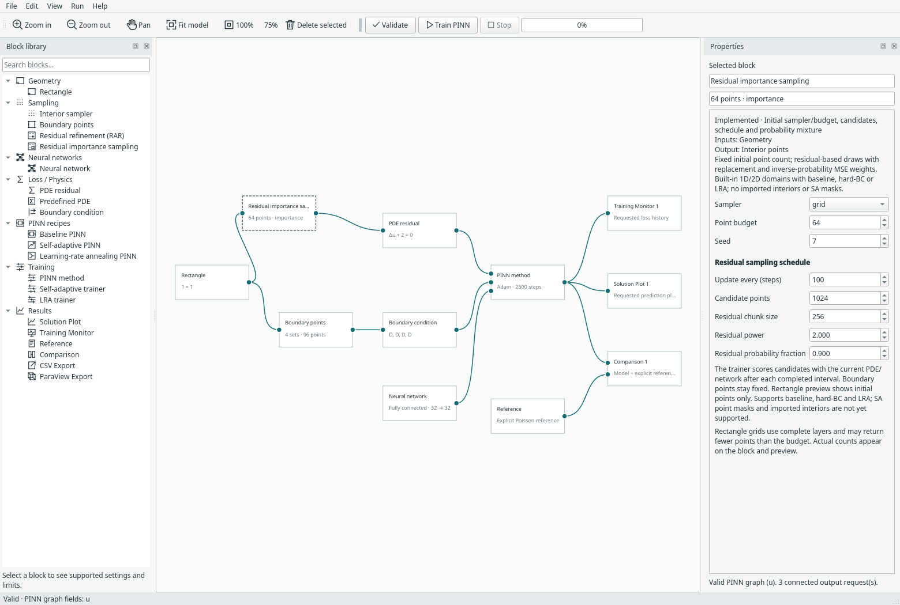

# Residual-driven sampling

Margam has two optional **Sampling** blocks. They replace **Interior sampler**;
they are not PINN recipes or boundary-condition blocks. The fixed sampler remains
the default. Both work with compact or expanded baseline/LRA recipes and the
hard-Dirichlet trainer on built-in 1D line segments and 2D rectangles, including
supported custom scalar PDEs and steady incompressible u/v/p residuals.

## Community provenance

RAR follows **DeepXDE**'s greedy refinement example. The PINN importance-sampling
formulation is referenced to **NVIDIA Modulus / Modulus Sym**, subsequently
PhysicsNeMo Sym. Margam implements these tools independently; see the
[community attribution catalogue](community-methods.md) for sources and reuse status.

## Add a block

1. Open a working example. Delete its Interior sampler (the two attached wires
   are removed with it).
2. Insert **Residual refinement (RAR)** or **Residual importance sampling** from
   the Sampling library.
3. Connect **Geometry → sampler → PDE residual / Predefined PDE**.
4. Select the sampler and configure its initial method, point budget and seed,
   followed by its residual sampling schedule.
5. Validate and train. **Messages** reports each sampling event and point count.

There is one interior sampler per executable graph. These blocks do not stack.
The trainer uses the connected PDE and current network to score candidates; no
extra feedback wire or second network is required. Boundary sets and pressure
gauge samples stay fixed. Result/export evaluation grids also stay unchanged.


## Residual refinement (RAR)

After the first **Update every (steps)** completed optimiser steps, evaluate a
fresh uniformly random candidate pool. Add up to **Points added per update**
coordinates having the largest residual magnitude, retain the existing points,
and repeat at the configured interval. Stop adding at **Maximum active points**.
Existing/duplicate coordinates are excluded after conversion to the model dtype.
The initial set must fit within the cap. A finite pool may supply fewer new points
than requested; actual counts are recorded.

This follows the greedy add-anchor idea in the
[DeepXDE RAR example](https://deepxde.readthedocs.io/en/v1.12.2/demos/pinn_forward/burgers.rar.html).
Margam uses a fixed step schedule, a fresh candidate pool per event, configurable
multi-point additions and a cap. It does **not** reproduce that demonstration's
residual stopping threshold, repeated Adam/L-BFGS phases or optimiser resets.
No DeepXDE dependency or source code is added.

RAR uses the usual mean PDE loss over its growing active set. It intentionally
changes the spatial weighting of that empirical objective.

## Residual importance sampling

Keep the **actual initial sample count** throughout training. At each scheduled
update, score a fresh uniform candidate pool and draw that many coordinates
**with replacement**. Repeated coordinates are valid statistical draws.

For candidate residual score `s_i`, pool size `M`, residual power `k` and residual
probability fraction `beta`:

```text
p_i = (1-beta)/M + beta * s_i^k / sum_j(s_j^k)
w_i = 1 / (M * p_i)
PDE loss = mean_over_draws(w_i * mean_over_residual_components(error_i^2))
```

The initial warm-up uses ordinary MSE. The probability fraction is limited to
0–0.99 to retain positive probability everywhere; all-zero scores fall back to
uniform probabilities. Scaling scores by their maximum before exponentiation
avoids overflow without changing probabilities. Weights are detached, are not
normalised by their sampled sum, and multiply only the PDE term. The optional
[integral loss formulation](integral-loss.md) additionally applies domain measure
and sums residual components. It supports importance sampling; RAR currently
requires mean loss because its anchors have no uniform-domain quadrature weights.

Conditional on the current network and pool, the weighted estimator and its
network gradient target the **uniform candidate-pool MSE**. This is not the same
as unweighted residual-biased resampling (often called RAD), and is not an exact
integral over the continuous domain. For multi-equation residuals, components
have equal weight in the score; users must choose suitable physical scaling.



## Comparison with NVIDIA Modulus / PhysicsNeMo Sym

Reviewed 28 October 2026 against NVIDIA's
[importance sampling theory](https://docs.nvidia.com/physicsnemo/26.03/physicsnemo-sym/user_guide/theory/advanced_schemes.html#importance-sampling)
and the older Sym
[importance-sampled dataset implementation](https://github.com/NVIDIA/physicsnemo-sym/blob/main/physicsnemo/sym/dataset/continuous.py).
This is a mathematical/source comparison, not a run of the NVIDIA package.
No NVIDIA sampling code is copied and no additional dependency is installed.

| Choice | NVIDIA Sym reference | Current Margam block |
| --- | --- | --- |
| Candidate locations | A fixed supplied point cloud | A fresh uniform box pool per scheduled event |
| Importance measure | User-supplied callable; the documentation illustrates velocity-derivative magnitude | RMS PDE residual across equations, raised to a configurable power |
| Drawing points | Rejection sampling with replacement for each yielded training batch; periodically refresh importance | Multinomial draws with replacement at scheduled events; retain the drawn batch between events |
| Loss correction | Reciprocal sampling density stored as integration area per draw | Reciprocal discrete probability in mean PDE loss |
| Probability safeguards | Inspect the chosen measure for its valid support | Explicit uniform mixture and all-zero fallback |

For a uniform pool of `M` equally weighted points in a domain of volume `V`,
NVIDIA's density convention gives each draw integration weight `V/(M*p_i*B)`
for batch size `B`. Dividing its integral estimate by `V` yields Margam's mean
estimate `mean(error_i^2/(M*p_i))`. The test suite verifies both the per-draw
correction and the expected parameter gradient for unit and non-unit volumes.
This equivalence assumes equal underlying quadrature weights; arbitrary imported
mesh/point weights require a separate contract.

**Importance sampling does not require the importance measure to be the PDE
residual.** A field-gradient measure is a reasonable future option. The current
UI is deliberately named **Residual importance sampling** to state what it
actually scores. It does not reproduce NVIDIA's full sampler or its example
flow configuration.

## Schedule, scoring and reproducibility

- An interval of 100 updates means the first replacement/addition occurs before
  optimiser step 101. A run stopping at step 100 has not adapted yet.
- Candidate coordinates and importance draws use seeds derived from the sampler
  seed and completed step number. Changing worker chunk boundaries does not change
  the update schedule.
- **Residual chunk size** limits candidate scoring memory, not training batch size.
  Spatial derivatives remain enabled; scoring does not backpropagate into parameter
  gradient buffers. Non-finite candidate residuals abort without replacing points.
- Training uses full batches of the active set. RAR can increase training memory
  substantially; the point cap is not a memory guarantee.
- The Training Monitor's PDE curve is active-set mean loss for RAR and the
  importance-weighted estimate for importance sampling. A jump at a sampling event
  is not evidence that solution accuracy improved or deteriorated.
- Rectangle **Preview samples** shows the initial recipe only. It does not display
  the live adaptive set. No new field heatmap or global figure pane is introduced.

## Saved models and runs

Model format 13 records the sampler block and schedule. Versions 1–12 retain
fixed sampling by default. Run archives include the active coordinates, importance
weights, event history and original data fingerprint, alongside the network and
Adam/LRA state. Resume restores those coordinates before the next update and
continues the same schedule. Changing sampler settings or initial data rejects
resume. Exported predictions still use their separate evaluation grid.

## Current limits

Imported interior point sets are rejected: a bounding box is not proof that
candidate points lie in an imported geometry. A future GeoSampler candidate source
must provide admissible locations explicitly. Imported boundary sets remain
independent, but do not define a candidate-domain geometry.

SA-PINN is deliberately rejected because its trained masks belong to specific
points. Moving or adding points requires a documented mask/moment transfer policy;
this is not silently reset. Adaptive BC sampling, arbitrary CAD candidate generation,
XPINN partitioning, minibatches and residual-threshold stopping are future work.

## Reproduce the workflow check

From the repository root, using the existing environment:

```bash
python -m examples.adaptive_sampling
python -m unittest discover -s tests -p 'test_adaptive_sampling*.py' -v
python -m examples.capture_adaptive_sampling --overwrite
```

The demo runs both samplers on a small CPU rectangle for 60 updates and checks
that an interrupted/resumed run exactly matches continuous training. The recorded
[evidence](../assets/benchmarks/adaptive-sampling-cpu.json) gives full configuration,
point counts, event residual statistics and losses. It is a correctness/workflow
check, not a numerical accuracy comparison or a recommended research configuration.
