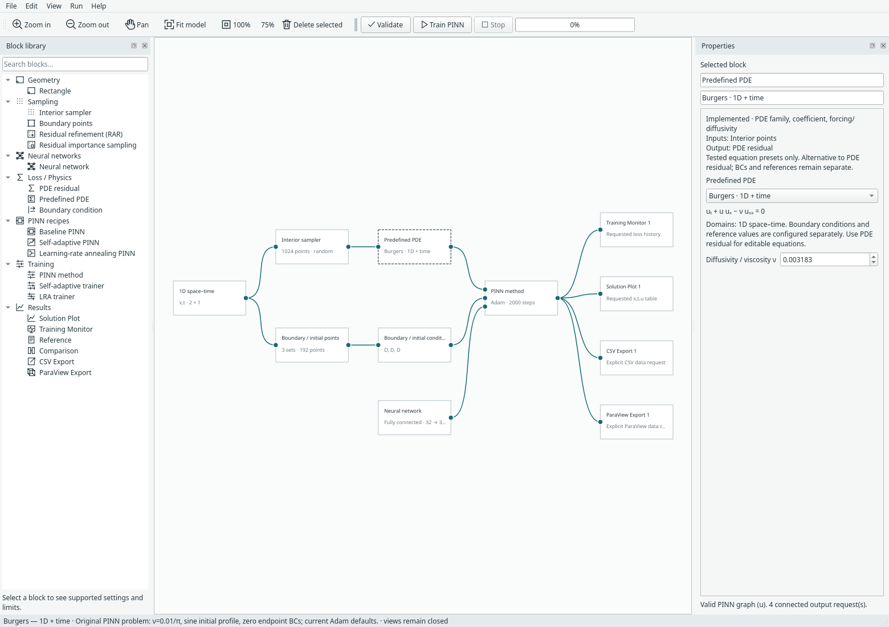
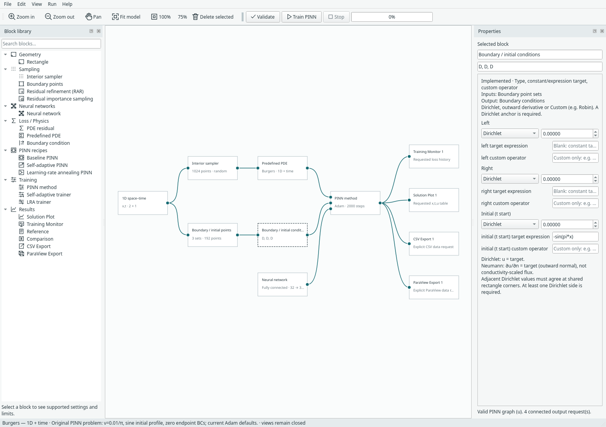
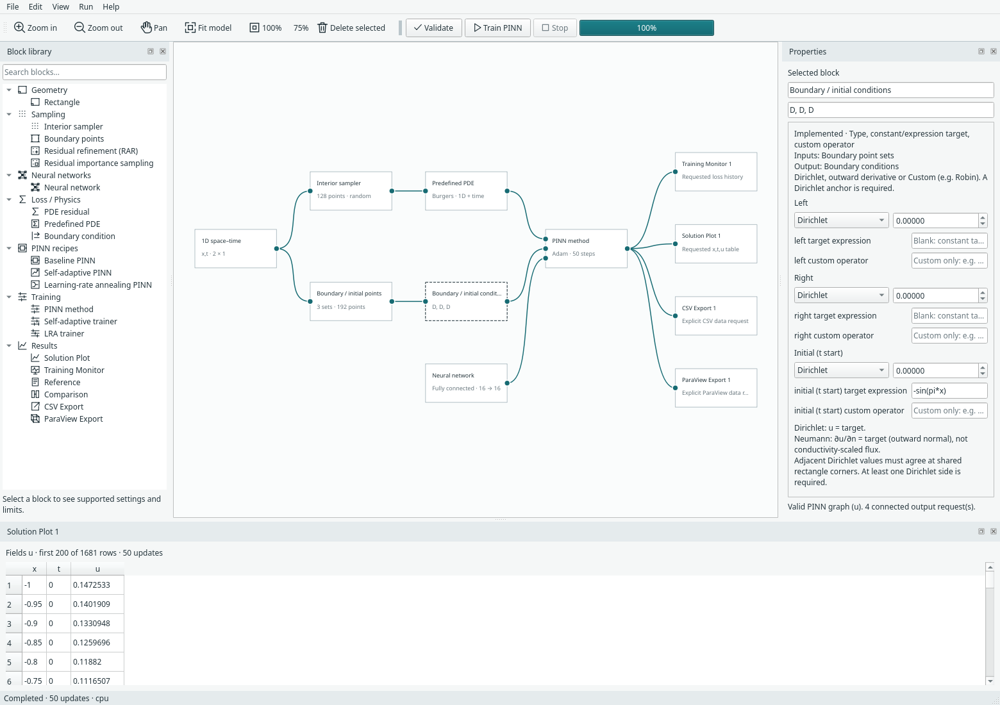

# Burgers equation — 1D space and time

Open **File → Examples → 1D examples → Burgers — 1D + time**.
This uses the continuous-time viscous Burgers problem presented by
**Raissi, Perdikaris and Karniadakis** in the original PINN work. The
[authors' problem description](https://maziarraissi.github.io/PINNs/) is the setup
reference; no TensorFlow source or reference dataset is copied.

```text
u_t + u*u_x - nu*u_xx = 0
nu = 0.01/pi
x in [-1, 1], t in [0, 1]
u(x, 0) = -sin(pi*x)
u(-1, t) = u(1, t) = 0
```

The problem is **1D in space**, although its network has two inputs `(x,t)`.
It is a continuous space–time PINN; it does not advance the solution through
numerical timesteps.



## Domain, samples and initial condition

The existing domain block has a **1D space–time** option. Set spatial bounds
with **x minimum/maximum** and physical-time bounds with **t start/end**.
Interior points sample the `(x,t)` slab. The boundary/initial sampler produces:

| Set | Coordinates | Default condition |
| --- | --- | --- |
| Left boundary | `x=-1`, sampled `t` | `u=0` |
| Right boundary | `x=1`, sampled `t` | `u=0` |
| Initial | sampled `x`, `t=0` | `u=-sin(pi*x)` |

**There is no final-time condition.** The initial profile must agree with the
spatial boundary values at its endpoints. Its named training loss is `initial`,
shown separately from PDE and spatial BC curves in the Training Monitor.

The initial set reuses the sampler's internal `bottom` storage key; the UI labels
it **initial (t start)**. `top` settings retained from rectangular models are
inactive. For save-format compatibility, `y_min/y_max` store the time bounds;
the UI and exported coordinates call them `t`.



## PDE and network

The **Burgers · 1D + time** preset exposes viscosity and constructs:

```text
D(u,t) + u*D(u,x) - nu*D(D(u,x),x)
```

It requires positive viscosity and a space–time domain. Restricted expressions
use `x,t`, not `x,y`, for this domain. `D(u,t)` differentiates physical time;
`laplace(u)` differentiates spatial coordinates only. Scalar expressions also
support the configured `nu`. Existing spatial models retain their `x` / `x,y`
coordinate meanings and reject a time derivative.

The example defaults to 1,024 seeded random interior points, 64 samples on each
of the three constraint sets, a tanh network with three 32-neuron hidden layers,
and 2,000 Adam updates at learning rate 0.001. These are editable Margam defaults,
**not** a reproduction of the paper's architecture, training budget, optimiser
schedule or reported accuracy. The original paper's pooled initial/boundary data
loss is represented here using separate named means with existing set weights.

Baseline, SA-PINN and LRA trainers work with this problem. RAR and importance
sampling act on `(x,t)` candidates using their existing compatibility rules.
Integral loss uses space–time measure for the PDE, time length for left/right
traces and spatial length for the initial profile. The all-sides hard-Dirichlet
transform is rejected because it would also constrain the final time.

## Results and export

Training Monitor, Solution Plot, CSV Export and ParaView Export blocks are wired
in this example; their views remain closed until requested. Training creates no
export files. The solution block opens an **`x,t,u` table**, reusing the current
table widget; this change adds no field heatmap or automatic figure pane.



No Reference or Comparison block is added: the sine initial profile is not a
reference solution at later times. No reference/error metric is invented. Users
can explicitly supply compatible mapped reference values or a valid expression.

CSV exports use columns **`x,t,u`**. The ParaView block writes a **`.pvd` series**
with one spatial line `.vti` per physical evaluation time. With evaluation
resolution `N`, there are `N` spatial points at each of `N` times, including the
initial/final bounds. Open the PVD in ParaView and press **Play**. Keep its generated
frame directory beside the index file. Time is stored as frame timestamps, never
as a second spatial coordinate or as training-update numbers.

Saved models and run archives retain the space–time domain, IC,
network and checkpoint. Earlier model versions remain readable. Compact recipe
expansion/collapse retains this same problem configuration.

## Verification and reproducible commands

From the repository root and existing environment:

```bash
python -m examples.burgers
python -m examples.burgers --steps 100 --export results/burgers.pvd
python -m unittest discover -s tests -p 'test_burgers*.py' -v
python -m examples.capture_burgers --overwrite
```

The [CPU workflow record](../assets/benchmarks/burgers-cpu.json) records 100 updates,
finite losses, exact checkpoint continuation and nine correctly timestamped line
frames. Tests separately check analytic derivatives, nonlinear residual terms,
viscosity, initial/boundary coordinates, absence of final-time constraints, method
and sampler combinations, CSV headings and archive/UI behaviour. This is software
correctness evidence; the shock profile has not been validated against the paper's
reference data and no paper-accuracy claim is made.
