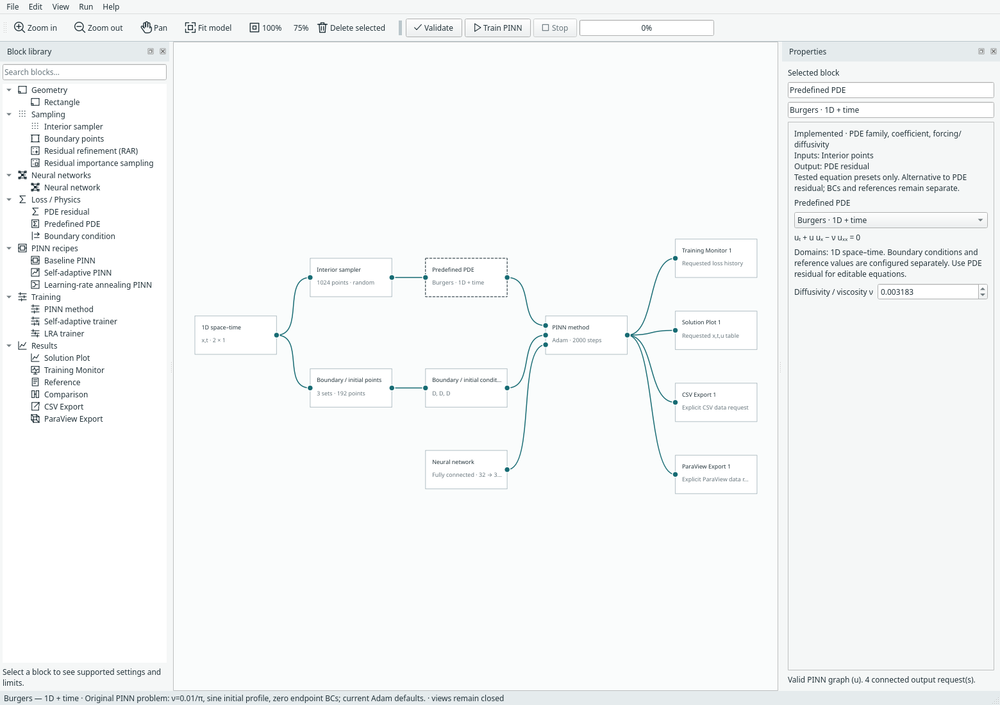
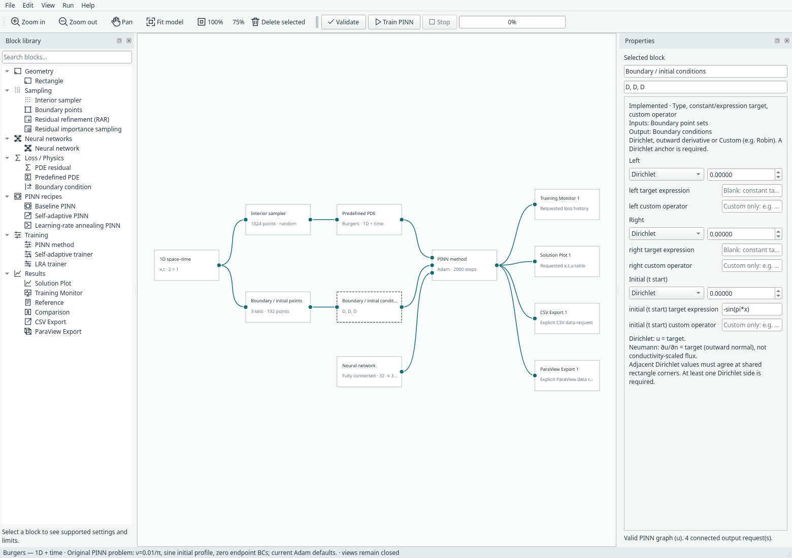
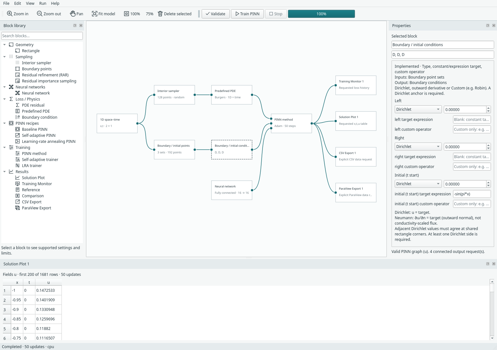
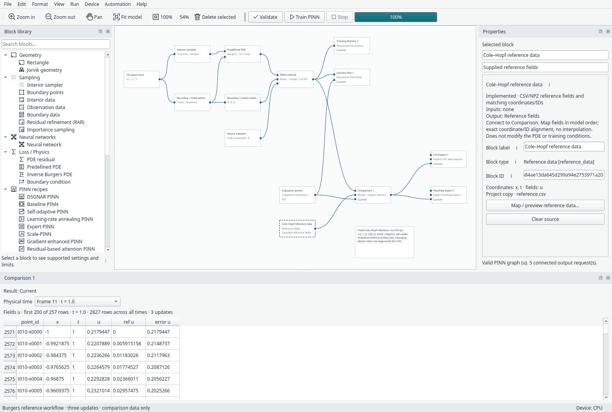

# Burgers equation — 1D space and time

Open **File → Examples → 1D examples → Burgers — 1D + time**.
This uses the continuous-time viscous Burgers problem presented by
**Raissi, Perdikaris and Karniadakis** in the original PINN work. The
[authors' problem description](https://maziarraissi.github.io/PINNs/) is the setup
reference; no TensorFlow solver source is copied.

```text
u_t + u*u_x - nu*u_xx = 0
nu = 0.01/pi
x in [-1, 1], t in [0, 1]
u(x, 0) = -sin(pi*x)
u(-1, t) = u(1, t) = 0
```

The problem is **1D in space**, although its network has two inputs `(x,t)`.
It is a continuous space–time PINN; it does not advance the solution through
numerical timesteps.



## Domain, samples and initial condition

The existing domain block has a **1D space–time** option. Set spatial bounds
with **x minimum/maximum** and physical-time bounds with **t start/end**.
Interior points sample the `(x,t)` slab. The boundary/initial sampler produces:

| Set | Coordinates | Default condition |
| --- | --- | --- |
| Left boundary | `x=-1`, sampled `t` | `u=0` |
| Right boundary | `x=1`, sampled `t` | `u=0` |
| Initial | sampled `x`, `t=0` | `u=-sin(pi*x)` |

**There is no final-time condition.** The initial profile must agree with the
spatial boundary values at its endpoints. Its named training loss is `initial`,
shown separately from PDE and spatial BC curves in the Training Monitor.

The initial set reuses the sampler's internal `bottom` storage key; the UI labels
it **initial (t start)**. `top` settings retained from rectangular models are
inactive. For save-format compatibility, `y_min/y_max` store the time bounds;
the UI and exported coordinates call them `t`.



## PDE and network

The **Burgers · 1D + time** preset exposes viscosity and constructs:

```text
D(u,t) + u*D(u,x) - nu*D(D(u,x),x)
```

It requires positive viscosity and a space–time domain. Restricted expressions
use `x,t`, not `x,y`, for this domain. `D(u,t)` differentiates physical time;
`laplace(u)` differentiates spatial coordinates only. Scalar expressions also
support the configured `nu`. Existing spatial models retain their `x` / `x,y`
coordinate meanings and reject a time derivative.

The example defaults to 1,024 seeded random interior points, 64 samples on each
of the three constraint sets, a tanh network with three 32-neuron hidden layers,
and 2,000 Adam updates at learning rate 0.001. These are editable Margam defaults,
**not** a reproduction of the paper's architecture, training budget, optimiser
schedule or reported accuracy. The original paper's pooled initial/boundary data
loss is represented here using separate named means with existing set weights.

Baseline, SA-PINN and LRA trainers work with this problem. RAR and importance
sampling act on `(x,t)` candidates using their existing compatibility rules.
Integral loss uses space–time measure for the PDE, time length for left/right
traces and spatial length for the initial profile. The all-sides hard-Dirichlet
transform is rejected because it would also constrain the final time.

## Results and export

Training Monitor, Solution Plot, CSV Export and ParaView Export blocks are wired
in this example; their views remain closed until requested. Training creates no
export files. The solution block opens an **`x,t,u` table**, reusing the current
table widget; this change adds no field heatmap or automatic figure pane.
Use its **Physical time** selector to preview one exact stored time rather than
only the first rows across the entire dataset. This display filter does not
change exports or run additional inference; see [time-frame selection](use/results.md#inspect-one-physical-time-frame).



In the basic example, no Reference or Comparison block is added: the sine initial profile is not a
reference solution at later times. No reference/error metric is invented. Users
can explicitly supply compatible mapped reference values or a valid expression.

CSV exports use columns **`x,t,u`**. The ParaView block writes a **`.pvd` series**
with one spatial line `.vti` per physical evaluation time. With evaluation
resolution `N`, there are `N` spatial points at each of `N` times, including the
initial/final bounds. Open the PVD in ParaView and press **Play**. Keep its generated
frame directory beside the index file. Time is stored as frame timestamps, never
as a second spatial coordinate or as training-update numbers.

Saved models and run archives retain the space–time domain, IC,
network and checkpoint. Earlier model versions remain readable. Compact recipe
expansion/collapse retains this same problem configuration.

## Verification and reproducible commands

From the repository root and existing environment:

```bash
python -m examples.burgers
python -m examples.burgers --steps 100 --export results/burgers.pvd
python -m unittest discover -s tests -p 'test_burgers*.py' -v
python -m examples.capture_burgers --overwrite
```

The [CPU workflow record](../assets/benchmarks/burgers-cpu.json) records 100 updates,
finite losses, exact checkpoint continuation and nine correctly timestamped line
frames. Tests separately check analytic derivatives, nonlinear residual terms,
viscosity, initial/boundary coordinates, absence of final-time constraints, method
and sampler combinations, CSV headings and archive/UI behaviour. This is software
correctness evidence; the trained shock profile has no paper-accuracy claim. The independent reference
evaluator is validated separately below.


## Optional reference-data example

Open **File → Examples → 1D examples → Burgers with reference data · 1D + time**.
This keeps the basic example's training problem and adds **Evaluation points**,
**Reference data** and **Comparison** blocks. Views remain closed until opened.
The two source blocks share one project-owned CSV snapshot: 257 spatial points
at each of 11 physical times, with stable text IDs. These values are evaluation
references, never training observations.



The fixed reference uses the equation, viscosity, initial condition and bounds
shown above. **Changing the physics does not regenerate the CSV.** Replace the
reference explicitly when changing the problem. The note on the example records
this restriction. The basic Burgers example still supplies no automatic reference.

The evaluator independently implements the Cole–Hopf Gaussian convolution using
128-node Gauss–Hermite quadrature, with bounded row chunks and normalized positive
weights. A 256-node check differs by less than 1e-15 on the bundled grid. Initial
and wall values use their known limits; predicted values are never overwritten.
See [Burkardt's Burgers exact-solution reference](https://people.sc.fsu.edu/~jburkardt/py_src/burgers_exact/burgers_exact.html)
for the integral approach and its literature references. No upstream solver code
or reference arrays were copied to create this CSV.

The evaluator agrees with the 2,000 author-reference observations already retained
for the inverse example to maximum absolute difference **4.14e-11** and relative
L2 difference **2.34e-12**. This validates the reference evaluator, **not the trained
PINN's accuracy**. Initial/wall values, symmetry, an independent differentiable PDE
residual oracle and quadrature convergence have separate tests.

The Comparison feeds CSV and ParaView Export. CSV includes IDs, predictions,
reference values and signed errors. Supplied evaluation points export as a PVD
series of VTU vertex clouds: 11 physical-time frames with 257 points each. Open
the PVD in ParaView and press Play; no mesh connectivity is inferred.

CPU and CUDA checks use only three updates plus two resumed updates. They check
owned-data portability, exact same-device continuation, unchanged reference/ID
alignment and exports; they are not shock-accuracy experiments.

```bash
python -m examples.burgers_reference --output results/burgers-reference
python -m examples.burgers_reference_workflow --device cpu --output results/burgers-reference-cpu
python -m examples.burgers_reference_workflow --device cuda --output results/burgers-reference-cuda
```

Choose fresh output directories. See the [dataset provenance](../assets/evaluation/burgers-reference/README.md)
and [workflow evidence](../assets/benchmarks/burgers-reference-2026-11-14.json).
