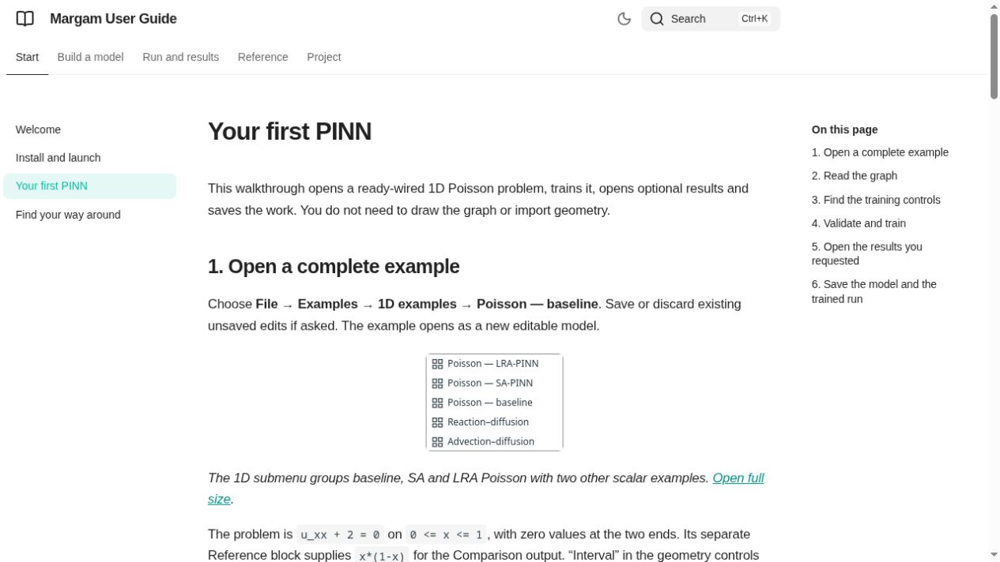

# Maintaining the illustrated manual

The user-facing entry is [docs/index.md](index.md). Short task pages live in
`docs/start/`, `docs/modeling/` and `docs/use/`. Existing method/API/evidence pages
remain the technical reference. The plain Markdown remains readable without a
site builder. Do not present planned work as a current UI feature.

## Build and read locally

Use the existing root environment:

```sh
uv pip install --python .venv/bin/python -e ".[docs]"
.venv/bin/python -m examples.documentation build
.venv/bin/python -m examples.documentation check
```

The optional extra pins Zensical 0.0.73. The application does not import it and
training does not depend on it. Generated files stay under ignored `build/manual/`.
F1 / Help → User manual opens `build/manual/site/index.html` in the browser. No
site is published or remote account configured by these commands.

The build stages copies of maintained Markdown and assets, rewrites local links
only in those copies, performs a strict Zensical build, and checks rendered local
links, images and section anchors. Root README/instructions/attribution are copied
as project reference; linked source files are available as reference downloads.
Edit the original files, never generated staging copies.

For an HTTP preview:

```sh
.venv/bin/python -m examples.documentation serve
```

Open `http://127.0.0.1:8765`. Stop with Ctrl+C. This serves a fresh build; rerun
after editing sources. The same site also opens directly from disk. Theme fonts
and search assets are local. The small MIT iframe-worker shim needed by offline
search is pinned and bundled under `assets/vendor/iframe-worker/` with its license.

## Capture screenshots

```sh
.venv/bin/python -m examples.capture_manual
# Only when deliberately replacing this manual's named images:
.venv/bin/python -m examples.capture_manual --overwrite
```

The helper captures 22 actual Qt states, uses `Window(state_directory=False)`,
releases clipboard data and verifies one default 1D baseline run, model save and
run/checkpoint save. It never touches personal layout/recovery state. Captures
live under `assets/screenshots/manual-*.png`; the manifest records tool/image
hashes, environment, parent revision and run settings. Captions describe actions
and expected UI behaviour, not an accuracy guarantee.

Keep menus and labels consistent with the application. Inspect screenshots at
full size and verify their placement in the rendered manual. Use descriptive alt
text and a full-size image link. Use repository-relative example paths: public
screenshots/snippets must not include usernames, home folders or hostnames. Do not modify heatmap behaviour for illustrations.

## Inspiration and scope

The local PyniteGUI manual provided the organisational example: a searchable
Zensical site, short workflow pages, screenshots beside actions, and separate
reference/project material. Margam's text, capture/build helpers and configuration
were written for this repository. No PyniteGUI source, prose or screenshots were
copied. Its checkout remains unchanged.

Browser checks should cover page navigation, search, images, light/dark themes and
opening the local-file build. Qt checks cover the F1 shortcut, missing-build
message and browser-launch failure handling. A successful build alone does not
establish UI help integration or scientific solution accuracy.



The browser preview was checked over localhost: navigation, a ParaView search,
result navigation, image rendering and the theme toggle. The in-app test browser
does not allow file URLs, so direct-file offline search was not exercised there.
The offline configuration and bundled local search shim are checked separately.
