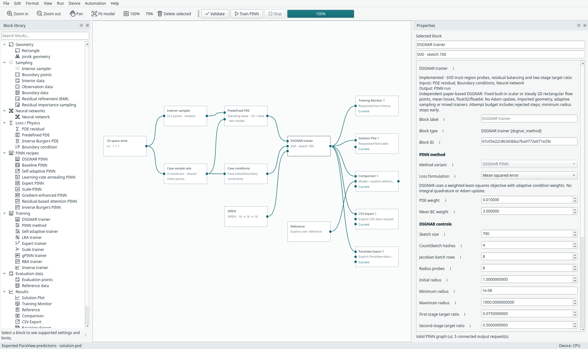
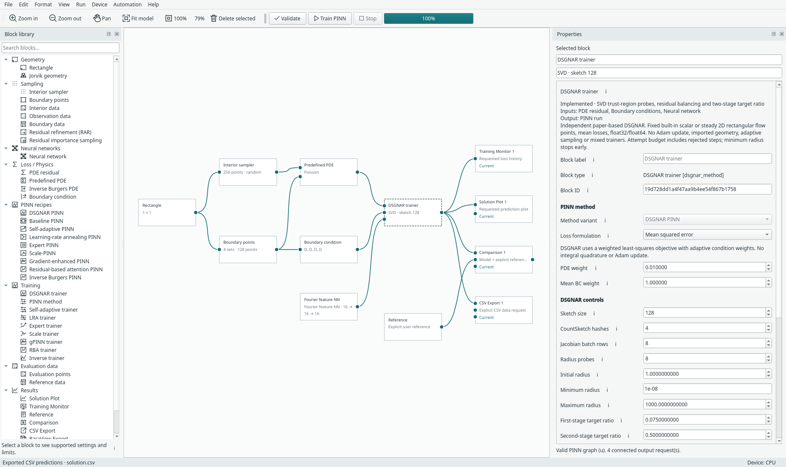

# Wave and multiscale Poisson

These examples implement Appendix C.3 and C.5 of the
[DSGNAR paper](https://arxiv.org/abs/2607.02194) independently, using Margam's
existing SIREN/Fourier networks and DSGNAR trainer. Open them under
**File → Examples → DSGNAR examples**:

- **Wave · 1D + time · two standing modes**
- **Multiscale Poisson · 2D · four spatial frequencies**

Their names describe the problems. The compact presets are starting points;
training-budget and architecture differences are explicit below.

## Standing wave

On `0 ≤ x ≤ 1`, `0 ≤ t ≤ 1`, the wave speed is `c=2` and

```text
u_tt − c² u_xx = 0
u(x,0) = sin(πx) + 0.5 sin(4πx)
u_t(x,0) = 0
u(0,t) = u(1,t) = 0
```

The analytical reference is
`sin(πx) cos(2πt) + 0.5 sin(4πx) cos(8πt)`.



The **Case conditions** inspector explicitly lists initial displacement, initial
velocity and endpoint displacement. Initial displacement and velocity use the
same initial point set but have **separate loss coefficients**. Endpoint traces
are grouped into one condition. There is **no final-time boundary**. The combined
boundary/initial point source supplies each geometric set once when wired to the
PDE; it does not duplicate initial rows just because two losses use them.

The wave preset owns this concrete two-mode initial state. Its wave speed is
editable in Predefined PDE; the explicit reference uses the same `c` coefficient.
Changing to unrelated initial data requires a different problem definition, not
silently ignoring an edited field. This first integration supports fixed built-in
samples, mean losses, baseline/DSGNAR and the unit spatial interval starting at
`t=0`. Existing SpaceTime1D sampling, comparison tables, CSV and **physical-time
PVD** exports are reused. The example includes an explicit ParaView Export block;
opening a result view remains optional.

The paper's reported wave runs split the time interval in two. This research
experiment uses **one complete interval**, so it is not a reproduction of that
schedule. A future wave-window handoff must carry **both displacement and
velocity**; the existing scalar Expert handoff cannot be assumed sufficient.

## Multiscale Poisson

On the unit square, with zero displacement on every edge,

```text
−Δu = f
u = 0.25 Σ sin(wπx) sin(wπy),       w ∈ {4,8,12,16}
f = 0.5 Σ (wπ)² sin(wπx) sin(wπy)
```

The ordinary **Predefined PDE → Poisson** block supplies `Δu + f = 0`. Its source
coefficient is zero; its forcing expression is populated explicitly. Constant
arithmetic is folded into decimal coefficients to stay within the existing
restricted-expression size limit. The expression language and its safeguards
are unchanged. The Reference block retains the readable four-mode formula.



The existing Fourier NN is configured with frequencies `2,4,6,8` cycles per unit
coordinate, matching sine modes `4,8,12,16`. This is a pointwise network, not a
neural operator. It does not hard-code the solution or a product of its modes.
The native model retains independent edge losses. The paper-equation research
experiment combines all walls into one boundary condition, as in Appendix C.5.

## Train and evaluate independently

The multiscale experiment uses a 24×3 Fourier NN (1,681 parameters). The selected
wave experiment uses the existing 16×3 SIREN (609 parameters), fixed first-layer
frequency 8, hidden frequency 1 and fixed condition coefficients. Both use sketch
budget 700, float64, 2,048 fixed interior points and 512 boundary rows. The wave
sketch is capped at its 609 parameters; multiscale retains a 700-column sketch. The wave additionally has 512 initial rows,
shared between its two initial conditions. Research PDE collocation is interior
only; native examples follow their explicit interior/boundary arrows.

```bash
python -m examples.dsgnar_analytic multiscale --device cuda --output build/dsgnar-analytic/multiscale.json --checkpoint build/dsgnar-analytic/multiscale.pt
python -m examples.dsgnar_analytic wave --device cuda --network siren --width 16 --reweight-exponent 0 --attempts 240 --output build/dsgnar-analytic/wave.json --checkpoint build/dsgnar-analytic/wave.pt
python -m examples.dsgnar_analytic multiscale --device cpu --resume build/dsgnar-analytic/multiscale.pt --evaluate-only --output build/dsgnar-analytic/multiscale-evaluated.json --csv build/dsgnar-analytic/multiscale.csv
python -m examples.dsgnar_analytic wave --device cpu --network siren --width 16 --reweight-exponent 0 --resume build/dsgnar-analytic/wave.pt --evaluate-only --output build/dsgnar-analytic/wave-evaluated.json --csv build/dsgnar-analytic/wave.csv
```

Resume must match the original architecture, sampling, seed and settings; explicit
physics/configuration and data fingerprints are validated. Read-only evaluation
checks unchanged weights, attempted-step count and sketch RNG. CSV uses explicit
`x,t,u,reference` or `x,y,u,reference` columns. References are analytical and never
used as interior observations or training stopping tolerances. Evaluation uses
an independent uniform 129×129 grid. NumPy and Torch reference implementations
are checked independently for numerical agreement.

### Adaptive wave attempt

The [initial adaptive wave experiment](../assets/benchmarks/dsgnar-wave-adaptive-attempt.json)
stopped after 89 attempts with relative L2 approximately **1.0**, a near-zero
solution that did not satisfy the prescribed initial displacement. The residual
balancer nearly removed that condition's coefficient. This is an **unsuccessful
solve**, even though the PDE/zero-condition losses decreased. Its raw losses and
error are retained. The subsequent fixed-weight run sets the already supported
`reweight_exponent=0`; this is an explicit setting change, not a new update rule.

## Recorded outcomes

| Case | Relative L2 against analytical reference | Attempts | Observed training time |
| --- | ---: | ---: | ---: |
| Multiscale Poisson, Fourier 24×3 | 0.000475316 (0.0475%) | 106 | 154.3 s |
| Wave, SIREN 16×3, fixed coefficients | 0.243392 (24.3%) | 96 | 127.8 s |

The [multiscale training record](../assets/benchmarks/dsgnar-multiscale-trained.json)
is a substantially closer solution than the [selected wave run](../assets/benchmarks/dsgnar-wave-trained.json).
**The wave solve remains inaccurate**; implementation/derivative checks do not
turn a 24% discrepancy into a successful numerical reproduction. Both runs stop
at the minimum trust-region radius rather than an analytical-error threshold.
The reported times include concurrent validation/training activity on the laptop;
they are not isolated speed benchmarks.

The [fixed-weight Fourier wave attempt](../assets/benchmarks/dsgnar-wave-fixed-fourier-attempt.json)
also remains unsuccessful (relative L2 about 1.139). Switching to the smaller
SIREN, the paper's architecture family, improved it but did not reproduce the
paper's two-window solve. The UI wave preset consequently uses SIREN and fixed
condition weights; it keeps an explicit analytical Reference/Comparison so the
remaining error can be inspected. Its samples and PDE boundary wiring differ
from the research run, so the table is not a claim about default UI accuracy.

The paper reports `4.83e-7` in float32 for multiscale Poisson and `5.41e-7` in
float32 for the two-window wave, with larger sampling/sketch/network budgets.
Neither target is matched here. Single-window wave accuracy, larger budgets and
displacement/velocity-preserving window transfer remain future work.

[Fresh CPU wave inference](../assets/benchmarks/dsgnar-wave-reloaded-cpu.json) and
[Poisson inference](../assets/benchmarks/dsgnar-multiscale-reloaded-cpu.json) preserve
weights, attempts and private sketch RNG. The
[full-network GPU Jacobian audit](../assets/benchmarks/dsgnar-analytic-jacobian-cuda.json)
checks all four wave and both Poisson conditions against generic autograd,
including remainder batches. The separate native CPU lifecycle records exercise
save/open, exact fresh-process continuation, evaluation and exports.
