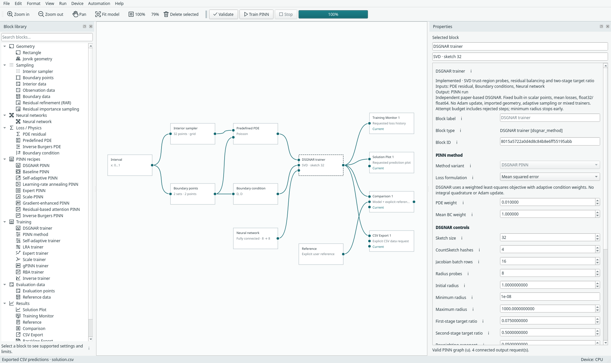

# DSGNAR: sketched Gauss–Newton training

DSGNAR is an independent PyTorch implementation of Joseph Webb, Sadok Jerad and
Coralia Cartis, [An Optimisation Framework for the Well-Conditioned Training of
Physics-Informed Neural Networks](https://arxiv.org/abs/2607.02194), v1 (2 July 2026).
It replaces the network update procedure with **Doubly-Sketched Gauss–Newton with
Adaptive Ratio**. It does not require a new neural-network architecture.

## Try it

1. Open **File → Examples → DSGNAR examples**.
2. Choose **Poisson · 1D** or **Burgers · 1D + time**.
3. Select the **DSGNAR trainer**, review the settings, and choose CPU/GPU in the
   application Device menu. Double precision is the explicit default.
4. Validate, inspect the Run summary and Train. Add/open output blocks as usual.
5. Use the trainer's **Step diagnostics…** button or context action to inspect
   acceptance, radius, regularization, achieved ratio and current condition weights.



*Actual state-isolated Poisson workflow after a small run. The view is a builder
and trainer inspector, not a paper-accuracy demonstration.*

The **DSGNAR PINN** recipe can be inserted compactly or expanded into the same
replaceable network and trainer. Physics, point sources, boundary conditions and
outputs remain ordinary connected blocks. PDE collocation follows the explicit
interior/boundary arrows; this trainer adds no hidden boundary rows.

The initial scope is fixed built-in scalar interval, rectangle and 1D space-time
problems with mean squared losses. Prepared/imported point sets, adaptive sampling,
coupled/vector physics, Expert/Scale compositions, integral quadrature and
sequential time marching are rejected. These are scope limits of this integration,
not mathematical limitations claimed for the paper.

## What each attempt does

- Form residual/Jacobian blocks for each condition, including parameter gradients
  through spatial/time derivatives. Process every remainder row. No full residual
  Jacobian or parameter-square Gauss–Newton matrix is stored.
- Apply signed multi-hash **CountSketch** to residual rows and an orthonormal
  **subsampled randomized cosine transform (SRCT)** to parameter columns. The DCT
  and adjoint use FFTs. Conditions accumulate in shared sketch buckets with
  square-root coefficient/sample-count scaling.
- Factor the square sketch with **SVD**, then evaluate geometrically spaced
  trust-region probes. Evaluate every fixed condition for every probe; no samples
  are discarded to satisfy batch divisibility.
- Interpolate a monotone decrease-ratio model with **PCHIP**, choose a candidate
  radius, lift the regularized step and evaluate it against the full objective.
  Accept a finite objective decrease with positive predicted-reduction ratio;
  otherwise restore the original parameters and shrink the radius.
- Update residual-based condition coefficients and switch to the second target
  ratio when the recent log-regularization history has a sustained upward trend.

The attempt budget includes rejected proposals. Training can stop earlier when
its next radius is below the configured minimum. A stopped radius is **not** a
PDE error estimate or proof of convergence to an accurate physical solution.
Normal Stop is checked between batches of up to 25 attempts; a single attempt
may take longer than an Adam update. The isolated-job force-stop action discards
an unresponsive job using the existing [job lifecycle](use/isolated-jobs.md).

## Controls

| Control | Meaning |
| --- | --- |
| Sketch size | Square sketch dimension, capped at the trainable parameter count. Controls SVD cost and approximation quality. |
| CountSketch hashes | Number of signed hash contributions per residual; scaled by `1/sqrt(hashes)`. |
| Jacobian batch rows | Point rows processed together; changes derivative workspace. Partial batches are kept. Probe-only residual evaluation uses bounded batches of up to 1,024 points. |
| Radius probes | Candidate radii from current radius/3 to 3×radius, capped by the maximum. |
| Initial / minimum / maximum radius | Starting norm bound, stopping threshold and probe upper bound. |
| First / second target ratio | Desired actual/predicted reduction ratio in the two stages. |
| Reweighting exponent | Residual-balancing strength; zero disables balancing. Positive values normalize updated weights to mean one. |
| Stage-switch grace attempts | Wait before testing the lambda trend. Zero follows the displayed algorithm; the reference training defaults use 80 attempts. |
| Stage-switch history | Recent lambda window; log slope above `1e-4` and correlation above `0.1` trigger stage two. |
| Precision | Explicit float32 or float64 for the network, residuals, Jacobians and SVD. |
| Sketch seed | Dedicated CPU generator, separate from network and sampling seeds. |

The learning-rate field is hidden for DSGNAR: **no Adam step is performed**.
An empty Adam payload remains in the shared checkpoint envelope for compatibility;
it has no moments or numerical updates. The ordinary resource review's Adam
subtotal is labelled as a comparison reference, not DSGNAR's working memory.
SVD work arrays, the square sketch, blocked Jacobians and probe autograd graphs
still consume memory. Process separation does not impose RAM/VRAM quotas.

## Losses, diagnostics and checkpoints

Baseline and trial objectives use identical evaluation batches, independently
of Jacobian batching; otherwise single-precision reduction noise can corrupt the
acceptance ratio near convergence.

The monitor records raw pre-attempt condition MSE and the weighted total used for
that attempt. `weighted:<constraint>` contributions use those same coefficients.
Adaptive coefficients can change the total between attempts even if a proposal
was rejected; compare the before/after objective **within one diagnostic row**
when checking acceptance. The paper's conventional `1/2` least-squares factor is
omitted consistently from both actual and predicted reductions; ratios and steps
are unchanged.

Diagnostics retain attempted/accepted counts, chosen/next radius, regularization,
achieved/target ratio, before/after objective and coefficients used. Checkpoints
also retain the dedicated sketch generator, coefficient state, lambda history and
stage/stopping state. Restoration validates the trajectory, network dtype,
architecture, data identity and physics/configuration before continuing. Exact same-device network/loss/RNG continuation is tested in the fresh-process
executor. Regularization diagnostics may differ by last-bit SVD roundoff and are
checked at `5e-14` relative tolerance. Qt-host direct-engine parity is a separate
double-precision tolerance check; cross-device bitwise equality is not promised.
Model format **32** adds `dsgnar_settings`; formats 1–31 remain readable. Other
methods ignore this unrelated setting in their historical checkpoint signatures.

## Script use

The same trainer is importable without registering a GUI block:

```python
from margam.research import DSGNARPINN, PINNProblem, PointConstraint
from margam.components.dsgnar_config import dsgnar_defaults

# problem is a PINNProblem with fixed, differentiable residuals/constraints;
# network is an ordinary pointwise torch.nn.Module.
settings = dsgnar_defaults()
settings.update(sketch_size=32, precision="float64")
model = DSGNARPINN(problem, network, settings=settings).compile(device="cpu")
model.train(10, display_every=0)
state = model.training_state()
```

For custom scripts, pass a versioned primitive `configuration` dictionary naming
your physics/operator implementation if you require strict checkpoint identity.
Tensor fingerprints cannot identify changes inside arbitrary Python callables.
Fixed target functions are evaluated canonically on CPU before transfer so archive
identity does not depend on CPU/CUDA transcendental-function rounding.
The block's built-in factory supplies its complete configuration automatically.
Batch-dependent networks, stochastic layers and operators that depend on the full
point batch are outside this trainer's contract. Shared pointwise architectures
remain replaceable; operator-network or transformer support is not implied.

## Paper/repository differences and implementation choices

The authors' [JAX/Equinox repository](https://github.com/wephy/physics-informed-neural-networks)
was inspected at commit `8b30ec3`. It has no declared top-level source licence in
that checkout; no upstream source, reference data, PDF, JAX environment or custom
CUDA/compiler code is bundled. Margam's code is independently written from the
paper equations and Algorithms 1–5.

The inspected sources contain ambiguities worth making explicit:

- Algorithm 1 accepts a decrease; nearby prose also describes rejecting a ratio
  that overshoots its target. The inspected code accepts a positive ratio and
  computes an overshoot flag without using it in acceptance. Margam follows the
  Algorithm 1 decrease rule with an additional finite/positive-ratio check.
- Algorithm 1 and inspected code generate fresh random operators per attempt;
  section 3.2.2 describes a consistent sketch. Margam uses fresh per-attempt
  sketches and checkpoints their generator state. Sketch dimensions remain fixed.
- Algorithm 3's displayed step lacks the minus sign present in Equation 20.
  Margam uses the descending Equation 20 sign.
- CUDA sketches of size at most 128 use a CPU SVD/step solve for consistent
  tiny-system arithmetic across library contexts; network/physics evaluation stays
  on the selected device. Larger CUDA sketches use the QR-based `gesvd` SVD driver rather than the default Jacobi driver,
  and a deterministic-algorithm context during attempts. An absent CUBLAS workspace
  configuration defaults to `:4096:8`; the prior Torch deterministic mode is restored
  afterward. These controls support strict same-device continuation checks.
- The secular equation is solved with a safeguarded bracket/bisection (80
  iterations), rather than unconstrained Newton iteration from zero. Exactly zero
  singular directions have zero coefficient; a feasible unregularized step uses
  lambda zero.
- PCHIP fits the non-increasing ratio against log radius and its crossing is
  found by bisection. Equal-ratio plateaus remain intact. Inverse interpolation
  with collapsed duplicate knots was found to overstep negative-ratio plateaus
  and was corrected; its exploratory accuracy records remain labelled separately. All conditions/probes include every row.
  Probes run sequentially; sorted segmented CountSketch reductions avoid CUDA atomic
  scatter nondeterminism. Parameter Jacobians use batched reverse-mode gradients.
- Reweighting uses weighted per-condition mean-square contributions (the squared
  norm of each normalized residual block), an `1e-8` denominator floor and
  mean-one normalization. An all-zero objective preserves coefficients safely;
  exponent zero disables balancing. The lambda trend uses a `1e-30` logarithm
  floor. These explicit zero cases prevent invalid checkpoint/JSON values.
- Current samples are fixed; there is no hybrid-precision warmup, automatic
  resampling or new time-marching scheme. Existing soft constraints/networks and
  small example budgets differ from the authors' benchmark configurations.

This portable batched reverse-autograd implementation is aimed at correctness and composition.
It does not claim the authors' compiled JAX speed, H100 timings or extreme errors.

## Reproduce the checks

```bash
QT_QPA_PLATFORM=offscreen python -m unittest discover -s tests -p 'test_dsgnar*.py' -v
QT_QPA_PLATFORM=offscreen python -m examples.dsgnar_workflow --device cpu
QT_QPA_PLATFORM=offscreen python -m examples.dsgnar_workflow --device cuda
```

Maintained [CPU](../assets/benchmarks/dsgnar-cpu.json) and
[CUDA](../assets/benchmarks/dsgnar-cuda.json) records cover six-attempt saved-project
runs, four-plus-two exact continuation, retained CPU checkpoints, explicit
re-evaluation and CSV/physical-time export. Raw final MSE is reported honestly;
these short workflows are not solution-accuracy benchmarks.

## Accuracy experiments

The native Poisson example is additionally trained against `u=x*(1-x)` on an
independent 1,001-point grid. The reproducible configuration and measured result
are in [the accuracy record](../assets/benchmarks/dsgnar-poisson-accuracy.json).
The trained local project/run archive are created under `build/dsgnar-accuracy/`:

```bash
python -m examples.dsgnar_poisson_accuracy --output assets/benchmarks/dsgnar-poisson-accuracy.json --checkpoint build/dsgnar-accuracy/poisson.pt
QT_QPA_PLATFORM=offscreen python -m examples.save_dsgnar_accuracy_project
```

The paper's fast Burgers case is **periodic**, with `nu=0.01`, rather than the
original PINN Dirichlet example's `nu=0.01/pi`. The separate research benchmark
implements the paper's six 16-wide tanh layers, six learned activation scales
(1,447 parameters), periodic `(cos(pi*x),sin(pi*x),t)` embedding, sketch 700 and
32,768 PDE / 16,384 initial rows. The benchmark command now defaults to the reference training configuration's
80-attempt stage-switch grace period. The retained successful run used the
displayed algorithm's zero-grace setting; its stage switch occurred after 80
attempts and independent replay verifies that an 80-attempt grace produces the
same realised decisions. Earlier recorded attempts start biases at zero. The later reference-initialisation
comparison uses Gaussian bias noise with standard deviation `0.01`, as observed
in the pinned authors' code; random generators still differ from JAX. It uses an independent
Cole–Hopf heat-convolution reference, evaluated by Gauss–Hermite quadrature.
SciPy is required for this optional reference generator, not for desktop training.
Tests check the initial field, periodicity, PDE consistency and quadrature
convergence. No upstream reference data are used.

```bash
python -m examples.dsgnar_accuracy --device cuda --functional --compile-functional --stage-grace 0 --output build/dsgnar-accuracy/repeated-run.json --checkpoint build/dsgnar-accuracy/repeated-run.pt
```

The functional/compiled path is specific to this research benchmark. It shares
DSGNAR's sketching, SVD, probe selection, acceptance and state handling, replacing
only PDE/IC derivative evaluation. Its Jacobians are tested against generic
autograd, including the [paper-sized compiled CUDA check](../assets/benchmarks/dsgnar-functional-validation.json).
It is not an arbitrary-code option in saved desktop blocks. Backend and compiler
Torch version are recorded in its caller-owned checkpoint identity; `--resume`
requires that identity and the fixed data to match. `--warm-start` explicitly
loads weights only and resets the optimizer trajectory. Neither operation is a
silent cross-backend exact-continuation claim.

The [corrected full-sampling accuracy run](../assets/benchmarks/dsgnar-burgers-forward-probes.json)
records whether it reaches the paper's `4.75e-7` single-precision relative L2
threshold. Its independent uniform 257×65 evaluation grid differs from the
authors' reference-grid protocol, so even meeting that threshold alone is not a
complete reproduction. Runtime includes compilation in the current script and
must not be compared directly with the paper's warmed H100 result. The current
machine is an RTX 3060 Laptop GPU. Earlier
[generic](../assets/benchmarks/dsgnar-burgers-generic-attempt.json),
[first compiled](../assets/benchmarks/dsgnar-burgers-first-compiled-attempt.json)
and [reduced-sampling pilot](../assets/benchmarks/dsgnar-burgers-pilot.json)
records retain unsuccessful/interrupted experiments rather than replacing them
with claimed matches.

The double-precision warm-start and full-parameter-sketch refinements are also
retained separately. They investigate the accuracy floor and do not constitute
single-precision paper matches. The `bias_noise` field records the initialisation
choice in newer accuracy reports. Research benchmark checkpoint identities are
versioned as these pre-release experimental paths change; weights-only warm
starts are explicit and are not passed off as exact continuation.

### Achieved errors after correcting probe interpolation

| Case | Precision | Attempts | Relative L2 error | Measured wall time |
| --- | --- | ---: | ---: | ---: |
| Poisson, independent 1,001-point analytical check | float64 | 74 | 5.512e-09 | 13.4 s |
| Periodic Burgers, full sampling, independent 257×65 grid | float32 | 127 | 2.558e-07 | 624.4 s |

The corrected Burgers run first crosses the paper's `4.75e-7` single-precision
threshold at attempt **123**, and stops normally at attempt **127** when its
radius falls below `1e-4`. The second stage first applies at attempt **102**;
replaying the complete lambda history confirms that the reference's 80-attempt
grace would not have changed any realised stage decision. No reference values
enter the training objective or acceptance rule.

**This matches the reported numerical error threshold on an independent grid,
not a complete paper-protocol or speed reproduction.** The paper reports 9.8 s
on an H100 with its compiled JAX implementation; this run takes about 624 s on an
RTX 3060 Laptop GPU, including compilation and per-attempt validation. Other
validation jobs also ran during development, so this is not a controlled speed
comparison. Bias noise matches the inspected code, but RNG streams, parameter
ordering, interpolation details and the evaluation grid differ.

The retained checkpoint reloads without optimization on
[GPU](../assets/benchmarks/dsgnar-burgers-reloaded-cuda.json) and
[CPU](../assets/benchmarks/dsgnar-burgers-reloaded-cpu.json), measuring
`2.558e-7` and `2.548e-7` respectively. The
[retained snapshot](../assets/benchmarks/dsgnar-burgers-target-checkpoint.json)
records its selection and original configuration. The benchmark-specific
periodic network currently uses the research path; the native menu's Burgers
example remains the explicitly documented original-PINN Dirichlet variation.

Reload the retained local model and optionally export its physical `(x,t,u)` rows:

```bash
python -m examples.evaluate_dsgnar_burgers build/dsgnar-accuracy/burgers-target.pt --device cuda --csv build/dsgnar-accuracy/burgers-target.csv
python -m examples.evaluate_dsgnar_burgers build/dsgnar-accuracy/burgers-target.pt --device cpu
```

The trained Poisson result can be opened directly through **File → Open saved
run** using `build/dsgnar-accuracy/poisson.margam-run.pt`; its model document is
`build/dsgnar-accuracy/poisson.margam.json`. Generated weights/exports stay local
under the ignored `build` folder. The public JSON records and commands retain the
configuration and evidence needed to repeat the experiments.
