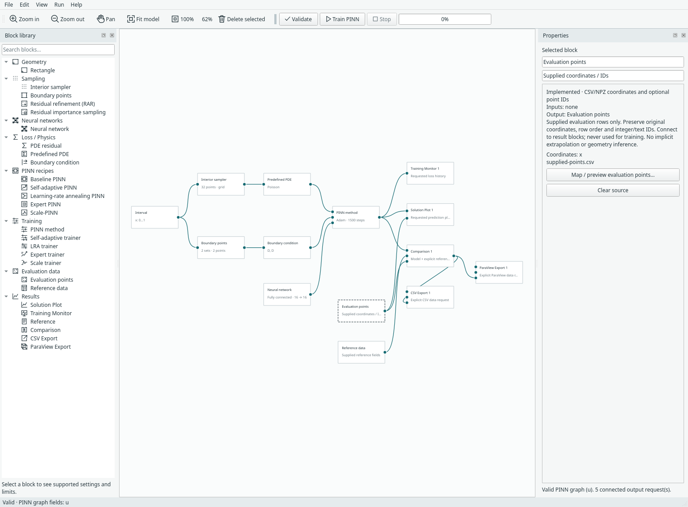
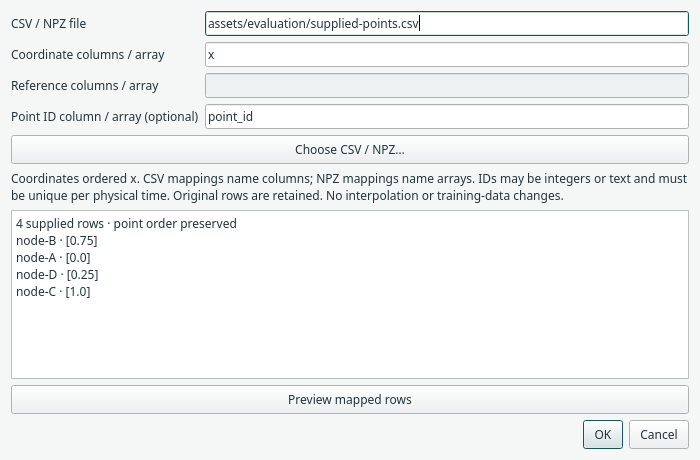
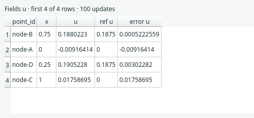

# Evaluate at your own points

Use **Evaluation points** when you want predictions at specific coordinates:
measurement locations, FEM nodes or points prepared by another tool. Use the
separate **Reference data** block when you also have numerical/reference values.
Neither block changes the points used to train the PINN.

## Try the working example

Open **File → Examples → 1D examples → Supplied evaluation points · 1D**. The example is wired
with four deliberately unsorted points and a separately ordered analytical
reference. Click **Validate**, then **Train PINN**. Double-click Comparison to see
predictions, reference values and signed errors. Views stay closed until requested;
training writes no export files.



*Actual desktop example. Evaluation data has its own library category. The two
source blocks are independent of the interior and boundary training samplers.*

## Connect the blocks

1. Add **Evaluation data → Evaluation points** and map a CSV or NPZ file in its
   inspector. Connect it to the **points** input of Solution Plot, Comparison,
   CSV Export or ParaView Export.
2. Keep the trainer/compact recipe connected to the output's **model** input.
3. For comparison, add **Evaluation data → Reference data**, map coordinates and
   field values, then connect it to Comparison's **reference** input.
4. To export the comparison, connect Comparison's output to the export block's
   **comparison** input. This carries the same points, IDs, predictions and errors.
   Choose either this route or a direct model/points route on that export block.

Without an Evaluation points connection, an output keeps its regular evaluation
grid. Its per-axis resolution is ignored when supplied points or a comparison
feed it. The older **Reference** block remains available for expressions, preset
references and existing saved models.

## Map a file explicitly



For CSV, enter comma-separated column names in model order: `x`, `x,y`, `x,t` or
`x,y,t`. A transient coordinate is physical time, never a training-update number.
Reference columns follow the model's field order: `u`, `u,v,p` or the explicitly
labelled torus `u,v,w` fields (where w is vorticity).

For example, evaluation points might be:

```csv
point_id,x
node-B,0.75
node-A,0.0
node-D,0.25
node-C,1.0
```

Map coordinates to `x` and the optional ID column to `point_id`. A separate
reference CSV may have these rows in a different order, with an extra `u` column;
map that column in Reference data. See the bundled
[point CSV](../assets/evaluation/supplied-points.csv) and
[reference CSV](../assets/evaluation/reference-values.csv).

For NPZ, the entries name arrays instead of columns. Coordinates must be an
N×D real array; reference values must be N×F (or N for a scalar). An optional ID
array must be one-dimensional integer or text data. Object arrays and pickle
loading are rejected. CSV IDs remain text, including leading zeros; NPZ integer
IDs retain their integer precision, including values larger than 2⁵³.

Each source is limited to 100,000 rows and 64 MiB (including expanded NPZ data).
Coordinates/values must be finite and match the current model dimensions, fields
and bounds. Points inside a built-in solid cylinder are rejected. No physical
3D geometry, unit conversion or mesh connectivity is inferred from the file.

## Reference alignment and errors

When both sources supply IDs, reference rows are matched by ID and physical time,
then their coordinates are checked. IDs must be unique within a time frame; a
node ID may recur at a different physical time. Without IDs on both sides,
coordinates must uniquely identify each row. Repeated coordinates require IDs
on both sources. Both sources must describe the same number of matching rows.

Missing IDs, mismatched coordinates, duplicate keys or incompatible field counts
are validation errors. There is no nearest-neighbour matching, interpolation or
silent dropping of points. Predictions retain the evaluation source's original
row order. Values use the model's units; convert them before import if needed.



*The demo after 100 CPU updates. This is evidence of the data workflow, not a
solution-accuracy benchmark. The table displays the first 200 rows; saved/exported
outputs retain all rows. Signed error is prediction minus reference. Comparisons
also record RMSE and maximum absolute error, with per-field metrics for vectors.*

## Evaluate without retraining

After training, change only the evaluation/reference mapping or requested outputs,
then choose **Run → Evaluate outputs** (also available from output context menus).
Margam reuses trained weights and preserves the optimizer checkpoint and update
count. Changing the PDE, network, geometry or training configuration requires a
new training run. Evaluation never starts automatically after editing a file.

Saved run archives contain evaluated rows and source fingerprints. Reopen them
and view/export the recorded outputs even if source files are unavailable. To
evaluate new points, the current mapped evaluation/reference files must exist.
Weights-only prediction can reuse a saved checkpoint without reopening its old
training-data files; resuming training retains its existing data checks.

## Export the same rows

**CSV Export** writes `source_row` (zero-based original row), optional `point_id`,
coordinates and predicted fields. Comparison-fed exports also include `ref_u`,
`error_u`, and equivalent columns for other fields. It preserves original order.

**ParaView Export** writes supplied steady points as `.vtu` vertex cells, without
inventing mesh connections. Predicted/reference/error fields and `source_row`
are point arrays. Canonical integer IDs that fit Int64 also appear as a `point_id`
array. All IDs, including text and leading-zero strings, are preserved losslessly
as UTF-8 JSON bytes in the UInt8 FieldData array `point_ids_json_utf8`; use CSV for
a directly readable text-ID column. This is not a native VTK string point array.

Transient exports produce `.pvd` collections of VTU frames ordered by the supplied
physical times. A frame retains original row order, global `source_row` indices
and IDs. Point counts and locations may vary between frames. Time is removed
from spatial coordinates; there is no implicit temporal resampling. Keep the
companion frame folder beside the PVD and open the PVD for playback in ParaView.
GUI playback was not exercised for this new supplied-point dataset.

Direct GeoSampler import, original FEM cells/connectivity, region labels and
explicit unit metadata remain [future work](todo.md#future-evaluation-and-export-at-supplied-points).

## Reproduce the checks

Run from the repository root with its existing environment:

```bash
python -m examples.evaluation_points --device cpu --output-dir /tmp/margam-evaluation-cpu
python -m examples.evaluation_points --device cuda --output-dir /tmp/margam-evaluation-cuda
python -m examples.capture_evaluation --overwrite
```

The [CPU record](../assets/benchmarks/evaluation-points-cpu.json) and
[CUDA record](../assets/benchmarks/evaluation-points-cuda.json) retain configuration,
point order/IDs, source hashes and values after 100 training updates. Both confirm
zero additional optimizer updates and unchanged trained state during evaluation.
The [capture manifest](../assets/screenshots/manual-evaluation-captures.json)
records the illustrated UI evidence. Tests cover shuffled references, large
integer/text IDs, invalid mappings, offline archives, evaluation reuse and
variable-point physical-time VTU/PVD exports.
