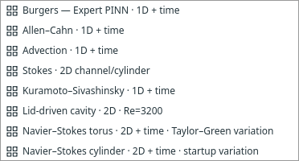
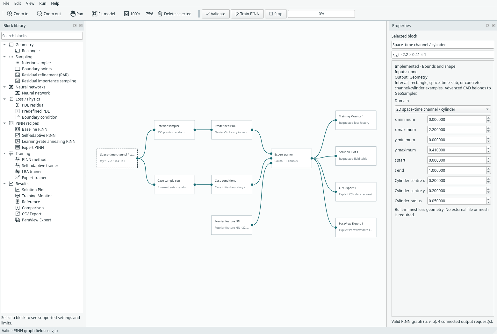
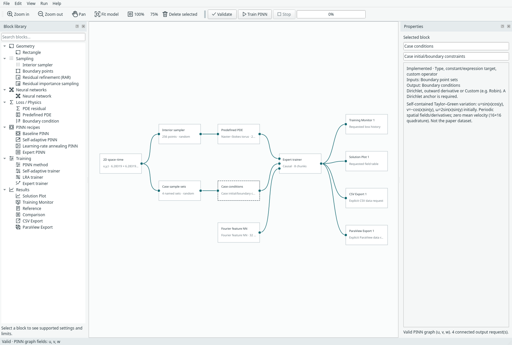

# Expert PINN examples

Open **File → Examples → Expert PINN examples**. All seven problems from the
paper's results section are available, alongside the existing Expert Burgers
example. Each creates an editable component graph with an independent network,
Expert trainer, named constraints and optional output blocks. No output window
opens automatically and training writes no export files.



These are independent PyTorch implementations of the equations in
[An Expert’s Guide to Training Physics-informed Neural Networks, v1](https://arxiv.org/abs/2308.08468v1).
“Expert PINN” is Margam's recipe label. No upstream JAX source or datasets are
bundled. See [method details and attribution](expert-pinn.md).

## Choose a problem

| Example | Space and time | Equation and defaults | Conditions |
| --- | --- | --- | --- |
| Allen–Cahn | x ∈ [−1,1], t ∈ [0,1] | uₜ − 0.0001uₓₓ + 5(u³−u)=0 | Initial x²cos(πx); periodic u and uₓ |
| Advection | x ∈ [0,2π], t ∈ [0,1] | uₜ + 50uₓ=0 | Initial sin(x); periodic u |
| Kuramoto–Sivashinsky | x ∈ [0,2π], t ∈ [0,1] | uₜ + αuuₓ + βuₓₓ + γuₓₓₓₓ=0; α=100/16, β=100/16², γ=100/16⁴ | Initial cos(x)(1+sin(x)); periodic u and first three spatial derivatives |
| Stokes channel/cylinder | 2D channel [0,2.2]×[0,0.41], disk removed | −νΔ(u,v)+∇p=0, uₓ+vᵧ=0; ν=0.001 | Parabolic inlet peak 0.3; stationary walls/cylinder; zero outlet traction |
| Lid-driven cavity | 2D unit square, steady | (u,v)·∇(u,v)+∇p−νΔ(u,v)=0, uₓ+vᵧ=0; ν=1/3200 | Top velocity (1,0); other walls (0,0); p(0,0)=0 |
| Navier–Stokes torus — Taylor–Green variation | Periodic 2D square [0,2π]², t ∈ [0,10] | ωₜ+uωₓ+vωᵧ−0.01Δω=0; div=0; ω=vₓ−uᵧ | Self-contained Taylor–Green initial velocity/vorticity; periodic fields and first two normal derivatives |
| Navier–Stokes cylinder — startup variation | Same 2D channel/disk, t ∈ [0,1] | (u,v)ₜ+(u,v)·∇(u,v)+∇p−0.001Δ(u,v)=0; div=0 | Quiescent initial velocity; parabolic inlet peak 1.5 with startup ramp; no slip; zero outlet traction |

Both cylinder cases remove a circle centred at (0.2,0.2), radius 0.05. The domain
inspector exposes these values; the disk must lie strictly inside the channel.
Uniform rejection sampling excludes the disk. Separate circle samples lie on its
surface. Inlet/outlet and wall samples exclude corner intersections.



The Stokes equations use dimensional coordinates/coefficients rather than the
paper's nondimensional L*=0.1, U*=0.2 form. Outlet traction at the right edge is
(νuₓ−p, νvₓ)=0. It fixes pressure level, so these cases do not add a pressure gauge.
The cavity does require one gauge. Its moving-lid corner discontinuities are
preserved: boundary sampling omits the corners rather than smoothing the lid.

## Explicit variations

**Torus:** this means a periodic planar domain, not a 3D surface. The original
experiment's externally supplied initial field is replaced with
u₀=sin(x)cos(y), v₀=−cos(x)sin(y), ω₀=2sin(x)sin(y).
The network predicts three outputs **u, v, w**, where **w means scalar vorticity ω**,
not a third velocity. A curl-closure residual ties w to vₓ−uᵧ; this auxiliary-field
representation differs from differentiating velocity to obtain every vorticity
prediction. Its PDE and initial/periodic constraints are all trained explicitly.
A zero-spatial-mean velocity constraint removes the time-dependent uniform drift
left undetermined by curl/div equations. It uses a 16×16 periodic quadrature at
up to eight sampled times per update; this is a soft quadrature constraint, not
an exact projection. The chosen Taylor–Green initial velocity has zero mean.

**Transient cylinder:** the paper uses an initial field obtained from a prior
flow simulation. Margam starts with u=v=0 and ramps the parabolic inlet by
1−exp(−(t−t₀)/τ), τ=0.1. Pressure has no prescribed initial value. This startup case
is deliberately labelled a variation and does not reproduce the paper's wake.



## Training and outputs

The default recipe uses Gaussian Fourier features with optional random weight
factorization. Replace the network after expanding a compact recipe, or edit it
in the expanded example. These cases support **Expert** or **baseline** training;
SA/LRA, imported geometry, RAR/importance sampling and integral loss are rejected
for these new contracts until their transfer/quadrature rules are implemented.

Expert training refreshes interior/condition points every update. Transient
interiors use equal physical-time strata and detached causal weighting. Steady
cases balance two groups (PDE/boundary), without causal weighting; transient cases
balance PDE/initial/boundary. Periodicity is a soft loss, not an exact periodic
network embedding. Allen–Cahn uses the classical initial profile, whose endpoint
derivative mismatch is handled as an initial/periodic loss, not forced corner data.

The default is **one time slab**; [optional time marching and NTK balancing](expert-training.md)
are available in the Expert trainer. There is no Reynolds-number curriculum for the cavity. Default small networks/sample counts
are usable starting graphs, not the paper's training configurations or accuracy
results. No later-time analytical reference is assumed or added automatically.

Solution tables and CSV preserve coordinate/field names. **ParaView Export** is
an explicit connected block: right-click it after training to write a file.
Steady rectangular fields use VTI; steady obstacle fields use VTU vertex point
clouds. Time-dependent examples use PVD collections with physical-time VTI/VTU
frames. The cylinder solid is excluded from both evaluation and export.
VTU contains vertices only, **no FEM cells or mesh connectivity**. The velocity
vector is (u,v,0); torus w is a separate scalar vorticity array. See
[export formats](paraview-export.md).

Resolution means points **per coordinate axis**, including time. A 2D transient
request with resolution N can evaluate N³ locations before obstacle exclusion.
Requests above 100,000 locations are rejected; the default for these cases is 9.
Higher resolution does not retrain the network.

## Recorded correctness checks

The [CPU record](../assets/benchmarks/expert-suite-cpu.json) and
[CUDA record](../assets/benchmarks/expert-suite-cuda.json) contain complete small
configurations, named sample counts, ten updates of finite losses and exact
same-device checkpoint continuation for each case. They make **no convergence or
solution-accuracy claim**. Automated checks additionally compare manufactured
PDE residuals, periodic derivatives through third order, obstacle sampling,
physical-time exports, UI worker execution, compact graphs and run archives.

```bash
python -m examples.expert_suite --device cpu
python -m examples.expert_suite --device cuda
python -m unittest tests.test_expert_examples -v
python -m examples.capture_expert_suite --overwrite
```
