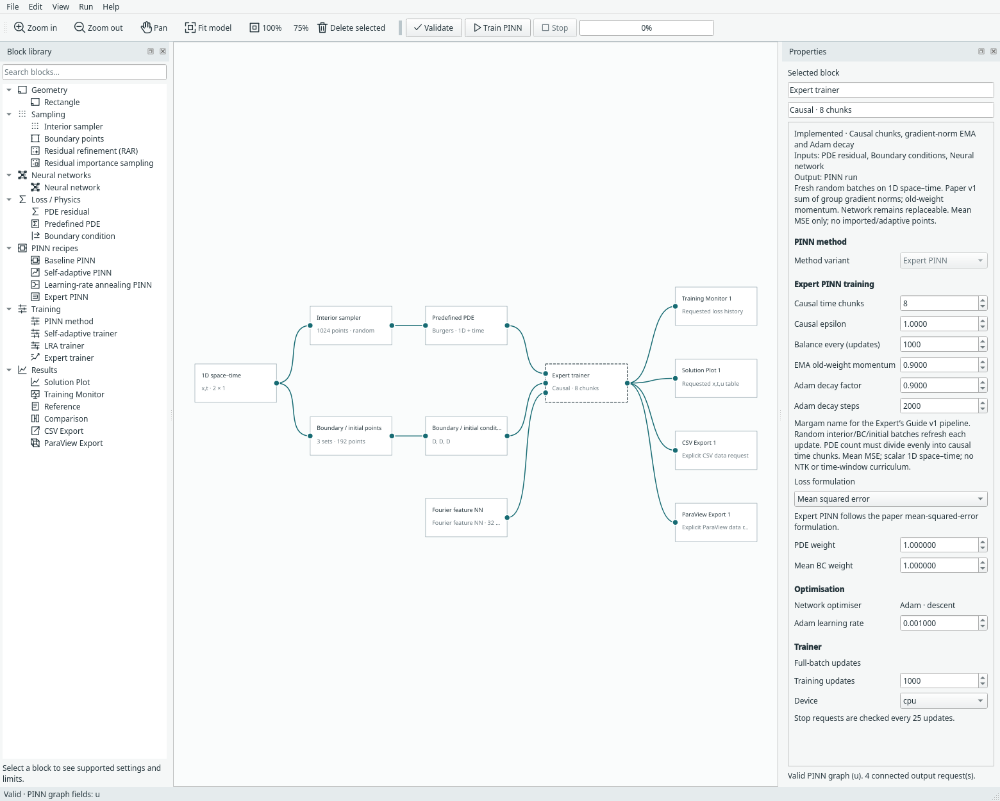
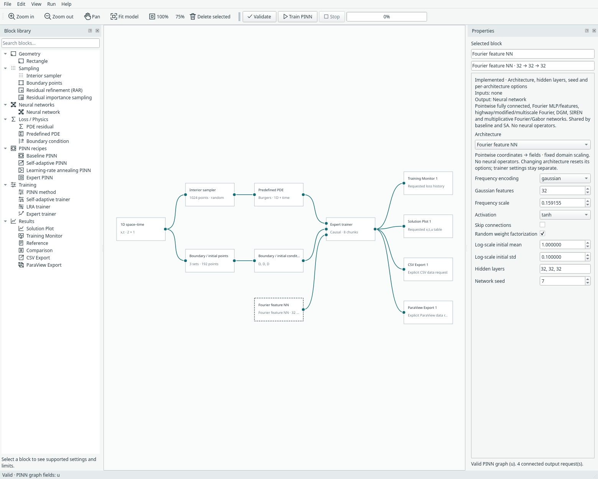
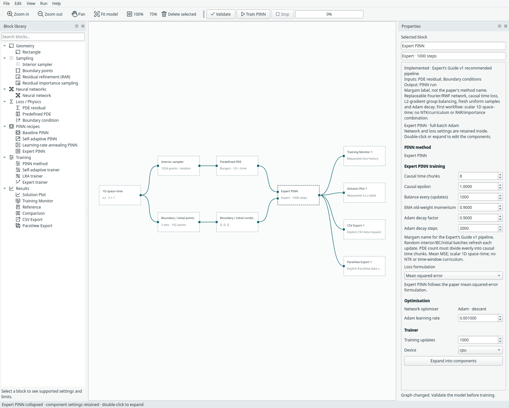

# Expert PINN — Margam’s recipe name

**Expert PINN** is Margam’s label for a recipe based on *An Expert’s Guide to
Training Physics-informed Neural Networks*, Sifan Wang, Shyam Sankaran,
Hanwen Wang and Paris Perdikaris, **arXiv:2308.08468v1 (16 August 2023)**.
The authors do not name a method “Expert PINN”. This is not a mixture-of-experts
network or an XPINN domain decomposition.
[Paper](https://arxiv.org/abs/2308.08468) ·
[Authors’ JAX-PI repository](https://github.com/PredictiveIntelligenceLab/jaxpi).

The supplied PDF v1 is the equation reference. The local JAX-PI checkout was
reviewed at revision `f944a0cd03c7f35a239955505d83bbdc5a07f831`; it contains later
research as well as the original pipeline. Its licence restricts reuse of source
and modifications. Margam implements the paper mathematics independently: no JAX,
Flax, Optax, W&B, upstream source or paper PDF is bundled/required. See
[community attribution](community-methods.md) and [third-party notes](../THIRD_PARTY.md).

## Start with the concrete example

Choose **File → Examples → 1D examples → Burgers — Expert PINN · 1D + time**.
The physics is the existing [Burgers initial-value problem](burgers.md), with zero
endpoint values and a sine initial profile. Insert **Expert PINN** for the compact
recipe or **Expert trainer** for an expanded graph. Compact expansion/collapse
uses the single definition in `margam/recipes/expert.py`; the network remains
replaceable after expansion.



## What this implementation includes

| Ingredient | Margam implementation |
| --- | --- |
| Fourier representation | Existing Gaussian Fourier feature network; default 32 Gaussian vectors and three 32-neuron tanh layers |
| Random weight factorization (RWF) | Optional exponential per-output-row factors on fully connected, Fourier and modified Fourier networks |
| Global loss balancing | L2 parameter-gradient norms, **sum** reference, old-weight EMA; all three groups adapt |
| Causal residual weighting | Equal-width physical-time strata, detached exponential weights from earlier residual strata |
| Fresh random training batches | New interior, spatial BC and IC coordinates for every optimiser update; equal interior count per time stratum |
| Optimisation | Adam, no weight decay, continuous exponential decay of its initial learning rate |
| Persistence | Coefficients, balancing events, initial data/configuration identity, Adam decay phase and deterministic sampling continuation |

Non-dimensionalising the PDE is the user’s modelling responsibility. Fixed network
coordinate scaling is **not** automatic physical non-dimensionalisation. The recipe
does not infer physical units or scale PDE coefficients/targets for you.

## Random weight factorization

For a linear layer with an initialized weight matrix `W` (PyTorch output rows):

```text
s ~ Normal(mean, std)
V = W / exp(s)[:, None]
W_effective = exp(s)[:, None] * V
```

Both `s` and `V` are trainable; the bias is retained. This follows section 4.3 and
Algorithm 2’s exponential parameterization. Initialization preserves the existing
network’s effective weights, values and derivatives up to rounding. It is not
weight normalisation. Expert defaults use log-scale mean 1 and standard deviation
0.1, including the output layer. Disable/change RWF in the network inspector or
replace the network; the Expert trainer does not force an architecture.

The existing Fourier network uses **cycles** in `sin/cos(2*pi*x*B)`. Expert’s
Gaussian scale defaults to `1/(2*pi)` for angular scale approximately 1 on the
network’s normalized coordinates. It retains the existing raw-coordinate
concatenation and frozen feature frequencies. Those are deliberate Margam
architecture choices, not exact reconstruction of the authors’ JAX architecture.
Disabled RWF preserves existing architecture/checkpoint descriptions.



## Causal loss — equations (2.10)–(2.11)

Split physical time into `M` equal-width strata and draw the same number of
interior samples in each. For stratum mean squared residual `L_i`:

```text
w_0 = 1
w_i = exp(-epsilon * sum(L_j for j < i))
L_pde = mean_i(w_i * L_i)
```

`w` is detached before backpropagation. The first stratum is always active;
later strata become active as earlier residuals decrease. Epsilon zero explicitly
removes causal suppression. This is weighting within one time slab, not a
multi-window marching algorithm. Whole `(x,t)` pairs stay together: time is never
sorted independently and reassigned to unrelated spatial points.

The PDE point count must divide evenly by the causal chunk count. The sampler
uses fresh uniform spatial draws and stratified uniform time draws every update.
It also refreshes spatial boundary and initial coordinates, preserving their
existing types/targets. The connected sampler blocks supply budgets and seeds;
select **random** for all their recipes. Fixed/grid/imported batches are not
silently substituted.

## Global balancing — equations (2.12)–(2.15)

There are three groups: PDE, initial, and combined spatial boundary loss. Existing
static PDE/named-constraint weights are applied before this balancing step; spatial
BC contributions are summed into their group. This preserves Margam’s named-set
weight convention rather than silently replacing it with a differently pooled BC
loss. For each group `g`, compute its L2 norm `n_g` over all trainable parameters:

```text
target_g = sum(n_h for every group h) / n_g
lambda_g = momentum * lambda_g + (1-momentum) * target_g
objective = sum(lambda_g * group_loss_g)
```

Coefficients start at one. Updates occur **before steps f, 2f, ...**, with default
`f=1000`. Momentum defaults to 0.9 and weights the **old** coefficient. The causal
weights and group coefficients are detached. A norm at/below the configured floor
holds its old coefficient; ratios are capped to avoid an unbounded update.

This differs from Margam’s existing [LRA trainer](lra-pinn.md): that uses maximum
PDE / mean constraint gradient statistics and keeps the PDE coefficient fixed.
Do not substitute it for this paper’s all-group L2-norm rule.

## Adam decay and diagnostics

Before update index `k` (starting at zero):

```text
learning_rate_k = initial_learning_rate * decay_rate ** (k / decay_steps)
```

Defaults are initial rate 0.001, decay factor 0.9 and decay steps 2000. These are
continuous exponential changes, not staircase changes. The GUI’s existing training
update budget remains editable; modest desktop defaults do not reproduce the
paper’s benchmark budgets.

The Training Monitor keeps named losses; its PDE curve includes causal weighting
but precedes group coefficients. **Messages** reports learning rate/minimum causal
weight at worker progress updates. Right-click the trainer/recipe for **Expert
training summary**, including group coefficients. Closing output views does not
stop training.



## Paper versus repository choices

| Detail | Supplied paper v1 / Margam choice | Reviewed JAX-PI checkout |
| --- | --- | --- |
| Balancing numerator | Paper’s sum of group gradient norms | Mean of group gradient norms |
| EMA parameter | Old-weight fraction, default 0.9 | Also old-weight fraction |
| Balance phase | Before steps divisible by `f` | Burgers loop updates after a network step, starting at loop step zero |
| Causal partition | Fixed physical-time strata with equally many samples | Sorted random time draws reshaped into equal-count chunks |
| Weight factors | Paper’s trainable log scales exponentiated in the forward map | Dense implementation initializes positive `g`, then optimizes `g` directly |
| Burgers boundaries | Existing Margam sine-IC/zero-endpoint case | Reviewed configurations use an exact periodic spatial embedding |

The implementations are therefore not claimed numerically equivalent. Exact JAX
random-number streams, default architecture, datasets and published accuracy are
not reproduced.

## Current limits

The first Expert workflow supports scalar **1D space–time** problems and **mean
MSE**. It rejects imported point sets and RAR/importance blocks because its causal
strata and per-update sampling policy need an explicit combined design before
those can be composed. Use the other supported trainers for those samplers.

NTK-diagonal balancing, curriculum/multiple time windows, automatic physical
non-dimensionalisation, exact periodic embeddings, modified JAX MLP architecture,
mini-batch gradient accumulation, distributed training and later PirateNet/ActNet
methods are not implemented by this recipe. These remain separate extensions.

Model format 16 stores Expert recipe/trainer settings and reads earlier formats.
Run archives use restricted tensor/primitive loading. Sampling seeds are derived
from the configured seed and update index, and the last active batch is regenerated
on resume. Mode/options/physics changes reject resume; iteration budget and device
can change. Initial target fingerprints are evaluated canonically on CPU so a GPU
archive can be opened for inspection on CPU. Exact continuation is tested on the
same device; CPU/GPU floating-point trajectories need not be identical.

## Reproduce the software checks

```bash
python -m examples.expert_pinn --device cpu
python -m examples.expert_pinn --device cuda
python -m unittest discover -s tests -p 'test_expert*.py' -v
python -m examples.capture_expert --overwrite
```

[CPU evidence](../assets/benchmarks/expert-cpu.json) and
[CUDA evidence](../assets/benchmarks/expert-cuda.json) record short 100-update
Burgers runs with full settings, finite named losses, balancing events, causal
summary, learning-rate decay and exact same-device checkpoint continuation.
The smoke configuration uses 128 points, three 16-neuron layers, eight Gaussian
features and balancing every ten updates so all mechanisms are exercised quickly.
Tests separately verify the formulas, detached causal gradients, RWF derivatives,
resampling geometry, coefficient guards, corrupted checkpoints, recipe editing and
archives. No shock-reference error or paper-accuracy claim is made.
