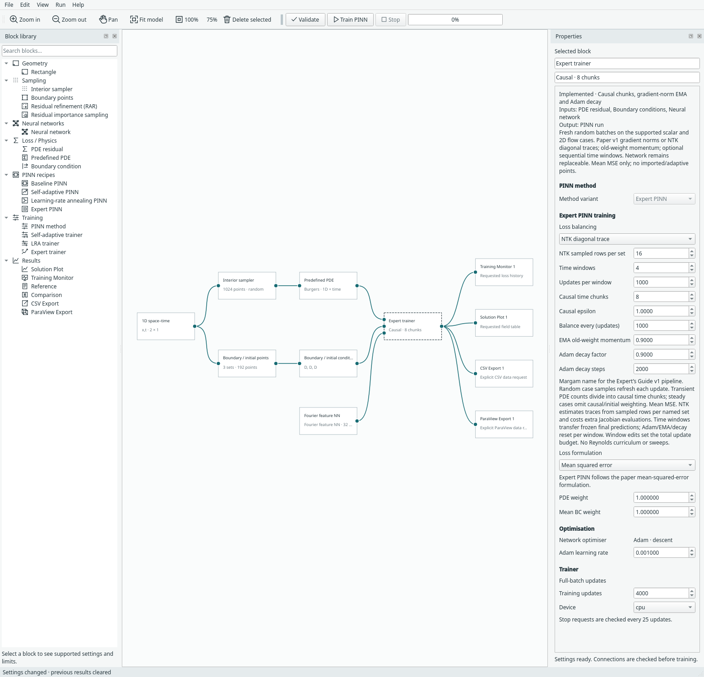

# NTK balancing and time marching

These options belong to the existing **Expert trainer** and **Expert PINN**
recipe. They implement two distinct ideas from
[An Expert’s Guide to Training Physics-informed Neural Networks, v1](https://arxiv.org/abs/2308.08468v1):
NTK weighting (equations 5.4–5.9) and sequential time windows (section 5.3).
The default remains gradient-norm balancing on one time window. No Reynolds
curriculum, grid search or parameter sweep is added.



## Choose loss balancing

Select the trainer, then choose **Loss balancing → NTK diagonal trace**. This
works on the existing Expert scalar/transient and steady flow examples. Choose
**Gradient norm (recommended)** to retain the original implementation; the paper
recommends it as the less expensive first choice.

For each scalar output of a constraint or PDE residual, Margam evaluates the
parameter Jacobian gᵢ=∂fᵢ/∂θ. The corresponding NTK diagonal is gᵢ·gᵢ; summing these
entries gives its trace. PDE, initial and combined boundary traces are Tᵣ, Tᵢ, Tᵦ.
Steady cases omit Tᵢ. The target coefficient for group j is
**λ̂ⱼ=(Σₖ Tₖ)/Tⱼ**, followed by the same old-weight EMA used by gradient balancing.

This differentiates **pointwise residuals/constraint operators**, not squared
losses. A perfectly fitted point can have a nonzero NTK diagonal even though its
loss gradient vanishes. Vector components each contribute a diagonal entry;
periodic/derivative boundary operators are differentiated as configured. The
trace uses unweighted operators, before causal weights and manual loss factors.
Existing manual factors still apply to the training objective.

Margam never constructs the full NTK matrix. **NTK sampled rows per set** caps
the rows used from each named condition/PDE set. A seeded random subset without replacement
selects from that update's fresh random batch; the sampled diagonal sum
is multiplied by full-row-count/sample-row-count. This is an unbiased sampled-row trace estimate when
the cap is smaller than a set, and the full diagonal trace otherwise. It is not
a random-vector/Hutchinson estimator. It is not divided by the number of rows.

The default cap is 16, with an allowed range of 1–256. Balancing runs at **Balance
every (updates)**. Zero/small traces retain the previous coefficient; the existing
numerical floor and coefficient cap prevent undefined ratios. Non-finite
Jacobians stop the update. The saved balance history's `norms` entries mean
**NTK traces** in this mode; the saved configuration identifies which mode was
used. NTK can be substantially more expensive, especially with high-order PDEs.

## Train successive time windows

Choose a transient example under **File → Examples → Expert PINN examples**.
Set **Time windows** above one and set **Updates per window**. Window edits set
**Training updates** to their product. For example, four windows with 1,000 updates
each request 4,000 total updates. There are at most 32 equal physical-time windows
and the configured schedule cannot exceed 100,000 updates.

Each window keeps causal strata and its selected balancing scheme:

1. The first window uses the problem's supplied initial condition.
2. Freeze its final network. At the next window's initial points, evaluate that
   frozen network at the shared physical time to obtain detached targets.
3. Warm-start the next network's trainable parameters. Retain its new local
   coordinate bounds; reset Adam, loss-balancing coefficients/history and decay
   phase for the new window.
4. Repeat until the final window is trained.

For velocity/pressure cylinder flow, only **velocity** is transferred as initial
data; pressure remains determined by the PDE and traction condition. Torus
transfers u/v/vorticity. The cylinder inlet ramp retains its original global-time
origin rather than restarting in every window. Spatial BCs and PDE coefficients
remain the problem's specified ones. Handoff error can accumulate; the interface
initial condition is a soft training constraint, not an exact continuity guarantee.

Gradient balancing and NTK both work with time marching. Single-window steady
training remains available, but multiple windows are rejected for steady cases.
This is sequential time decomposition, independent of Reynolds curriculum or
parameter sweeps.

## Results, stop and resume

The monitor counts total updates; the log and Expert summary show the current
window and its local update. **Training updates** is the job's total update budget,
whereas **Updates per window** fixes the transition schedule. If the job stops
before the final window has started, no full-domain prediction/export is produced.
The checkpoint and loss histories are retained for resume. The log explains that
full-domain outputs are being held. Direct prediction beyond the active window's
physical end is rejected.

After the last window starts, tables/CSV/ParaView requests evaluate each physical
time with its corresponding frozen or active network. An interface timestamp
uses the preceding window's final prediction. Time remains a physical coordinate,
not an epoch number. PVD playback therefore follows the original full time axis.
Resuming after the final window adds updates to that final window; it does not
rewrite earlier windows or alter the partition.

Archives store completed windows, the active network/Adam state, all named loss
histories and the immutable schedule. Loading reconstructs the teacher chain and
validates each window before replacing the live run. Changed schedules,
inconsistent phases/history or changed teacher identity are rejected. CPU continuation is tested bitwise at either side of a window boundary. CUDA
Jacobian/backward execution can introduce float32 round-off after reopening; the
recorded GPU runs compare losses and network tensors with rtol=1e−5, atol=1e−7
and report actual maximum differences. Bitwise identity is recorded separately
and is not promised for every GPU configuration or CPU-to-CUDA continuation. Model format 18 migrates older
settings to gradient balancing and one window; prior Expert checkpoints remain
supported with those defaults.

## Run and inspect evidence

```bash
python -m examples.expert_extensions --device cpu
python -m examples.expert_extensions --device cuda
python -m unittest tests.test_expert_extensions -v
python -m examples.capture_expert_extensions --overwrite
```

[CPU evidence](../assets/benchmarks/expert-extensions-cpu.json) and
[CUDA evidence](../assets/benchmarks/expert-extensions-cuda.json) record short
training, balancing events and checkpoint continuation with explicit CPU/GPU
comparison criteria. These are
software correctness checks, **not published accuracy reproduction**. The
implementation is independent paper-based PyTorch code; no JAX-PI source or
datasets were copied. See [community attribution](community-methods.md).
