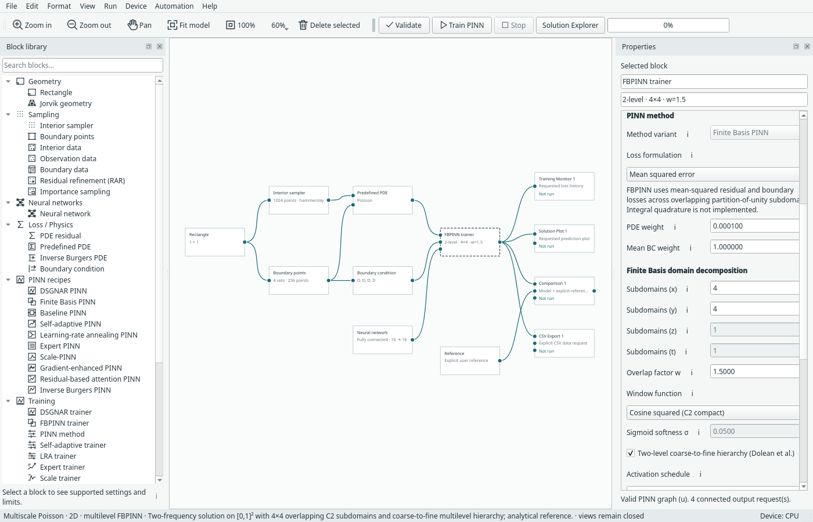

# Finite Basis PINN (FBPINN)

[Documentation index](README.md) · [Recipes](pinn-recipes.md) · [Measured results](results.md) · [Validation](validation.md)

Finite Basis PINN (**FBPINN**) is Margam's first built-in spatial and space–time
domain decomposition method. It partitions a domain into overlapping
hyper-rectangular subdomains, gives each subdomain its own locally normalized
pointwise neural network, and blends them through an exact smooth partition of
unity. An optional **two-level coarse-to-fine hierarchy** adds a global Level-0
network to preserve elliptic coupling across many subdomains, and an optional
**progressive active-subdomain marching** schedule advances an active frontier
along time or space.



## Primary references and independence

- **FBPINN and active-subdomain scheduling**: Ben Moseley, Andrew Markham and
  Tarjei Nissen-Meyer, *"Finite basis physics-informed neural networks (FBPINNs):
  a scalable domain decomposition approach for solving differential equations"*,
  *Advances in Computational Mathematics* **49**, 62 (2023),
  [arXiv:2107.07871](https://arxiv.org/abs/2107.07871).
- **Multilevel coarse-to-fine hierarchy**: Victorita Dolean, Alexander Heinlein,
  Siddhartha Mishra and Ben Moseley, *"Multilevel domain decomposition-based
  architectures for physics-informed neural networks"*, *Computer Methods in
  Applied Mechanics and Engineering* **429**, 117116 (2024),
  [arXiv:2306.05486](https://arxiv.org/abs/2306.05486).

Margam's implementation (`margam/methods/fbpinn.py`,
`margam/components/fbpinn_config.py`, `margam/recipes/fbpinn.py`) is written
independently in PyTorch from the published mathematical formulations. No
upstream JAX code or datasets are bundled.

### Documented differences from the papers

1. **Default window smoothness**: Margam defaults to a compact $C^2$ squared
   raised-cosine window (`cosine_sq`) so second-order PDE derivatives
   ($\nabla^2 u$) remain continuous and exact across every support edge while
   preserving compact support. Moseley et al.'s $C^\infty$ sigmoid product
   (`smooth_sigmoid`, Eq. 11) and compact $C^1$ raised cosine (`cosine`) are
   also selectable.
2. **Explicit boundary conditions**: Rather than baking PDE-specific hard
   analytical ansatz multipliers into the network, FBPINN uses Margam's explicit
   boundary/initial condition blocks and mean MSE loss terms.
3. **Replaceable pointwise base architectures**: Every subdomain instantiates
   the architecture configured on the connected `Neural network` block (FCNN,
   Fourier, SIREN, DGM, etc.) with deterministic per-subdomain seed offsets
   `seed + j`. Homogeneous FCNN subdomains execute through a vectorized batched
   `torch.einsum` forward path with identical mathematics to sequential
   evaluation.
4. **Bounded grid limits**: Up to 32 subdomains per axis and at most 64 fine
   subdomains in total (plus 1 optional coarse network).

## Mathematical formulation

Let $\mathbf{x} = (\mathbf{x}_{\text{st}}, \mathbf{p})$ separate the
$d_{\text{st}}$ spatial/time coordinates from any continuous parameter axes
$\mathbf{p}$ (`parametric_axes`). Only the spatial/time axes are partitioned,
with cell counts $(n_1, \dots, n_{d_{\text{st}}})$, cell widths
$\Delta_k = (U_k - L_k) / n_k$, cell centers
$c_{k,i} = L_k + (i + \tfrac{1}{2})\Delta_k$, and overlap half-widths
$h_k = \tfrac{1}{2} w \Delta_k$ for overlap factor $w \in [1.05, 3.0]$.

- Each subdomain $j$ owns a locally normalized network $\mathcal{N}_{\theta_j}$
  whose input bounds are clipped to the physical intersection
  $[\max(L_k, c_{k,j} - h_k), \min(U_k, c_{k,j} + h_k)]$ on spatial/time axes
  and retain full global bounds on continuous parameter axes $\mathbf{p}$.
- With normalized offset $s_{k,j} = (x_k - c_{k,j}) / h_k$, the unnormalized
  separable window is $\omega_j(\mathbf{x}) = \prod_{k=1}^{d_{\text{st}}} \phi(s_{k,j})$:

| Window | $\phi(s)$ | Smoothness | Support | Supported derivative order |
| --- | --- | --- | --- | --- |
| `cosine_sq` *(default)* | $\frac{1}{4}(1+\cos(\pi s))^2\,\mathbf{1}_{\|s\|<1}$ | $C^2$ everywhere | Compact | Up to 2nd order |
| `smooth_sigmoid` | $\sigma\!\left(\frac{s+1}{2\sigma_w}\right)\sigma\!\left(\frac{1-s}{2\sigma_w}\right)$ | $C^\infty$ everywhere | Global | Arbitrary order (required for 3rd/4th-order PDEs) |
| `cosine` | $\frac{1}{2}(1+\cos(\pi s))\,\mathbf{1}_{\|s\|<1}$ | $C^1$ | Compact | Up to 2nd order (piecewise smooth 2nd derivative) |

- Because $w \ge 1.05 > 1$, every point on the closed domain $\bar{\Omega}$
  (including faces and corners) satisfies
  $\sum_{k=1}^M \omega_k(\mathbf{x}) \ge [\phi(1/w)]^{d_{\text{st}}} > 0$.
- Over the active and fixed subdomain set $\mathcal{S} = \mathcal{A} \cup \mathcal{F}$:

$$u_{\text{fine}}(\mathbf{x}) = \sum_{j \in \mathcal{S}} \frac{\omega_j(\mathbf{x})}{\sum_{k \in \mathcal{S}} \omega_k(\mathbf{x})}\,\mathcal{N}_{\theta_j}(\mathbf{x})$$

- When **Two-level coarse-to-fine hierarchy** (`multilevel=True`) is enabled
  (simultaneous mode with at least 2 fine subdomains):

$$u_\theta(\mathbf{x}) = \frac{1}{2}\Big(\mathcal{N}_{\theta_0}(\mathbf{x}) + u_{\text{fine}}(\mathbf{x})\Big)$$

- When **Progressive active marching** (`schedule='progressive'`) is selected,
  subdomains are sliced along `schedule_axis` into $S = n_{\text{axis}} \ge 2$
  groups with frontier $g_{\text{front}}(k) = \min(S - 1, \lfloor k / \text{active\_steps} \rfloor)$.
  Slices $g > g_{\text{front}}$ are `INACTIVE` (excluded), slice $g = g_{\text{front}}$
  is `ACTIVE` (trainable), and trailing slices $g < g_{\text{front}}$ become
  `FIXED` when `freeze_completed=True`. Frozen subdomains disable parameter
  gradients (`requires_grad=False`) rather than disabling autograd, so spatial
  and temporal derivatives across overlap zones remain exact.

## Supported scope and explicit rejections

- **Supported**: Built-in `Interval`, `Rectangle`, `SpaceTime1D`, `SpaceTime2D`,
  `Box3D`, `SpaceTime3D`, `SphereObstacle3D`, steady 2D incompressible flow
  (`Rectangle`), continuous `parametric_axes`, all built-in pointwise base
  architectures, mean MSE loss with per-constraint `bc_weights`, CPU and CUDA,
  `SolutionExplorerWindow` (1D/2D/3D/transient/parametric), ParaView and CSV
  export, and `margam.research` Python scripts.
- **Explicitly rejected**: `Prepared2D`/Jorvik imported geometries, imported
  training datasets, `Channel2D`/`ChannelTime2D`/paper-case suites, KdV,
  adaptive samplers (`rar`, `importance`), `integral` loss formulation,
  `multilevel=True` combined with `schedule='progressive'` or a single
  subdomain, `schedule='progressive'` without at least 2 slices on the target
  axis (or with any empty collocation slice), and non-$C^\infty$ windows on
  3rd/4th-order PDEs.

## Checkpoints, persistence and diagnostics

- Model format **36** persists `fbpinn_settings` and migrates formats `< 36` to
  defaults without breaking existing method checkpoints.
- `FiniteBasisNetwork` registers `subdomain_state` (`0=inactive`, `1=active`,
  `2=fixed`) in `state_dict()`, so mid-march pauses predict identically through
  `CheckpointPredictor` and resume bit-for-bit on the same device.
- `load_training_state` validates metadata, signatures, buffer consistency,
  finiteness and histories, and rolls back all weights, optimizer tensors,
  counters, histories and `requires_grad` flags atomically on any rejection.
- Right-click **FBPINN trainer** (or click **Subdomain diagnostics…** in
  Properties) after a run to inspect subdomain states, parameter totals and
  per-subdomain PDE residual RMSE.

## Equal-budget multiscale benchmarks (CUDA)

Reproduce with:

```bash
.venv/bin/python -m examples.fbpinn_benchmark --device cuda --seeds 7 11 19 \
    --output assets/benchmarks/fbpinn-multiscale-cuda.json
```

All methods within each case share identical collocation points, boundary sets,
initial seeds (`7, 11, 19`), learning rate, loss weights and Adam update budget
on an NVIDIA GeForce RTX 3060 Laptop GPU (`float32`, Torch `2.14.1+cu130`).
Complete per-seed measurements are retained in
[fbpinn-multiscale-cuda.json](../assets/benchmarks/fbpinn-multiscale-cuda.json).

### 1. Multiscale 1D Poisson (`sin(2πx) + 0.5 sin(16πx)`, 2,000 updates)

| Method | Parameters | Median Rel. $L^2$ | Per-seed Rel. $L^2$ (7 / 11 / 19) | Median RMSE | Median Wall (s) |
| --- | ---: | ---: | --- | ---: | ---: |
| Baseline FCNN (`16×16`) | 321 | 1.8768 | 1.8768 / 1.7982 / 2.0021 | 1.4823 | 10.32 |
| Baseline FCNN (`64×64`, param-matched) | 4,353 | 0.7445 | 0.7445 / 2.3312 / 0.6028 | 0.5880 | 10.98 |
| FBPINN 1-level (12 subdomains) | 3,852 | 0.4621 | 0.4277 / 0.4621 / 0.5843 | 0.3650 | 54.77 |
| **FBPINN 2-level (12 subdomains + coarse)** | **4,173** | **0.1310** | **0.0634 / 0.4735 / 0.1310** | **0.1035** | **62.55** |

Adding the Level-0 coarse network reduces median relative $L^2$ error by **5.7×**
relative to the parameter-matched `64×64` baseline (which has more parameters)
and **3.5×** relative to single-level FBPINN, matching the multilevel coupling
behavior analyzed in Dolean et al. (2024).

### 2. Multiscale 2D Poisson (`sin(2πx)sin(2πy) + 0.5 sin(8πx)sin(8πy)`, 2,000 updates)

| Method | Parameters | Median Rel. $L^2$ | Per-seed Rel. $L^2$ (7 / 11 / 19) | Median RMSE | Median Wall (s) |
| --- | ---: | ---: | --- | ---: | ---: |
| Baseline FCNN (`16×16`) | 337 | 0.8484 | 0.8484 / 1.1493 / 0.8409 | 0.4627 | 18.45 |
| Baseline FCNN (`64×64`, param-matched) | 4,417 | 0.9611 | 0.8327 / 0.9713 / 0.9611 | 0.5242 | 17.66 |
| **FBPINN 2-level (`4×4` + coarse)** | **5,729** | **0.0572** | **0.0572 / 0.1132 / 0.0446** | **0.0312** | **152.85** |

On the 2D multiscale case, both monolithic baselines stall above 83% relative
$L^2$ error on every seed, whereas 2-level `4×4` FBPINN reaches **4.5%–11.3%**
relative $L^2$ error (**16.8×** median reduction over the `64×64` baseline) at
the same update budget, at roughly 8.5× higher wall-clock time per step due to
17 concurrent sub-networks.

### 3. Standing wave 1D + time (`u_tt - 4 u_xx = 0`, 1,600 updates — honest negative case)

| Method | Parameters | Median Rel. $L^2$ | Median RMSE | Median Wall (s) |
| --- | ---: | ---: | ---: | ---: |
| Baseline FCNN (`16×16`) | 337 | 0.7058 | 0.3944 | 15.39 |
| FBPINN simultaneous (`2×4`) | 2,696 | 0.9883 | 0.5523 | 84.85 |
| FBPINN progressive (`2×4`, 400 steps/slice) | 2,696 | 1.0958 | 0.6124 | 65.73 |

Under soft initial-condition penalties without a hard analytical IC ansatz
multiplier, 1,600 plain Adam steps on the homogeneous wave equation do **not**
converge cleanly for either baseline or `2×4` FBPINN (progressive marching runs
faster than simultaneous because inactive slices are skipped, but still suffers
soft-IC damping). This preset is provided as a starting point for progressive
time-axis marching rather than a solved wave benchmark.
