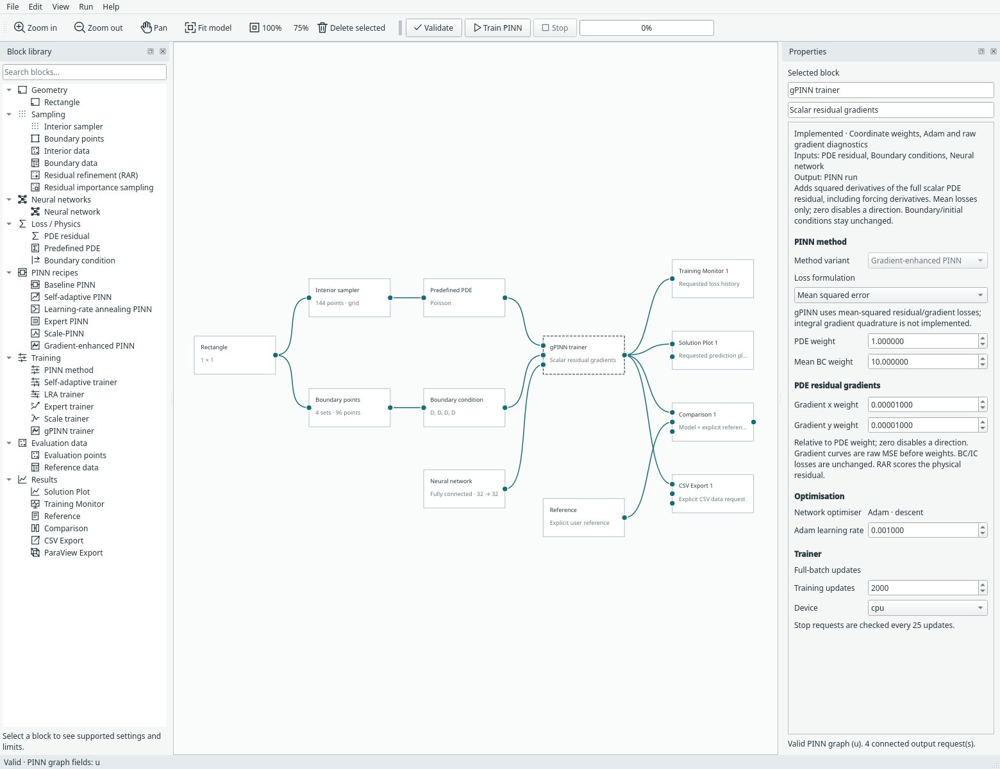
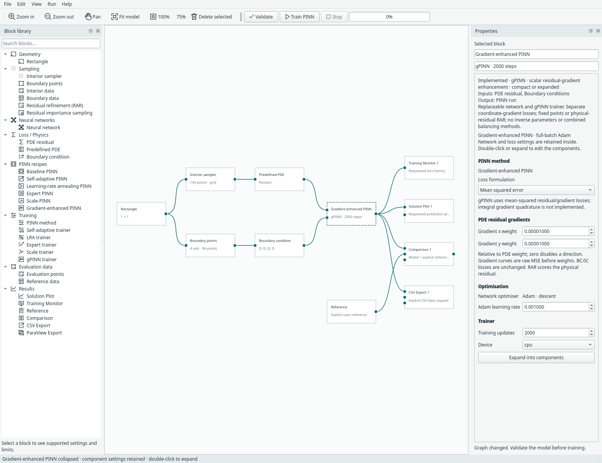
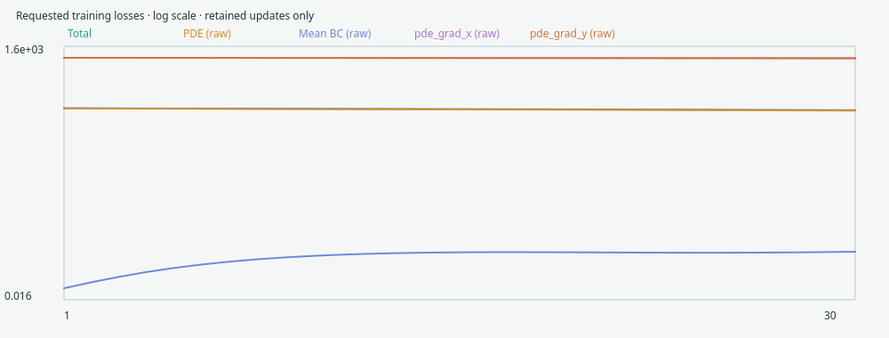

# gPINN: gradient-enhanced PINN

Choose **File → Examples → gPINN examples** for a 2D Poisson sine variation,
Burgers, or Burgers with residual-based adaptive refinement (RAR). The reusable
**Gradient-enhanced PINN** compact recipe is under **PINN recipes**, and its
expanded **gPINN trainer** is under **Training**. Networks remain replaceable.



*Coordinate-gradient controls belong to the gPINN trainer. Views stay closed until
requested. [Open full size](../assets/screenshots/manual-gpinn-trainer.png).*

## What changes mathematically

Yu, Lu, Meng and Karniadakis add derivatives of the PDE residual to the PINN loss:
[paper](https://arxiv.org/abs/2111.02801),
[published article](https://doi.org/10.1016/j.cma.2022.114823),
[authors' code](https://github.com/lu-group/gpinn).

For a scalar equation, let r be the **full physical residual minus its target**.
Margam uses:

```text
L = w_pde [mean(r²) + Σ_i λ_i mean((∂r/∂coordinate_i)²)]
    + Σ_boundary_or_initial w_j L_j
```

This differentiates r, **not r²**, not the network parameter gradient and not the
solution gradient alone. If a Poisson residual is uₓₓ−f(x), the added derivative
is uₓₓₓ−f′(x). The forcing derivative must be included. A callable residual target
is evaluated on differentiable coordinates too; a non-scalar detached array of
PDE targets is rejected because it does not define a coordinate derivative.
Imported boundary targets remain supported through the existing data contract.

Each visible coordinate has its own relative λ weight. Zero disables that
direction; inactive dimensions are ignored. All-zero active weights reproduce
baseline mean-MSE training on the same samples and network. For an x/t problem,
time differentiation is explicit and distinct from spatial differentiation.
A second-order PDE generally needs third network derivatives here, increasing
compute/memory cost. The available smooth pointwise networks remain compatible.

Boundary and initial operators, targets and weights are unchanged. Gradient losses
use the same interior collocation rows as the physical residual. The paper allows
independent derivative sample sets; this first implementation deliberately shares
them. The base network/trainer is not replaced with the authors' architecture.

## Compact or expanded



*Compact and expanded forms use the single recipe definition in
`margam/recipes/gradient_enhanced.py`. Expand to replace the network; its affine or
Fourier settings remain separate from the loss weights.*

The trainer exposes **PDE residual gradients**, coordinate weights, physical/BC
loss weights, Adam learning rate, update budget and device. The gradient weights
are relative to the global PDE weight, not absolute multipliers independent of it.
The default reusable recipe sets λ=0.01 for available coordinates. Values must be
finite and between zero and 10⁶; the current control displays eight decimal places.

## Included examples and deliberate differences

| Example | Gradient weights | Scope |
| --- | --- | --- |
| Poisson sine · 2D | λx=λy=10⁻⁵ | Δu+2π²sin(πx)sin(πy)=0 on [0,1]²; zero Dirichlet edges; explicit sine reference |
| Burgers · 1D + time | λx=λt=10⁻⁴ | ν=0.01/π, −sin(πx) initial field, zero spatial endpoints; no assumed later-time reference |
| Burgers + RAR | Same | Actual RAR block, adding points with the largest physical residual |

The **Poisson sine case is a manufactured variation**, not the authors' localized
polynomial-bump benchmark. The authors' code supplies the displayed gradient-weight
starting values, but Margam uses its own point budgets, networks, soft boundary/IC
constraints and Adam defaults. Upstream Burgers uses a hard output transform and
additional L-BFGS training; those are not reproduced here. No accuracy claim follows
from including the method. Paper datasets are not bundled.

RAR uses the existing sampler's interval, candidate pool, additions and cap. It
scores the **physical residual**, not the gradient penalty. Both loss types are
recomputed on the resulting common collocation set. Active points, history and
weights/configuration are checkpointed for exact same-device continuation.

## Monitor the right quantities



*The monitor records `pde`, `pde_grad_x`, `pde_grad_y` or `pde_grad_t`, unchanged
boundary/initial terms and the weighted `total`. Gradient curves show raw MSE
before λ and global PDE weights. Their magnitude is not directly comparable to
the weighted total or a solution-error norm.*

Only connected monitor blocks retain histories. Solution/comparison/export blocks
keep their existing opt-in behaviour. Burgers ParaView output remains physical-time
PVD; gradient-loss updates are never physical timesteps. Predictions are still the
network fields, not residual-gradient arrays.

## Supported composition and persistence

The first implementation supports scalar intervals, rectangles, prepared 2D data
and 1D space–time equations, with fixed samples or the existing RAR block. It does
not silently combine gPINN with SA attention, LRA/NTK balancing, Scale correction,
Expert causal/time-window training or coupled/vector residuals. Integral gradient
quadrature, importance-weighted gradient terms, inverse unknown parameters and
independent gradient-point datasets remain future work.

Model format **22** adds `gpinn_weights` and reads formats 1–21. Run archives retain
coordinate weights, physical configuration, network/Adam state, raw gradient-loss
history and optional RAR state. Resume rejects changed gradient weights, physics,
network settings or data. Existing Scale/Expert/time-window signatures migrate the
new unused default field without changing their mathematics. Archived output
viewing/export still works without original training files; actual training resume
reconstructs and checks its input data.

## Reproduce the implementation checks

From the repository root with its existing environment:

```bash
python -m examples.gpinn --device cpu --steps 6 --output /tmp/gpinn-cpu.json
python -m examples.gpinn --device cuda --steps 6 --output /tmp/gpinn-cuda.json
python -m unittest tests.test_gpinn tests.test_gpinn_ui -v
python -m examples.capture_gpinn --overwrite
```

The [CPU](../assets/benchmarks/gpinn-cpu.json) and
[CUDA](../assets/benchmarks/gpinn-cuda.json) records run all three cases with small
networks and six updates. They record raw/effective weights, physical and gradient
losses, point counts, RAR events, requested evaluation and identical same-device
checkpoint continuation. They are software checks, not tuned convergence studies.

Tests additionally verify analytic third-derivative/forcing/target identities,
backpropagation through residual derivatives, constant-gradient zeros, bitwise
baseline equivalence when disabled, finite-gradient safeguards, exact RAR resume,
legacy method migration, saved compact/expanded UI graphs and physical-time PVD.
The [reference record](../assets/benchmarks/gpinn-reference.json) stores paper/source
hashes and the inspected upstream revision. The
[capture manifest](../assets/screenshots/manual-gpinn-captures.json) identifies the
real screenshots. The implementation is independent PyTorch code; DeepXDE,
TensorFlow, the upstream code and its datasets are not runtime dependencies.
