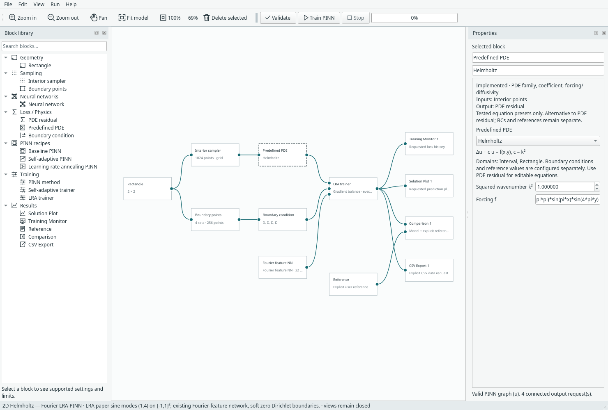
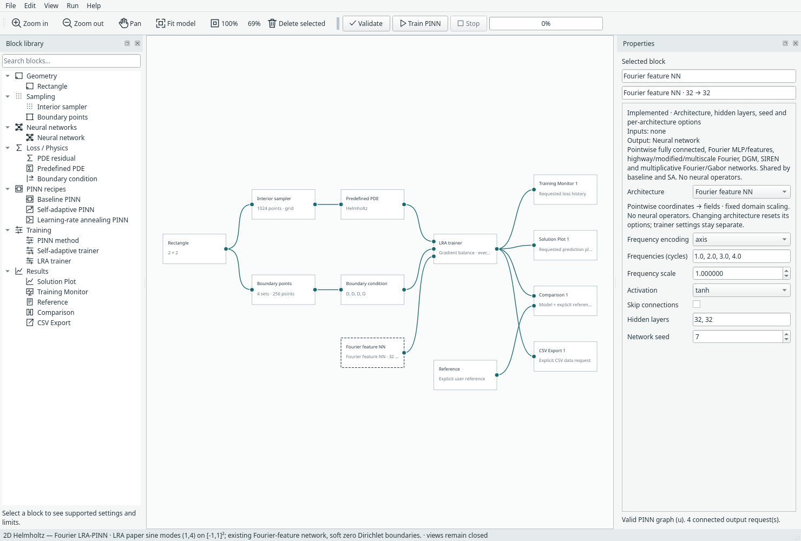

# 2D Helmholtz — Fourier LRA-PINN

[Documentation index](README.md) · [Example catalogue](problem-examples.md) · [Results](results.md#helmholtz-with-fourier-lra-pinn)

Open **File → Examples → 2D Helmholtz — Fourier LRA-PINN**. This adds the
Helmholtz problem from Wang, Teng and Perdikaris, *Understanding and mitigating
gradient pathologies in physics-informed neural networks*, supplied
arXiv:2001.04536v1, section 2.2, equations (8)–(10), page 4. The two-dimensional
square follows the figures and the [authors' Helmholtz example](https://github.com/PredictiveIntelligenceLab/GradientPathologiesPINNs/blob/master/Helmholtz/Helmholtz2D.py), which also confirms k²=1.

## Physics contract

```text
Domain:      -1 <= x <= 1, -1 <= y <= 1
Equation:    laplace(u) + k² u = q(x,y), k² = 1
Reference:   u = sin(pi*x) * sin(4*pi*y)
Forcing:     q = (1 - 17*pi*pi) * sin(pi*x) * sin(4*pi*y)
Boundary:    u = 0 on all four sides (soft Dirichlet constraints)
```

The new **Helmholtz** choice in Predefined PDE exposes **Squared wavenumber k²**
and the existing restricted forcing-expression field. Its residual is
`laplace(u)+c*u-f`, with c=k²≥0. This has the positive mass-term sign, unlike the
existing `-laplace(u)+c*u-f` reaction–diffusion preset. A preset supplies only the
equation: geometry, BCs, samples, network and explicit reference are separate.
The preset supports the existing line/rectangle contracts; this example is 2D.
No new geometry input or 3D support is introduced.



## Existing Fourier network, not the paper architecture

The example selects **Fourier feature NN**, axis encoding, frequencies 1,2,3,4,
scale 1, tanh hidden widths 32×32, no skip connections. Existing coordinate
normalisation maps [-1,1] to [0,1]; features use sin/cos(2π frequency z).
Frequencies 1 and 4 therefore cover the known one-cycle x and four-cycle y
structure across the domain. These are deliberately problem-informed features,
not evidence of automatic frequency discovery or an architecture ranking.
All weights remain trainable through the existing network implementation.



The paper's proposed network, residual gates and multiplicative architecture
were not added. Change the Neural network block normally or collapse the current
network and LRA trainer into the existing recipe; settings survive both forms.

## Default training and outputs

- 1,024 fixed interior grid samples (32×32 cell centres), 64 grid points per edge.
- LRA with alpha 0.9 (new-estimate fraction), balance before updates 1,11,21,…,
  gradient floor 1e-12 and coefficient cap 10,000 before smoothing.
- Static PDE weight 1 and mean BC weight 1: 0.25 per named edge before LRA.
- Network Adam learning rate 0.001, 5,000 full-batch updates, network seed 7, CPU.
- Training Monitor, Solution Plot, Comparison and CSV Export are wired explicitly.
  Comparison has the separate sine-product Reference block; views remain closed.

The cap was selected after a small development check of caps 100 and 10,000; it
is a practical LRA safeguard, not a paper formula or universally optimal setting.
LRA still uses Margam's per-named-edge grouping and raw-gradient denominator;
see [method guide](lra-pinn.md). The base Adam learning rate does not decay.

The existing in-app output grid is 41×41 by default. The recorded numerical study
uses a separate, denser 101×101 grid including boundaries for field errors, PDE
residual RMS and boundary maxima. Do not confuse display resolution with training
or benchmark resolution. Existing plots are preserved; no heatmap feature work.

## Reproduce and verify

```sh
.venv/bin/python -m margam.ui
.venv/bin/python -m examples.run_helmholtz --iterations 5000 --seeds 7 11 19
# Preserve curated records; write a fresh output filename:
.venv/bin/python -m examples.run_helmholtz --output benchmark-results/helmholtz-new.json
.venv/bin/python -m unittest discover -s tests -p 'test_helmholtz.py' -v
.venv/bin/python -m unittest discover -s tests -p 'test_predefined_examples.py' -v
```

Tests verify analytic residual signs, full-domain coordinates, zero boundary
values, coefficient validation and the configured network. Actual desktop checks
cover menu placement, graph configuration, compact conversion, background
training, explicit comparison/reference output, model/run round-trip and resume.
The manufactured-example accuracy regression uses 2,000 updates for Helmholtz,
700 for the smaller examples, requiring RMSE <0.05 on independently drawn points
across each example's full domain.

This is the paper's manufactured **problem**, not a reproduction of its reported
accuracy or timing. We use a different architecture, fixed sample sets, 5,000
full-batch updates, constant Adam rate, per-edge loss grouping and numerical guards.
The paper reports different architectures and 40,000-update stochastic protocols.
No claim of superiority to its proposed architecture follows from this example.

Recorded three-seed 5,000-update relative L2 errors are 1.333%, 1.464% and 0.832%
for network seeds 7,11,19 (mean 1.210%). See [full field, residual and
boundary metrics](results.md#helmholtz-with-fourier-lra-pinn), including the distinction
between training-point and dense-grid residuals.
