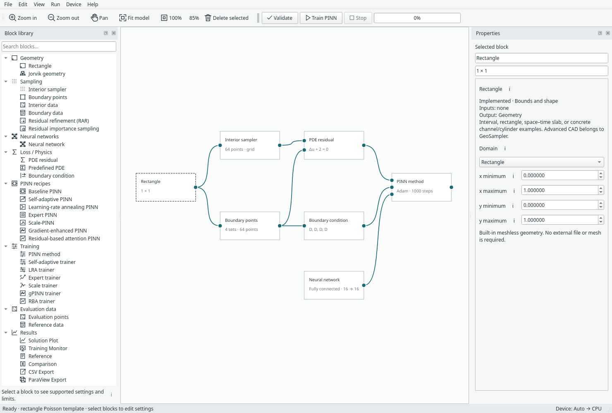

# Build your first PINN with Margam

Connect a domain, samples, physics and a PINN method. Train it, open the results
you need, then save or export your work. You can start with a complete example
and replace its components as you learn the editor.

**New here?** Start with [installation](start/install.md), then follow
[Your first PINN](start/first-pinn.md). No mesh or geometry file is needed.

*The Margam desktop: block library, model canvas and Properties. [Open full size](../assets/screenshots/manual-workspace.png).*

Margam brings community methods into one builder. See [community methods and
attribution](community-methods.md) for the DeepXDE and NVIDIA Modulus references
behind RAR, PINN importance sampling and integral loss.

## What would you like to do?

| Your task | Start here |
| --- | --- |
| Run an example and see where results appear | [Your first PINN](start/first-pinn.md) |
| Find a pane, command or keyboard shortcut | [Workspace tour](start/workspace.md) |
| Add blocks, connect them, or use a compact recipe | [Blocks and connections](modeling/blocks.md) |
| Change the domain, sample it, or bring prepared points | [Geometry, sampling and data](modeling/sampling.md) |
| Choose an equation and assign boundary conditions | [Physics and BCs](modeling/physics.md) |
| Replace a network or choose baseline, SA or LRA | [Networks and methods](modeling/networks.md) |
| Watch training or compare against a supplied reference | [Training and results](use/results.md) |
| Keep the model or continue a saved training run | [Saving and resuming](use/saving.md) |
| Export predictions for another tool | [CSV and ParaView](use/export.md) |
| Understand a missing result or validation message | [Troubleshooting](use/troubleshooting.md) |

## A few useful distinctions

A **complete example** includes a physical problem and its connected components.
A **PINN recipe** contains a network and trainer; geometry, physics and outputs
stay outside. **Training samples** teach the model; **evaluation points** are where
we ask it for predictions. An **output block** requests data; its view opens only
when you choose to open it.

Current workflows cover 1D/2D scalar problems and steady 2D incompressible flow.
Transient solvers, arbitrary mesh-node evaluation and study/sweep blocks are
[planned work](todo.md), not hidden features. Method settings belong to you;
this guide explains controls and data flow rather than promising an accuracy level.

## Need the details?

The [reference catalogue](README.md) links the numerical API, component support,
method equations and file contracts. [Recorded results](results.md) and
[validation](validation.md) are separate from the walkthroughs. Screenshots here
are real current Qt widgets; [capture records](../assets/screenshots/manual-captures.json)
identify their source and settings.
