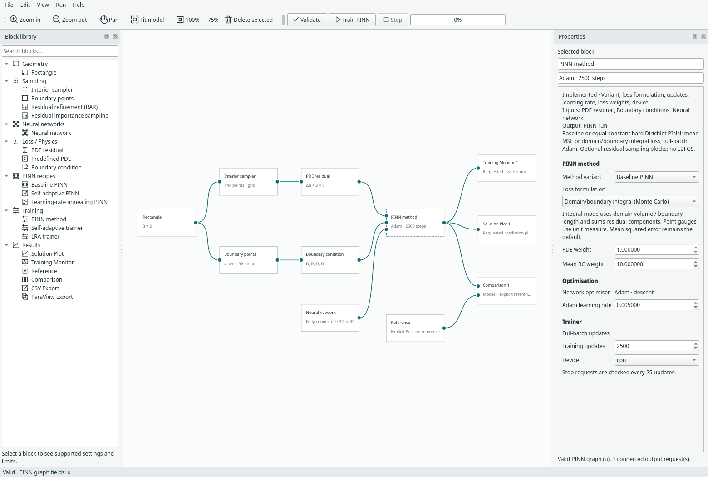

# Domain and boundary integral loss

Select a PINN trainer or compact recipe and choose **Loss formulation →
Domain/boundary integral (Monte Carlo)**. **Mean squared error** remains the
default, including when opening older models. This option changes loss assembly;
it does not change the network architecture or PDE.



## Community provenance

This PINN loss formulation follows **NVIDIA Modulus / Modulus Sym**, subsequently
PhysicsNeMo Sym: treat squared pointwise error as a domain/boundary integral and
approximate it using sampling weights. The implementation is independently
written. See [community methods and attribution](community-methods.md) for sources.

## What is integrated?

The PDE term is the integral of its squared residual over the domain. Each BC
term integrates its squared error over that named boundary set:

```text
L_pde = integral_domain sum_components(residual_component^2) dV
L_bc  = integral_boundary sum_components(boundary_error_component^2) dS
```

For `N` uniformly distributed points in a region of measure `V`, the Monte Carlo
estimate is `V/N * sum_i(sum_components(error_i^2))`. Random samples provide
Monte Carlo estimates; cell-centred grids give equal-cell quadrature instead.
Hammersley/stratified methods retain their documented uniform-domain construction.
No random resampling is required to select this formulation.

This follows the area-weighted squared pointwise loss in NVIDIA Modulus / PhysicsNeMo Sym's
[PointwiseLossNorm](https://github.com/NVIDIA/physicsnemo-sym/blob/main/physicsnemo/sym/loss/loss.py),
which multiplies point errors by integration weights before summing. Margam's
implementation is independent and does not require NVIDIA's package.

It is **not** the square of the integrated residual: opposite-sign residuals must
not cancel before squaring. NVIDIA's separate `IntegralLossNorm` applies to a
target on an integrated quantity, for example a total flux. Such integral
constraints are not added by this change. The PDE remains strong-form; this is
not a weak-form/variational PINN.

## Measures and vector fields

| Set | Measure used |
| --- | --- |
| 1D interior | Physical interval length |
| 2D interior | Physical rectangle area |
| Rectangle left/right boundaries | Rectangle height |
| Rectangle bottom/top boundaries | Rectangle width |
| 1D endpoint BC | Unit counting measure per endpoint |
| Pressure gauge | Unit measure: it remains a point penalty |

On a `3 × 2` rectangle, PDE terms scale by 6, vertical-edge terms by 2 and
horizontal-edge terms by 3 compared with scalar mean MSE at the same network.
Point counts do not introduce an extra multiplicative factor.

For coupled PDEs the integral formulation sums squared residual components,
matching separate per-field integrals. Mean mode keeps the existing average over
components. Therefore changing a vector problem to integral mode changes both
geometric measure and component normalisation, even on a unit square.

Global **PDE weight**, averaged-across-sets **BC weight**, pressure-gauge weight
and LRA coefficients still apply after term construction. For example the scalar
BC multiplier remains `boundary_weight / number_of_sides`; selecting integral
mode does not silently remove that existing convention. Larger domains or longer
boundaries can change the loss balance. No automatic physical nondimensionalisation
or weight tuning is performed.

## PINN methods and sampling

Baseline, hard-Dirichlet, SA-PINN and LRA trainers support this formulation.
SA-PINN applies its squared masks inside the measured loss; monitor term curves
show the corresponding unmasked integral estimates. LRA uses gradients of these
measured terms for its coefficient updates. Hard-BC errors remain zero by construction.

For **Residual importance sampling**, with uniform candidate pool size `M`, draw
probability `p_i`, and `B` draws:

```text
L_pde_estimate = V/B * sum_draws(sum_components(error_i^2)/(M*p_i))
```

The probability correction and volume each appear once. BC sampling stays fixed.
The estimate targets the current uniform finite candidate pool; it is not an
exact continuous-domain integral. See [importance sampling](adaptive-sampling.md).

**RAR is rejected with integral mode.** Greedily inserted anchors lack quadrature
weights for the uniform domain measure. Multiplying their unweighted mean by
volume would not make it an unbiased Monte Carlo estimator. Use mean loss for
RAR or choose importance sampling for a corrected integral estimate.

Imported interior/boundary sets are also rejected in integral mode: their region
measures and per-point quadrature cannot be inferred reliably from a bounding box.
Explicit imported quadrature support belongs to the future GeoSampler data contract.

## Save, resume and verification

Model format 14 stores the choice inside trainer/recipe parameters. Earlier model
versions default to mean loss. Integral checkpoints record the mode and named
measures; resume rejects a different formulation or measure. Mean checkpoints keep
the existing format/behaviour. Compact expansion/collapse, undo and archives retain
the selection. Geometry and initial-data checks continue to apply.

Reproduce the small CPU workflow check from the repository root:

```bash
python -m examples.integral_loss
python -m unittest discover -s tests -p 'test_integral_loss*.py' -v
python -m examples.capture_integral_loss --overwrite
```

The [recorded CPU evidence](../assets/benchmarks/integral-loss-cpu.json) verifies
initial scalar measure scaling on a non-unit rectangle and exact checkpoint
continuation with fixed and importance sampling. Tests also cover vector sums,
parameter gradients, boundary lengths, endpoint/gauge measures, residual
cancellation, all supported trainers and UI persistence. These are software
correctness checks, not claims of improved solution accuracy.
