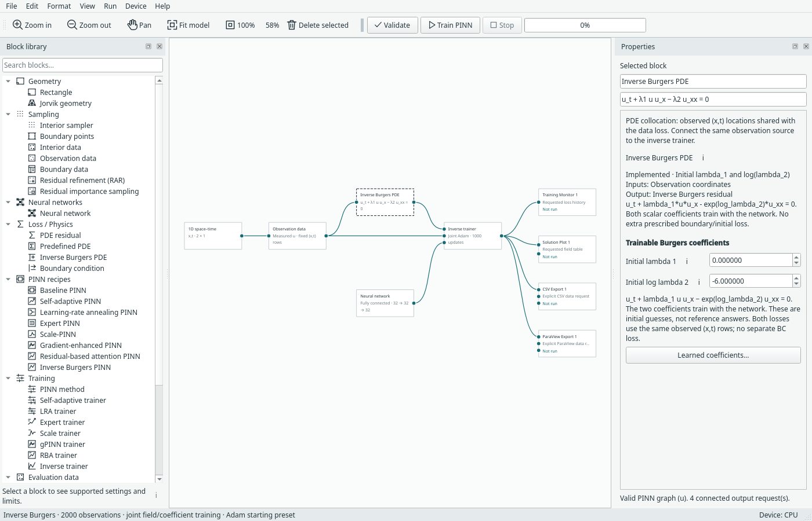
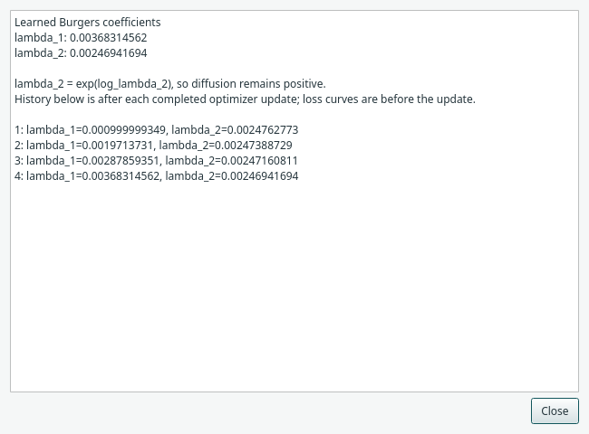
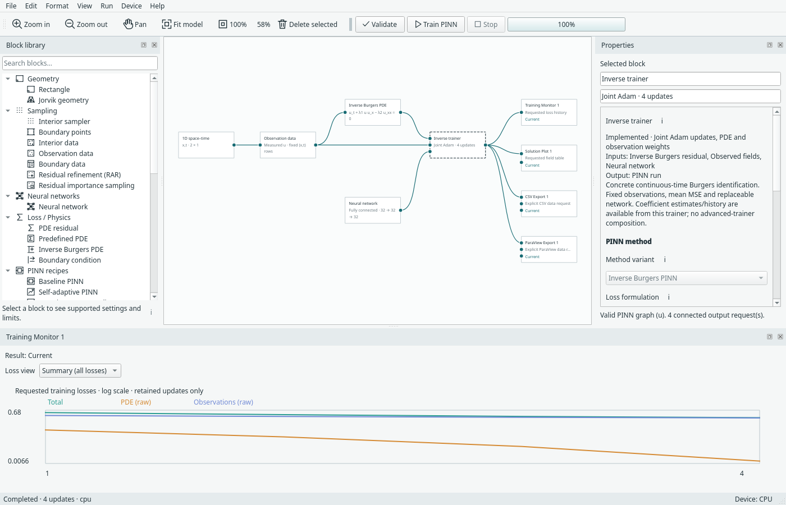

# Inverse Burgers: learn the equation coefficients

Open **File → Examples → 1D examples → Inverse Burgers · 1D + time**.
This is Margam's first inverse problem: infer two constant physical coefficients
alongside the solution field, rather than prescribing their values.

The formulation follows Raissi, Perdikaris and Karniadakis,
[Part II, continuous-time Burgers identification, §2.1](https://arxiv.org/html/1711.10566#S2.SS1):

\[
f=u_t+\lambda_1u u_x-\lambda_2u_{xx},\qquad
\mathcal L= w_f\operatorname{mean}(f^2)+w_u\operatorname{mean}((u-u_{obs})^2).
\]

Both losses use the **same observation coordinates**. There is no extra imposed
boundary or initial-condition loss in this example. The published reference
coefficients are \(\lambda_1=1\), \(\lambda_2=0.01/\pi\); these are provenance
information, not values supplied to the training objective.



## Follow the graph

| Component | Owns or supplies |
| --- | --- |
| 1D space–time geometry | Bounds and coordinate order `(x,t)` |
| Observation data | Explicit measured `u` values and coordinates |
| Inverse Burgers PDE | Residual and the two initial coefficient guesses |
| Neural network | Replaceable pointwise architecture, widths and initialization |
| Inverse trainer | Joint Adam updates and PDE/observation loss coefficients |
| Optional outputs | Loss recording, prediction tables, CSV and physical-time ParaView export |

Observation data fans out to the PDE and trainer. The graph checks that both
arrows use the same observation instance and that it has the declared geometry.
The residual has its own typed port, so a forward PDE cannot silently substitute
for it. Remove unused core blocks before running this concrete inverse graph.
The existing forward Burgers example remains separate.

**Inverse Burgers PINN** under PINN recipes is the compact network/trainer form.
Expand or collapse it using the existing recipe actions. Observation data and the
PDE remain external. You can replace the network independently using the existing
supported architectures; no upstream neural-network architecture was copied.

## Supply observations

The example starts with 2,000 deterministic observations selected from the authors'
published Burgers reference field. It copies its CSV into the project's owned
files and records an accepted-import fingerprint, so moved models, recovery and
run archives do not depend on the original repository fixture.

To use your data, select **Observation data → Map / preview observations…**:

- CSV: map coordinate columns `x,t` and measured field column `u`.
- NPZ: map a `(N,2)` coordinate array and a scalar `(N,)` or `(N,1)` values array.
- Leave normals unused. Finite values, row agreement, count/file limits and bounds
  are validated before training. Coordinates and measured values retain row order.
- Choose **Copy into project** or **Link existing file**, as for other imported
  training sources. Clearing observations leaves an incomplete, saveable model.

These are training measurements, **not Reference data** and not evaluation points.
A reference is optional for checking predictions; it does not enter this method's
loss. Inputs are fixed rows: there is no automatic resampling, interpolation,
noise augmentation or minibatch schedule. Training point IDs are not part of this
first adapter. You can provide noisy measured values directly.

The original file, pinned revision, selection rule, hashes and MIT notice are
recorded in [the fixture manifest](../assets/training/inverse_burgers/source.json)
and [retained licence](../assets/training/inverse_burgers/UPSTREAM-LICENSE.txt).
The original MAT file and paper PDF are not bundled. Runtime CSV/NPZ use needs no
SciPy installation.

## Set guesses and run

Select **Inverse Burgers PDE** to set **Initial lambda 1** and **Initial log lambda 2**.
The diffusion coefficient is parameterized as
\(\lambda_2=\exp(\mathrm{log\_lambda\_2})\), keeping it positive. Both scalar
parameters and the solution network belong to the same Adam optimizer. Initial
guesses remain configuration data; learned values never overwrite them.

The starting preset uses lambda 1 = 0, log lambda 2 = −6, a 32/32/32 fully connected
network, Adam learning rate 0.001 and 1,000 updates. These are editable starting
settings. It uses Margam's current Adam workflow rather than the paper's L-BFGS
training protocol and is **not an accuracy reproduction**.

Validate, review the run summary, then choose **Train new run**. The summary names
the unknown coefficients and observation/PDE row count; unrelated fixed-forward
viscosity/source settings are not presented as this equation's coefficients.
The application Device menu controls training, inference and continuation.

## Read the learned coefficients

Right-click **Inverse trainer**, its compact recipe, or **Inverse Burgers PDE** and
choose **Learned coefficients…**. The inspector provides the same action. The
window shows the latest values and the last 200 per-update records; checkpoints
retain the complete history. Coefficient records are **after** each successful
optimizer update. Loss records retain the shared engine's **before-update** meaning.



Training Monitor shows **PDE (raw)** and **Observations (raw)**, without inventing a
BC/initial loss. Its named-constraint selection also exposes the actual weighted
observation contribution.



Save the **model** to retain the graph, inputs and guesses. Save a **run archive**
to retain learned parameters, Adam state and coefficient history. Resume verifies
the observations, objective, initialization/settings and network. Changed data or
weights cannot silently continue an older checkpoint. Inference reconstructs both
the solution network and its learned coefficient parameters without optimizer
updates. Existing CSV/ParaView blocks export predicted `u`; transient ParaView
output uses physical-time PVD frames, not optimizer-update frames.

## Recorded implementation evidence

The short default-preset fixture deliberately uses only **four updates**:

| Device | Learned lambda 1 | Learned lambda 2 | Same-device 2 + 2 versus 4 updates |
| --- | --- | --- | --- |
| CPU | 0.0036831456 | 0.00246941694 | Exact weights, losses and coefficient history |
| CUDA | 0.0036831454 | 0.00246941694 | Exact weights, losses and coefficient history |

These values demonstrate updates and persistence, **not recovered-coefficient
accuracy**. Raw configurations, losses and estimates are in the
[CPU evidence](../assets/benchmarks/inverse-burgers-cpu.json) and
[CUDA evidence](../assets/benchmarks/inverse-burgers-cuda.json).
Numerical tests independently check the residual and coefficient gradients,
positive diffusion, exact continuation and rejection/rollback of invalid states.
Desktop tests cover owned data, compact/expanded graphs, model/run reopening,
inference, resume and physical-time export.

Reproduce the short checks from the repository root:

```bash
.venv/bin/python -m examples.inverse_burgers --device cpu
.venv/bin/python -m examples.inverse_burgers --device cuda
```

## Current scope

This is two constant coefficients in continuous-time scalar Burgers identification
on 1D space–time. General unknown expressions, inverse Navier–Stokes/latent pressure,
spatially varying coefficients, discrete-time Runge–Kutta discovery and composition
with SA/LRA/Expert/Scale/gPINN/RBA or adaptive sampling are separate future work.
Observation coverage and coefficient identifiability need a problem-specific
study before claiming parameter accuracy.
