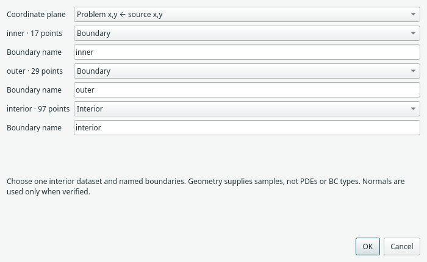
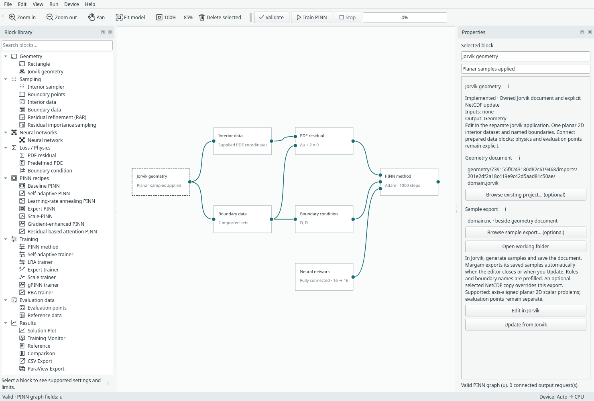
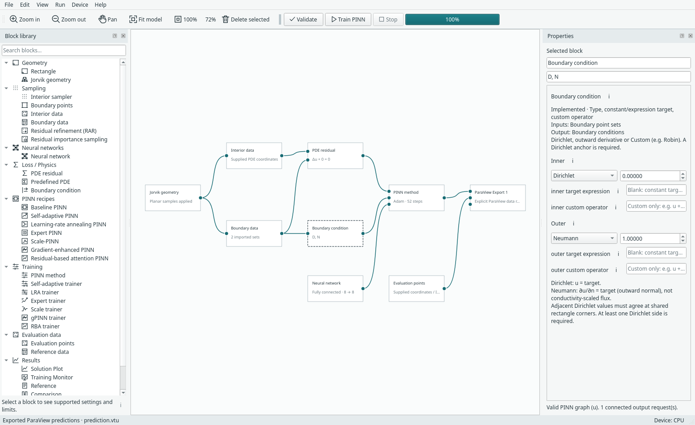
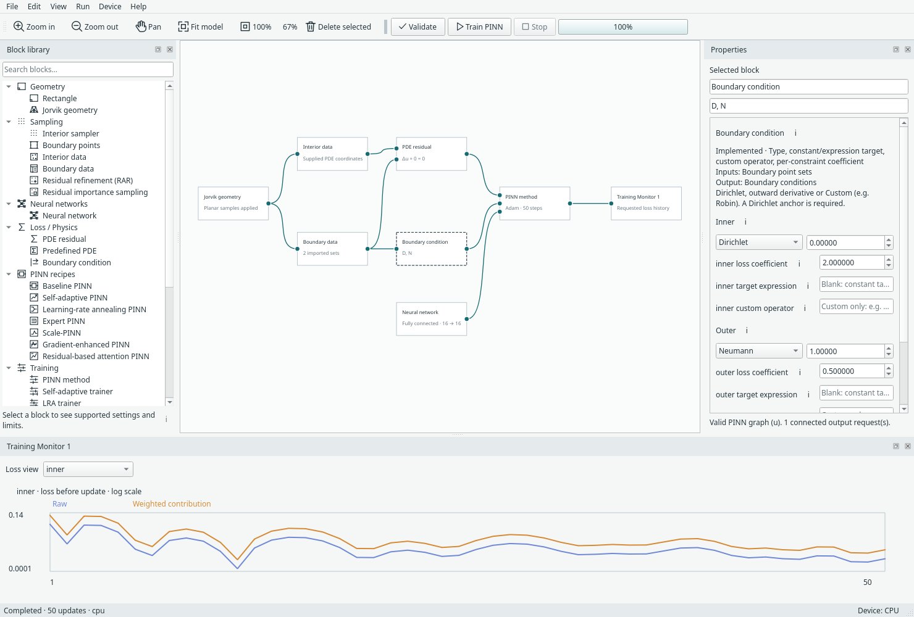

# Geometry documents with Jorvik

Add **Geometry → Jorvik geometry** when you want to prepare CAD-derived samples
in a separate editor. Simple rectangles still work directly in Margam.
Jorvik owns geometry, boundary regions and sampling; Margam owns PDEs, boundary
operators, networks and training. No 3D viewport is embedded in Margam.

## Install the editor

Install Jorvik into the existing root environment. For sibling local checkouts:

```sh
uv pip install --python .venv/bin/python ../Jorvik
```

Use a Jorvik version providing `create_empty_project` and command-line opening of
`.jorvik` files. Both applications currently require PySide6 6.12.0. The optional
Margam `geometry` extra declares the NetCDF reader dependencies, xarray and SciPy;
installing Jorvik supplies those too. Margam's ordinary built-in domains do not
require Jorvik. Importing a model never launches the external editor automatically.

## Edit, save and apply

1. Add **Jorvik geometry** from the block library. It creates an empty `.jorvik`
   document in the current project's working folder.
2. Right-click the block → **Edit in Jorvik**, or double-click it. Import your
   geometry, define named boundary regions and generate samples there.
3. Save the Jorvik document after generating samples. Margam reads its saved
   generated datasets and exports **domain.nc** automatically when the editor
   closes. No manual export step is needed. It also regenerates the export when
   you choose Update, so a stale adjacent NetCDF file is not reused.
4. Close Jorvik. Back in Margam, right-click → **Update from Jorvik**.
5. Review the dataset table. Roles are preselected from Jorvik sampling metadata;
   boundary names are prefilled from the exported labels and remain editable.
   Each boundary dataset has its own row. Confirm the coordinate plane, one
   **Interior** dataset and one or more **Boundary** datasets. **Ignore** is an
   explicit opt-out, not the default. Boundary names start with a letter, followed
   by letters, digits, `_` or `-`.
6. Confirm the update. Margam creates or updates **Interior data** and **Boundary
   data** blocks connected to this geometry. Connect their outputs to the PDE and
   Boundary condition blocks, respectively. Also connect Boundary data to the PDE
   block's optional boundary input if you want the PDE enforced there. Without
   that arrow, it is not. Remove the original rectangle/samplers
   if replacing an existing template; each executable graph has one geometry.
7. Assign the PDE and boundary types/targets in Margam. For result outputs, supply
   an explicit **Evaluation points** block; Margam does not fill the geometry's
   bounding box with evaluation points.



*Real Jorvik annulus export: 97 interior points, 17 inner-boundary points and 29
outer-boundary points. Metadata selects the default roles; editable names preserve
the exported labels. No PDE or BC type is inferred from a name.*



*The geometry block opens its document in the external editor. This capture applies
a saved annulus document and automatically exports its generated samples.*

## Optional existing files

Both browse buttons are optional. A new block still starts with an empty document
and defaults to `domain.nc` beside it.

- **Browse existing project… (optional)** accepts `.jorvik` or legacy `.gsproj`.
  Margam validates and copies it into this project's owned files. Editing this copy
  does not overwrite the original. Choosing a different document requires an
  explicit sample update before training and resets any custom export selection.
- **Browse sample export… (optional)** accepts an existing Jorvik `.nc` file with
  any filename. Margam validates and copies it into its owned files. **Update from
  Jorvik** then uses this selected copy, with the usual dataset-role mapping.
  Selecting the file alone does not apply its datasets. To pick up later external
  changes, browse the export again.
- **Use export beside geometry document** clears the optional export override and
  restores the adjacent `domain.nc` default.

Both selections are undoable, survive Save/Save As and recovery, and move with the
project companion folder. Cancelling a picker leaves the block unchanged. The
named BC sets remain separate for physics assignment and individual loss coefficients
in the Boundary condition inspector.

## Generated samples and separate boundaries

Margam exports samples that already exist in the saved Jorvik document; it does
not generate new samples or choose sampling budgets. If the saved document has no
generated datasets, Update explains that samples must be generated and saved first.
Ungenerated sampling requests are not exported. Export errors leave the last applied
snapshot unchanged. There is no silent fallback to an older adjacent NetCDF file.

For four independent rectangle BCs, create and sample four named boundary regions
in Jorvik. A single dataset containing all edges remains one set; Margam does not
split it or invent names from the entity tags. Multiple interior datasets still
require choosing one for this executor. Unknown metadata asks for a role rather
than defaulting to Ignore. Previous boundary aliases remain selected by stable ID.

An optional **Browse sample export** selection bypasses automatic project export:
that selected copy is the chosen data source. Use **Use export beside geometry
document** to return to automatically exporting the saved project samples.

## Updates and boundary identity

Each applied update copies the NetCDF file to an immutable, uniquely named snapshot.
Later exports do not change an existing run's training inputs. Applying a new
snapshot clears trained results and is undoable. A missing or modified snapshot
fails validation rather than silently changing inputs.

Jorvik region IDs preserve boundary assignments when a region's display label
changes. Where a dataset has no region ID, its label is the fallback identity;
renaming that label is therefore a new identity. The selection dialog remembers
previous assignments. Reusing an existing boundary name for a different region is
rejected. Removed or renamed assignments are listed for confirmation, and their
old physics settings are cleared. Overlapping regions are not merged or deduplicated.

## Saving and recovery

An unsaved Margam model uses a private temporary folder. First Save copies its
owned documents and snapshots to `<name>_files` beside `<name>.margam.json`.
Save As copies that folder and preserves the original project. File pickers start
in Documents (or Documents/Margam if it exists) and remember the last project
folder when desktop preferences are enabled. Keep the model and
its companion folder together when moving or sharing them; their links are relative.
Saving to a different model whose companion folder already exists is refused to
avoid merging unrelated project files.

While Jorvik is open, editing, saving, project replacement and closing Margam are
blocked. Close Jorvik first, so it cannot continue writing to a folder being moved
or deleted. Closing it marks the Margam document modified and exports its saved generated
samples. Applying those datasets still requires Update and confirmation. Desktop recovery includes owned files from its last recovery
snapshot; recovery is paused during external editing and queued when the editor
closes. Discard removes temporary working files, not saved project folders.

## Current scope

The first integration supports **steady planar 2D scalar problems**, one interior
point set and named edge boundaries. Choose XY, XZ or YZ explicitly; all selected
points must lie on the same axis-aligned plane. Both chosen coordinates must have
nonzero extent. Verified planar outward conormals are preserved; missing normals
are allowed for Dirichlet constraints but must be supplied for normal-dependent
operators. No direction is inferred from the coordinate bounding box.

NetCDF datasets can have independent row counts. The reader supports Jorvik's
sample schema version 2 and NetCDF3 export, with a 64 MiB file limit, at most
100000 interior rows and 100000 boundary rows in total. Units remain those of the
source geometry; no unit conversion is performed. Prepared-domain method limits
still apply: no automatic RAR/importance candidate generation, integral quadrature,
or Expert/Scale fresh sampling on unknown domains. Copy/paste now makes independent owned geometry
and sample copies; see the workflow below. Existing linked CSV/NPZ inputs are unchanged; new imports can optionally be
copied into the project using File handling in their mapping dialogs.

This integration does not import arbitrary 3D volumes, rotated planes, mesh cells,
PDE definitions, BC targets or evaluation datasets automatically.

## Reproduce the interchange check

```sh
CUDA_VISIBLE_DEVICES='' .venv/bin/python -m examples.jorvik_exchange --output assets/benchmarks/jorvik-exchange.json
QT_QPA_PLATFORM=offscreen .venv/bin/python -m examples.capture_jorvik --overwrite
```

The [recorded CPU check](../assets/benchmarks/jorvik-exchange.json) generates an
annulus through Jorvik/Gmsh, checks inner/outer normal orientation, trains four
baseline updates from the NetCDF data and compares uninterrupted training with
2+2 checkpoint continuation. It is an interchange/lifecycle check, not evidence of
solution accuracy. Additional automated UI checks cover document creation, editor
launch arguments, locking, update/undo, failed update preservation, first Save,
Save As, relocation and changed-snapshot rejection.


## Walk through a complete project

This example checks the complete desktop workflow with a curved annulus rather
than a rectangle. It uses 97 interior, 17 inner-edge and 29 outer-edge samples.
The equation is Laplace, with **inner Dirichlet u = 0** and **outer Neumann
∂u/∂n = 1**. The known field `u = log(2r)` checks the imported operators and normal
directions; the short training run is not an accuracy benchmark.



1. Create/sample the annulus in Jorvik, save and apply its datasets as described
   above. Keep the `inner` and `outer` names.
2. Connect **Interior data → PDE residual**, **Boundary data → PDE residual**
   (optional boundary input), and **Boundary data → Boundary condition**.
   This graph uses all **143 PDE rows** while retaining independent BC losses.
3. Set source to zero. In Boundary condition, set inner Dirichlet value 0 and
   outer Neumann value 1. Neumann means outward derivative, not a conductivity-scaled
   flux. Set the trainer's overall boundary weight to 3 if following this check.
   Each boundary also has its own **loss coefficient**, default 1. For example,
   inner 2 and outer 0.5 give effective fixed weights 3 and 0.75 with overall BC
   weight 3 and two constraints; other terms are not renormalized.
4. Add **Evaluation points** and map an explicit CSV with columns `id,x,y`.
   For example, use `probe-C,0.75,0`, `probe-A,0,0.6`, `probe-B,-0.8,0`.
   Connect Evaluation points and PINN method to **ParaView Export**. Evaluation
   points are independent of training samples; no bounding-box grid is generated.
5. Save the model, close and reopen it. Choose **Device → CPU** or **GPU**,
   train, then press **Stop**. Stopping is checked between batches of up to 25
   updates, so the final step can be later than the first displayed progress event.
6. Choose **File → Save run and checkpoint**, reopen that archive and use
   **Run → Resume checkpoint**. **Evaluate outputs** reuses the trained weights
   without optimizer updates.
7. Right-click ParaView Export → **Export ParaView…**, selecting `.vtu`.
   In ParaView, open the file and press Apply. Use a point representation and
   colour by `u`. This is a vertex cloud, not a surface mesh: no cells connecting
   the samples or interpolation are invented.

### Run the automated version

```sh
.venv/bin/python -m examples.jorvik_workflow --device cpu
.venv/bin/python -m examples.jorvik_workflow --device cuda
```

Each invocation creates a fresh `run-*` folder under `build/jorvik-workflow` and
prints its location. It leaves the source Jorvik document, NetCDF export, saved
models with companion folders, a run archive, `evaluation.csv`, `prediction.vtu`
and a machine-readable `report.json` for inspection. Open `resumed.margam.json`
from that folder to inspect the final saved graph. The CSV is an external input:
keep it at its recorded location or browse/map it again when moving the example.
The automated test relocates owned geometry, not arbitrary external inputs.

The check closes/reopens the desktop project, verifies the physical BC operators,
stops a running job, saves an archive, hides the original project companion folder,
and resumes from the archived owned files. Continuation matches uninterrupted
training exactly on the same device, including loss history and network weights.
It also verifies inference leaves
network weights unchanged and exported VTU coordinates, predictions and IDs match
exactly. The [CPU record](../assets/benchmarks/jorvik-workflow-cpu.json) and
[CUDA record](../assets/benchmarks/jorvik-workflow-cuda.json) both passed.
The number of updates before Stop is scheduling-dependent. Neither ParaView nor
its optional VTK Python reader was installed during these recorded checks; XML
structure and exact array contents were checked, not visual rendering in ParaView.

### What a run archive carries

New **version 4** run archives include project-owned files, including the Jorvik
document and applied immutable NetCDF snapshots. Opening one restores these into
a private temporary workspace; Save model transfers them to a new companion
folder. This makes continued training independent of the original companion
folder. The archive still validates training-data fingerprints on resume.
Linked CSV/NPZ files remain external; explicitly copied datasets are included
in new run archives alongside geometry. Recorded predictions remain viewable and
exportable without those external inputs; fresh evaluation or resume needs the
relevant source files. Versions 1–3 remain readable, but cannot recover owned
files that were never embedded. Archives have a 256 MiB limit and at most 4096
owned files. Unsafe relative paths, symlinks and conflicting file paths are rejected.


## Weight named boundaries and inspect their contributions

Select **Boundary condition**. Each boundary has a **loss coefficient**, alongside
its operator and target settings. Use **i** for the meaning and limits. Coefficients
are positive (1e-6 to 1e6), default to 1, and multiply rather than redistribute the
existing global BC weighting. They do not change sampling counts or raw errors.



*Actual annulus training: inner coefficient 2, outer coefficient 0.5 and overall
BC weight 3. The monitor's Loss view selects inner and compares its raw loss with
its weighted contribution. This short run demonstrates controls, not accuracy.*

Open a connected **Training Monitor** and choose a named constraint in **Loss view**.
**Summary (all losses)** restores the existing overview. The selected view plots
raw loss and its contribution to the actual training objective, including adaptive
mask/EMA weights where applicable. Both are measured before the optimizer update.
Old archives have raw curves but cannot reconstruct missing historical weighted
contributions; those gaps are labelled rather than guessed.

Coefficients belong to the BC block and survive undo/redo, save/load and run
archives. A coefficient change invalidates cached training state. Updating Jorvik
clears coefficients for removed/renamed BC aliases along with their old operator
settings; undo restores them. The original imported points are unchanged.

## Copy geometry into another model

Select the **Jorvik geometry** block together with its **Interior data** and
**Boundary data** blocks, then use **Edit → Copy blocks** and **Paste blocks**.
Select any other components you want to carry along. Internal wires between the
selected blocks are copied; unselected neighbors are not added automatically.

Each paste has new block IDs and independent copies of the saved Jorvik document,
selected NetCDF export and referenced sample snapshots. The clipboard holds the
bytes from Copy, so you can paste into another Margam window even after closing
the original project. Repeated pastes remain independent. A never-edited empty
geometry block instead gets its own document location when edited.

Pasting does not launch Jorvik, regenerate samples, apply new physics or copy
training results. Applied dataset roles, boundary names and sample fingerprints
are retained. The automatic export beside the document stays automatic; an
explicit export override stays explicit. External linked data remain external
links. Labels and mathematical expressions are literal text, not file references.

Undo removes the pasted graph and Redo restores the same copies. Cut also leaves
files available for Undo. These retained files are saved with the project and are
not deleted automatically when blocks disappear.

The clipboard supports at most **16 MiB of owned file bytes and 128 files**, plus
the existing 4 MiB model fragment limit. Larger copies are rejected; use **Save
model as…** for a complete larger project. Missing files, symbolic links and
malformed payloads are rejected before changing the graph. Finish a numerical job
or close the geometry editor before copying owned files.

Owned-file clipboard operations require descriptor-based no-follow filesystem
support. On platforms without it, ordinary block copying remains available but
owned-file copying/pasting reports that it is unavailable.
