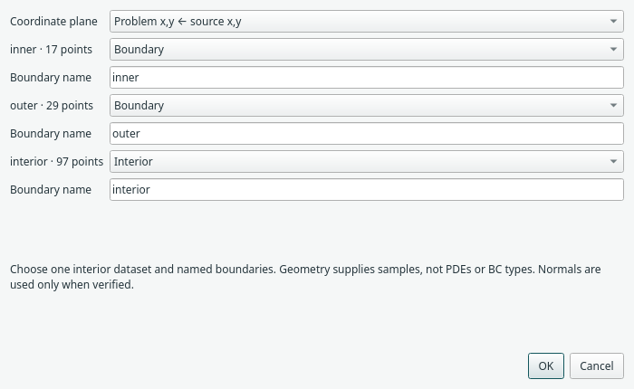
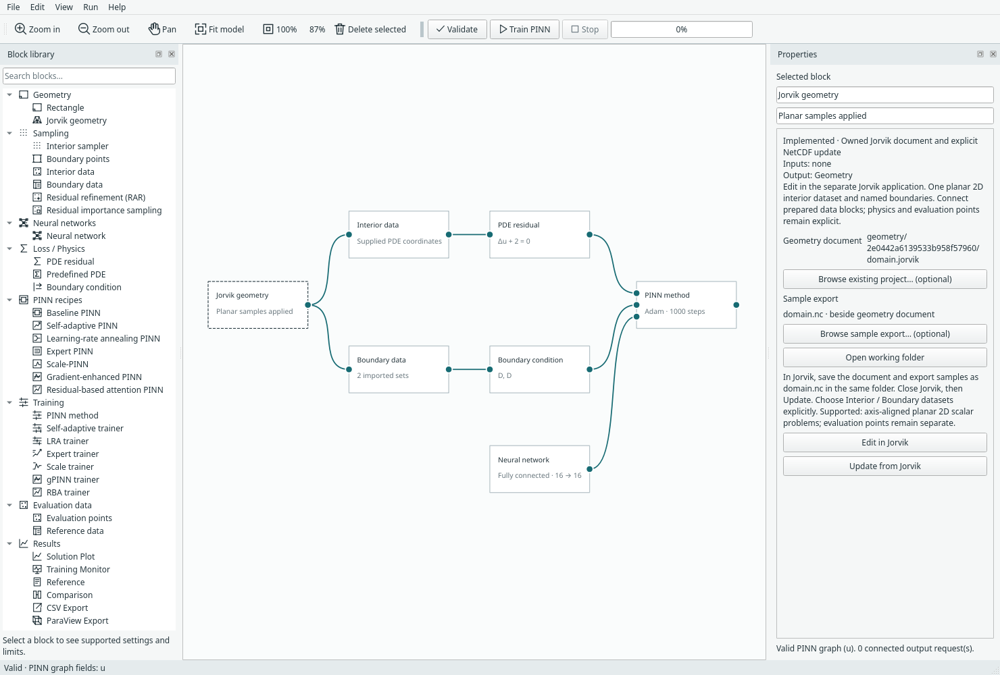

# Geometry documents with Jorvik

Add **Geometry → Jorvik geometry** when you want to prepare CAD-derived samples
in a separate editor. Simple rectangles still work directly in Margam.
Jorvik owns geometry, boundary regions and sampling; Margam owns PDEs, boundary
operators, networks and training. No 3D viewport is embedded in Margam.

## Install the editor

Install Jorvik into the existing root environment. For sibling local checkouts:

```sh
uv pip install --python .venv/bin/python ../Jorvik
```

Use a Jorvik version providing `create_empty_project` and command-line opening of
`.jorvik` files. Both applications currently require PySide6 6.12.0. The optional
Margam `geometry` extra declares the NetCDF reader dependencies, xarray and SciPy;
installing Jorvik supplies those too. Margam's ordinary built-in domains do not
require Jorvik. Importing a model never launches the external editor automatically.

## Edit, export and apply

1. Add **Jorvik geometry** from the block library. It creates an empty `.jorvik`
   document in the current project's working folder.
2. Right-click the block → **Edit in Jorvik**, or double-click it. Import your
   geometry, define named boundary regions and generate samples there.
3. Save the Jorvik document. Export the generated datasets as **domain.nc** beside
   **domain.jorvik**. The block's **Open working folder** button shows that folder.
   Saving the editor document alone does not create the NetCDF export.
4. Close Jorvik. Back in Margam, right-click → **Update from Jorvik**.
5. Choose the source coordinate plane, exactly one **Interior** dataset and one
   or more **Boundary** datasets. Leave other datasets as **Ignore**. Enter a
   unique boundary name starting with a letter; letters, digits, `_` and `-` follow.
6. Confirm the update. Margam creates or updates **Interior data** and **Boundary
   data** blocks connected to this geometry. Connect their outputs to the PDE and
   Boundary condition blocks, respectively. Remove the original rectangle/samplers
   if replacing an existing template; each executable graph has one geometry.
7. Assign the PDE and boundary types/targets in Margam. For result outputs, supply
   an explicit **Evaluation points** block; Margam does not fill the geometry's
   bounding box with evaluation points.



*Real Jorvik annulus export: 97 interior points, 17 inner-boundary points and 29
outer-boundary points. Dataset roles are explicit; labels do not decide physics.*



*The geometry block opens its document in the external editor. This capture applies
an actual annulus export to a newly created block; its editor document starts empty.*

## Optional existing files

Both browse buttons are optional. A new block still starts with an empty document
and defaults to `domain.nc` beside it.

- **Browse existing project… (optional)** accepts `.jorvik` or legacy `.gsproj`.
  Margam validates and copies it into this project's owned files. Editing this copy
  does not overwrite the original. Choosing a different document requires an
  explicit sample update before training and resets any custom export selection.
- **Browse sample export… (optional)** accepts an existing Jorvik `.nc` file with
  any filename. Margam validates and copies it into its owned files. **Update from
  Jorvik** then uses this selected copy, with the usual dataset-role mapping.
  Selecting the file alone does not apply its datasets. To pick up later external
  changes, browse the export again.
- **Use export beside geometry document** clears the optional export override and
  restores the adjacent `domain.nc` default.

Both selections are undoable, survive Save/Save As and recovery, and move with the
project companion folder. Cancelling a picker leaves the block unchanged. The
named BC sets remain separate for physics assignment; per-boundary loss weight
controls are separate future work.

## Updates and boundary identity

Each applied update copies the NetCDF file to an immutable, uniquely named snapshot.
Later exports do not change an existing run's training inputs. Applying a new
snapshot clears trained results and is undoable. A missing or modified snapshot
fails validation rather than silently changing inputs.

Jorvik region IDs preserve boundary assignments when a region's display label
changes. Where a dataset has no region ID, its label is the fallback identity;
renaming that label is therefore a new identity. The selection dialog remembers
previous assignments. Reusing an existing boundary name for a different region is
rejected. Removed or renamed assignments are listed for confirmation, and their
old physics settings are cleared. Overlapping regions are not merged or deduplicated.

## Saving and recovery

An unsaved Margam model uses a private temporary folder. First Save copies its
owned documents and snapshots to `<name>_files` beside `<name>.margam.json`.
Save As copies that folder and preserves the original project. File pickers start
in Documents (or Documents/Margam if it exists) and remember the last project
folder when desktop preferences are enabled. Keep the model and
its companion folder together when moving or sharing them; their links are relative.
Saving to a different model whose companion folder already exists is refused to
avoid merging unrelated project files.

While Jorvik is open, editing, saving, project replacement and closing Margam are
blocked. Close Jorvik first, so it cannot continue writing to a folder being moved
or deleted. Closing it marks the Margam document modified, but does not apply its
export automatically. Desktop recovery includes owned files from its last recovery
snapshot; recovery is paused during external editing and queued when the editor
closes. Discard removes temporary working files, not saved project folders.

## Current scope

The first integration supports **steady planar 2D scalar problems**, one interior
point set and named edge boundaries. Choose XY, XZ or YZ explicitly; all selected
points must lie on the same axis-aligned plane. Both chosen coordinates must have
nonzero extent. Verified planar outward conormals are preserved; missing normals
are allowed for Dirichlet constraints but must be supplied for normal-dependent
operators. No direction is inferred from the coordinate bounding box.

NetCDF datasets can have independent row counts. The reader supports Jorvik's
sample schema version 2 and NetCDF3 export, with a 64 MiB file limit, at most
100000 interior rows and 100000 boundary rows in total. Units remain those of the
source geometry; no unit conversion is performed. Prepared-domain method limits
still apply: no automatic RAR/importance candidate generation, integral quadrature,
or Expert/Scale fresh sampling on unknown domains. Copy/paste of owned geometry
and owned data blocks is currently disabled. External CSV/NPZ inputs are unchanged.

This integration does not import arbitrary 3D volumes, rotated planes, mesh cells,
PDE definitions, BC targets or evaluation datasets automatically.

## Reproduce the interchange check

```sh
CUDA_VISIBLE_DEVICES='' .venv/bin/python -m examples.jorvik_exchange --output assets/benchmarks/jorvik-exchange.json
QT_QPA_PLATFORM=offscreen .venv/bin/python -m examples.capture_jorvik --overwrite
```

The [recorded CPU check](../assets/benchmarks/jorvik-exchange.json) generates an
annulus through Jorvik/Gmsh, checks inner/outer normal orientation, trains four
baseline updates from the NetCDF data and compares uninterrupted training with
2+2 checkpoint continuation. It is an interchange/lifecycle check, not evidence of
solution accuracy. Additional automated UI checks cover document creation, editor
launch arguments, locking, update/undo, failed update preservation, first Save,
Save As, relocation and changed-snapshot rejection.
