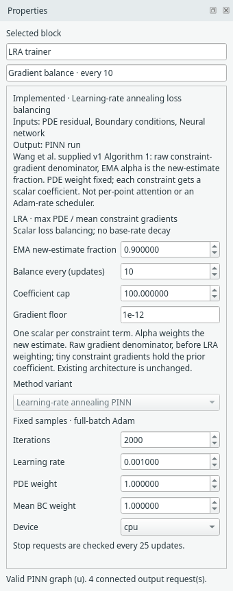
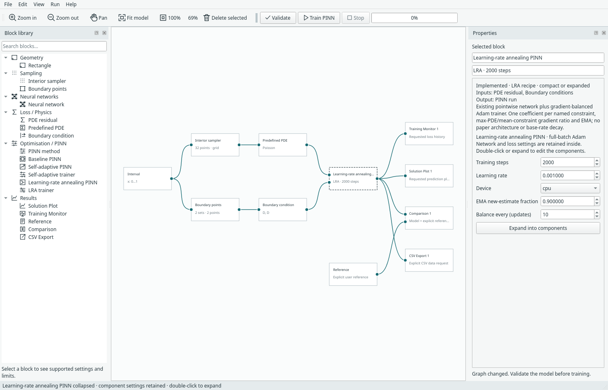

# Learning-rate annealing PINN

[Documentation index](README.md) · [Measured results](results.md#learning-rate-annealing-pinn)

Implemented from Wang, Teng and Perdikaris, *Understanding and mitigating gradient
pathologies in physics-informed neural networks*, supplied `LRA.pdf`,
arXiv:2001.04536v1. Algorithm 1, section 2.5, page 10, equations (40)–(42);
the experiment protocol on page 14 updates coefficients every ten iterations.
[Authors' repository and paper link](https://github.com/PredictiveIntelligenceLab/GradientPathologiesPINNs).
This implementation follows the supplied v1 pseudocode rather than assuming all
later implementations use the same denominator or smoothing convention.
No authors' code or section 2.6 network architecture was imported.

## What changes

LRA adjusts one scalar coefficient per named constraint loss. It keeps the PDE
reference weight fixed. It is not an Adam base-learning-rate decay schedule and
it is not SA-PINN's learned per-point squared mask. All ten existing pointwise
architectures remain available, with the same network factory and settings.

Let R = w_pde MSE_pde and B_i = w_i MSE_i, including Margam's user-specified
static weights. The training objective is:

```text
L = R + sum_i lambda_i B_i
lambda_i initially = 1
lambda_hat_i = max_theta |gradient R| / mean_theta |gradient B_i|
lambda_i = (1-alpha) lambda_i + alpha lambda_hat_i
```

**Alpha weights the new estimate** (default 0.9). The denominator does **not**
include the previous lambda_i. Max/mean are taken over all trainable scalar
parameters, including biases and zero entries for unused parameters, not an
unweighted average of layer means. Coefficients are detached statistics, not
trainable tensors. Adam takes one descent step on L.

With interval 10, balance occurs before updates 1, 11, 21, …, using the current
network. The absolute update counter survives worker batches, stop and resume.
The base Adam rate stays at the selected value (recipe default 0.001).

For scalar problems each named side is its own constraint; in coupled flow each
named side/component and the pressure gauge have their own coefficient. The
three flow PDE residual columns remain one existing PDE MSE. This grouping and
Margam's static weighting matter: interval BC weight 1 means static weight 0.5
per endpoint. It is not the paper's specific aggregated-boundary experiment.

## Numerical safeguards and limits

A denominator at or below `lra_epsilon` holds its previous coefficient; default
1e-12. Otherwise the ratio is capped at `lra_max` **before** smoothing. The generic
recipe uses cap 1e6; the runnable Poisson example explicitly uses cap **100**.
These guards are practical additions to Algorithm 1, not paper equations.
There is no positive lower coefficient floor. Nonfinite physical losses,
statistics, objective or network gradients abort before Adam or balancing state
is advanced.

Small boundary gradients can produce large coefficients and stall PDE fitting.
The saved equal-budget comparison includes both caps rather than presenting LRA
as an automatic accuracy improvement. Full-batch fixed samples/MSE/Adam are
supported; no paper architecture, minibatch/resampling scheme, L-BFGS stage or
paper benchmark reproduction is claimed. CPU validation does not verify CUDA.

## Desktop use

1. Open **File → Examples → 1D examples → Poisson — LRA-PINN**.
2. Select **LRA trainer** to edit steps, base rate, static weights, alpha, update
   interval, cap and gradient floor. Select the separate Neural network to replace
   its architecture. The example uses FCNN 16×16, 32 grid points and 2,000 updates.
3. Alternatively choose **File → Insert PINN recipe → Learning-rate annealing
   PINN · compact / expanded**. Physics, sampling, geometry and output blocks stay
   external. Expand to access the cap and floor; collapse preserves all settings.
4. Train, then explicitly open a connected Training Monitor or Comparison.
   Right-click the trainer/compact recipe for **LRA loss-weight summary**.
   No output view opens automatically.





Monitor PDE and BC curves remain raw physical MSE; total includes changing LRA
coefficients and cannot be compared directly across methods as an error score.
The summary shows coefficients and effective static-times-LRA weights. Full
statistics/targets/coefficients at every balancing event are in checkpoint state.

## Code and persistence

- Method: `margam/methods/learning_rate_annealing.py`.
- One-file recipe: `margam/recipes/learning_rate_annealing.py`.
- Example: `margam/templates/examples.py::example_config('lra_poisson')`.
- Compare: `.venv/bin/python -m examples.compare_lra --iterations 2000`.
- Test: `.venv/bin/python -m unittest discover -s tests -p 'test_lra*.py' -v`.

Model format 11 reads formats 1–10. Run format 2 stores ordinary network/Adam
state plus LRA settings, current coefficients and balancing history. Restricted
loading validates the ratio, smoothing, term names and update phase. Actual
resume also checks original data fingerprints and network architecture. A changed
algorithm setting, architecture, or data cannot silently resume the old run.
Tests cover the exact raw-gradient ratio and EMA, cap/zero guards, nonfinite
aborts, batching/resume equality, all ten networks and a coupled-flow smoke run,
and real desktop insertion/expand/collapse/clipboard/undo/model/run lifecycle.
