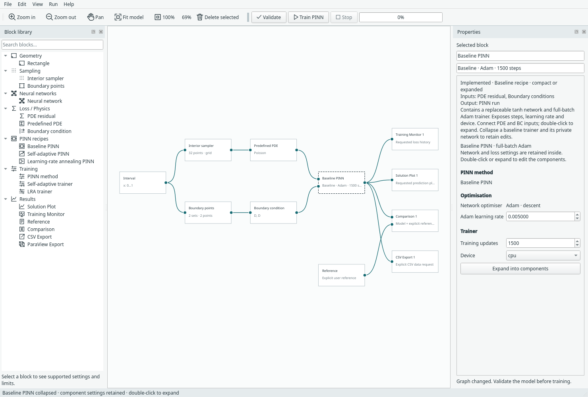

# Blocks, connections and recipes

Start with a complete example when learning. You can then replace one component
while retaining the surrounding problem.

## Connect compatible ports

Drag from a block's output port to the target's input port. A trainer needs its
PDE, boundary-condition and network inputs. A compact recipe already owns the
network and exposes its physics inputs. Output blocks connect to a PINN run.

Ports have specific meanings: a geometry connection is not a network connection.
The editor rejects incompatible or occupied inputs. Use **Validate** after
replacing a component to find missing or inconsistent dependencies.

Right-click a block for the actions it supports. For example, Rectangle provides
sample previews, Training Monitor provides an Open action, and ParaView Export
provides an explicit export action. There is no universal plotting action.

## Compact and expanded are two views of one construction

The compact recipe contains its network and trainer. Geometry, samples, PDEs,
BCs and outputs stay external. Double-click the recipe or choose **Expand into
components** to expose the internal blocks on the canvas.

*The compact baseline recipe retains the same network and trainer settings. [Open full size](../../assets/screenshots/manual-compact.png).*

Right-click the expanded trainer and choose **Collapse as …** to fold it back.
Expansion/collapse is undoable and preserves settings and external connections.
A shared network cannot be hidden inside one recipe if another trainer needs it.

*The expanded form lets you edit or replace its network independently. [Open full size](../../assets/screenshots/manual-expanded.png).*

## Editing safely

Use selection plus Copy/Paste or the Edit menu to duplicate blocks. Pasted blocks
have new identities; copied internal connections remain attached to the copies.
Undo/redo restores graph edits. Deleting a required block makes the graph
incomplete until you reconnect a replacement.

Numerical setting changes invalidate old results. Moving blocks or renaming an
output changes the presentation rather than the trained problem. See
[Saving and resuming](../use/saving.md) before continuing an old checkpoint.

**Next:** [Geometry and sampling](sampling.md), or [network choices](networks.md).
The [recipe reference](../pinn-recipes.md) lists exact ownership and limitations.
