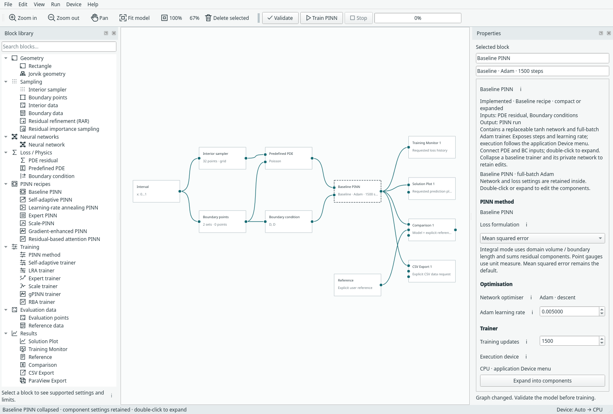
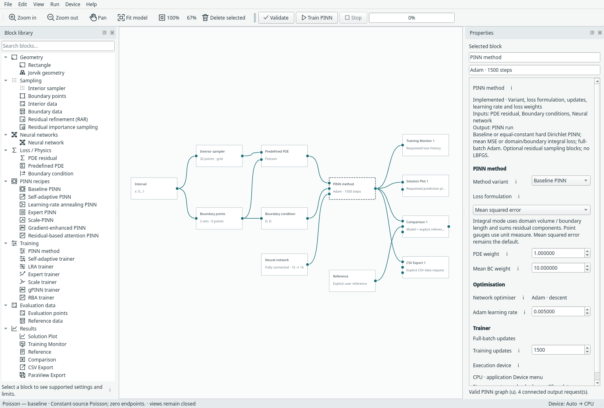
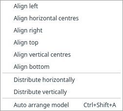
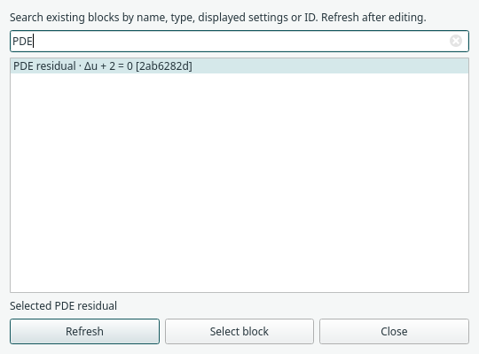
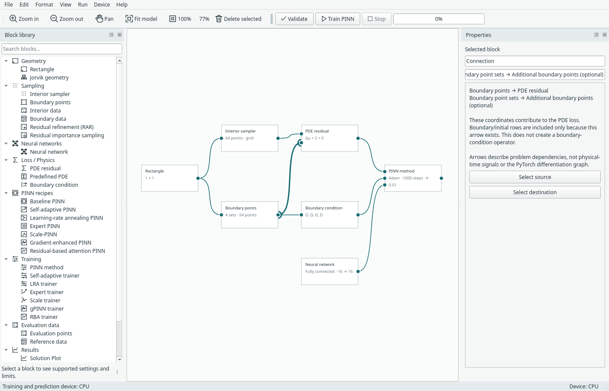
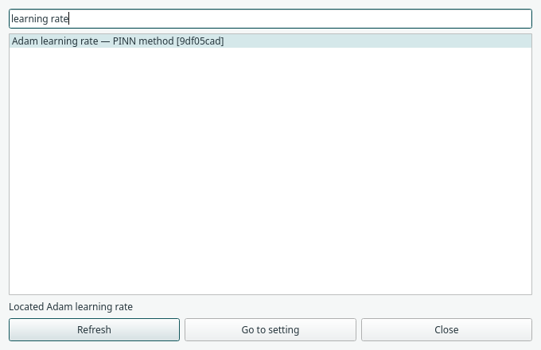
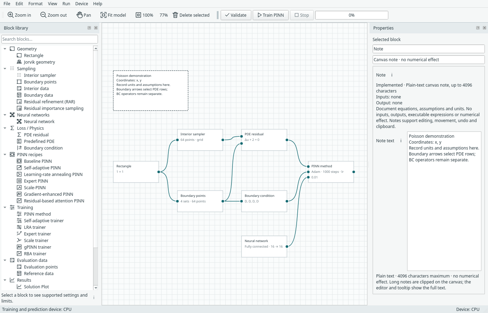
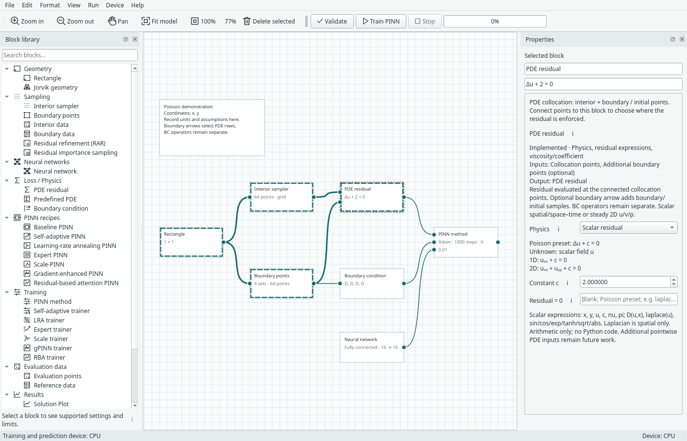
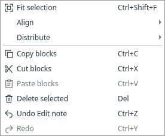

# Blocks, connections and recipes

Start with a complete example when learning. You can then replace one component
while retaining the surrounding problem.

## Connect compatible ports

Drag from a block's output port to the target's input port. A trainer needs its
PDE, boundary-condition and network inputs. A compact recipe already owns the
network and exposes its physics inputs. Output blocks connect to a PINN run.

Ports have specific meanings: a geometry connection is not a network connection.
The editor rejects incompatible or occupied inputs. Use **Validate** after
replacing a component to find missing or inconsistent dependencies.

Right-click a block for the actions it supports. For example, Rectangle provides
sample previews, Training Monitor provides an Open action, and ParaView Export
provides an explicit export action. There is no universal plotting action.

## Compact and expanded are two views of one construction

The compact recipe contains its network and trainer. Geometry, samples, PDEs,
BCs and outputs stay external. Double-click the recipe or choose **Expand into
components** to expose the internal blocks on the canvas.

*The compact baseline recipe retains the same network and trainer settings. [Open full size](../../assets/screenshots/manual-compact.png).*

Right-click the expanded trainer and choose **Collapse as …** to fold it back.
Expansion/collapse is undoable and preserves settings and external connections.
A shared network cannot be hidden inside one recipe if another trainer needs it.

*The expanded form lets you edit or replace its network independently. [Open full size](../../assets/screenshots/manual-expanded.png).*

## Editing safely

Use selection plus Copy/Paste or the Edit menu to duplicate blocks. Pasted blocks
have new identities; copied internal connections remain attached to the copies.
Undo/redo restores graph edits. Deleting a required block makes the graph
incomplete until you reconnect a replacement.

Numerical setting changes invalidate old results. Moving blocks or renaming an
output changes the presentation rather than the trained problem. See
[Saving and resuming](../use/saving.md) before continuing an old checkpoint.

**Next:** [Geometry and sampling](sampling.md), or [network choices](networks.md).
The [recipe reference](../pinn-recipes.md) lists exact ownership and limitations.

**Validate** opens a list of actionable issues. Click a row to select its block
and open the inspector; named boundary issues select their set. Recheck after
edits. See [model validation](../use/results.md#fix-problems-before-training).

## Organise and find blocks

Use **Format** to align two or more selected blocks by their edges or centres.
Select three or more for **Distribute horizontally/vertically**: this preserves
outer edges and makes equal gaps. When the span is too small to avoid overlap,
distribution leaves it unchanged; spread the outer blocks first.

**Format → Auto arrange model** (**Ctrl+Shift+A**, canvas focus) lays out the whole
model from inputs to outputs. It includes disconnected blocks. Cyclic leftovers
occupy a final column; arranging them does not make an invalid graph executable.
It is a simple layered layout, not an obstacle-avoiding wire router. Each layout
edit is one Undo action and preserves physics, wires and trained results. Layout
editing is unavailable while training or the geometry editor locks the model.

*Select blocks to enable alignment and spacing commands.*

**Edit → Find in model…** (**Ctrl+F**, canvas focus) searches existing instances by
name, type, displayed settings or full ID. Choose **Select block**, press Enter in
the search field, or activate a result to centre it and show its properties.
Refresh after edits. Search does not insert blocks; use the library to add one.

*Model search locates an existing block without changing its settings.*

**View → Fit selection** (**Ctrl+Shift+F**, canvas focus) frames only the selected
blocks. It works for a single block or a group, ignores selected wires, and leaves
positions, settings, history and results unchanged. With no blocks selected the
command is disabled. **Fit model** continues to frame the complete diagram.

## Read the graph

Hover a port for its name, payload meaning and connection rule. Arrows describe
problem dependencies; they are not physical-time signals or PyTorch's internal
differentiation graph.

Click a wire to highlight it and both port endpoints. The Properties pane names
the source and destination and explains the connection. **Select source** and
**Select destination** jump to the corresponding block. A boundary → PDE arrow
adds residual collocation rows; boundary → Boundary condition instead supplies
points for operators and targets. Neither arrow silently creates the other.

Block summaries use two lines where available. Hover a block to read its full
name, untruncated summary and supported capabilities. Network summaries show the
architecture and hidden widths; baseline trainers show updates and learning rate.
Output blocks reserve their second summary line for result freshness.

## Find a setting

**Edit → Find setting…** (**Ctrl+Shift+P**, canvas focus) searches settings owned by
existing blocks. Try **learning rate**, **boundary coefficient left**, or
**flow boundary top u target**. Results identify the owning instance. Activate one
to select its block, reveal the Properties pane, scroll to the control and focus
it. Sampling and flow entries select the named side where needed.

Search and navigation do not edit the model. Conditional settings may be disabled
or hidden for the current options. A compact recipe retains settings that require
expansion; search explains when the control is not currently exposed rather than
expanding or changing the graph automatically. Refresh after graph edits. Search
results resolve IDs again before navigation, so deleted blocks are handled safely.

## Add canvas notes

Use **Edit → Add note**, or insert **Note** from the library's **Notes** category.
Select it to edit its text in Properties. Text is saved as you edit; Undo/Redo,
Copy/Cut/Paste, move and delete work as for other canvas items. A note-only edit
preserves trained weights, results and output freshness. Mixed selections that
also change numerical blocks or wires still invalidate results normally.

Notes are plain text, up to 4096 characters. Write equations, units, assumptions
or provenance; HTML is displayed literally. Long notes are clipped on the canvas;
the Properties editor and tooltip contain the full text. Notes have no ports and
never contribute to physics or losses. They survive model saving, run archives and
recovery through the model document. Notes were introduced in model format 29;
current documents use format 30. Formats 1–29 remain readable by this release.
Older Margam versions cannot read the new format.

## Follow dependencies

Select one or more computational blocks, then choose **View → Highlight
dependencies → Upstream**, **Downstream**, or **Both directions**. Related blocks
and wires are highlighted without changing the selection or Properties context.
Use **Off** to clear the highlighting. Clearing selection also clears the path.

Traversal follows the editor's arrows, handles branches/cycles and includes
optional sources. It explains graph dependencies; it does not certify that an
incomplete graph is executable. Notes are excluded. Highlighting is available
while training because it changes only the view. The chosen mode is a local
preference, not a model setting; the highlights themselves are recomputed from
current selection.

## Snap and arrange a group

**View → Show grid** and **View → Snap to grid** are independent local preferences,
off by default. Snapping uses a 20-unit canvas grid when a drag ends or an item is
inserted/pasted. A dragged group snaps using the clicked item's origin and moves
as one translation, preserving all relative offsets. Undo restores the entire
move in one step. Toggling snapping does not relocate existing items; loaded
positions, manual Format commands and Undo/Redo are not rounded. Zooming far out
may hide intermediate grid lines to keep the grid readable.

Right-click a selected block or note to open a **group context menu** without
losing the selection. It offers Fit selection, alignment and distribution, plus
existing clipboard, delete and undo actions. Right-clicking an unselected item
selects that item and opens its normal context menu. Alignment needs at least two
items; equal-gap distribution needs three. Automatic whole-model layout leaves
notes at their chosen positions.

