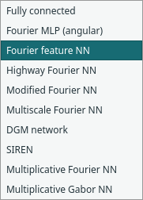
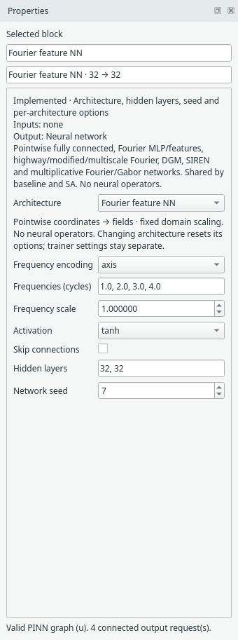
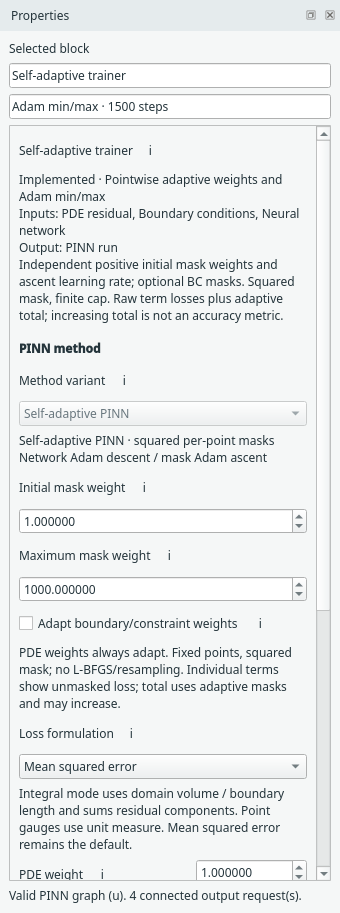

# Networks and PINN methods

The **network** maps coordinates to fields. The **PINN method** determines how
physical losses participate in training. You can change one without replacing
the whole problem.

## Choose the network

Select the Neural network block and open **Architecture**. In a compact recipe,
expand it first to expose the network.

{ .portrait }

*The architecture dropdown offers ten supported pointwise networks. [Open full size](../../assets/screenshots/manual-network-choices.png).*

The choices include the original fully connected model, Fourier variants, DGM,
SIREN and multiplicative Fourier/Gabor networks. These are pointwise networks,
not neural operators. Architecture-specific controls appear below the choice.
Changing architecture resets its own options and is one undoable edit.

{ .portrait }

*The existing Fourier network exposes encoding, frequencies, scale, activation and hidden widths. [Open full size](../../assets/screenshots/manual-fourier-settings.png).*

Fourier frequencies are measured in normalised domain coordinates. The displayed
Helmholtz example deliberately includes the known oscillation modes; it is not
an automatic frequency search. SIREN has its own omega controls. Use the
[network reference](../neural-networks.md) for each option's definition.

## Find the right settings group

| Inspector group | Responsibility |
| --- | --- |
| PINN method | Variant, physical loss weights and method-specific adaptation |
| Optimisation | Network Adam learning rate; SA has a separate mask Adam rate |
| Trainer | Number of updates and device |

The sections currently have clear headings; they are not collapsible controls.
Do not confuse these inspector groups with the Block library categories.

## Baseline, hard Dirichlet, SA and LRA

Baseline uses fixed weighted physical losses. The hard-Dirichlet variant enforces
its supported equal constant boundary values through a box transform. SA learns
per-point squared masks and has a separate Adam ascent optimiser. LRA adjusts
scalar constraint-loss coefficients using gradient statistics.

{ .portrait }

*SA separates method controls, network Adam descent and mask Adam ascent. [Open full size](../../assets/screenshots/manual-sa-settings.png).*

**LRA does not decay Adam's base learning rate.** Its balancing interval and EMA
belong to Method; the network's Adam rate belongs to Optimisation. The
[LRA guide](../lra-pinn.md) and [SA guide](../self-adaptive-pinn.md) give exact
update rules and checkpoint requirements.

Choose a method to explore; the software does not promise that one will be more
accurate on every problem. User-selected budgets and settings are retained when
recipes are expanded/collapsed, saved and reopened.

**Next:** [Train and inspect results](../use/results.md).

Select a trainer or compact recipe to choose **Loss formulation**. Mean squared
error remains the default; the optional [integral formulation](../integral-loss.md)
uses domain volume and boundary lengths. It works with the existing architectures.
