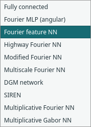
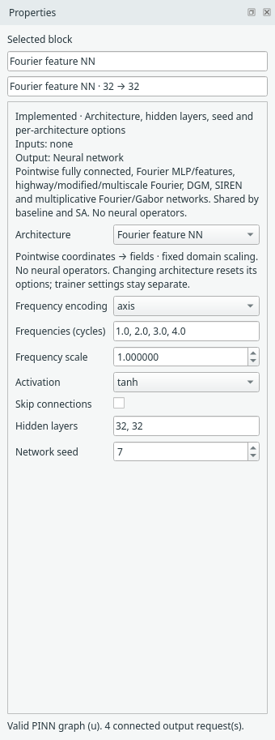
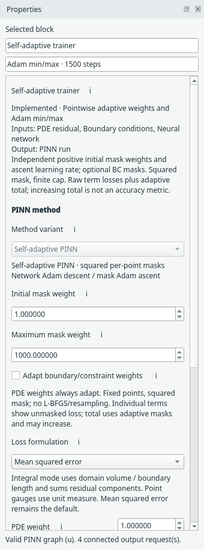

# Networks and PINN methods

The **network** maps coordinates to fields. The **PINN method** determines how
physical losses participate in training. You can change one without replacing
the whole problem.

## Choose the network

Select the Neural network block and open **Architecture**. In a compact recipe,
expand it first to expose the network.

{ .portrait }

*The architecture dropdown offers ten supported pointwise networks. [Open full size](../../assets/screenshots/manual-network-choices.png).*

The choices include the original fully connected model, Fourier variants, DGM,
SIREN and multiplicative Fourier/Gabor networks. These are pointwise networks,
not neural operators. Architecture-specific controls appear below the choice.
Changing architecture resets its own options and is one undoable edit.

{ .portrait }

*The existing Fourier network exposes encoding, frequencies, scale, activation and hidden widths. [Open full size](../../assets/screenshots/manual-fourier-settings.png).*

Fourier frequencies are measured in normalised domain coordinates. The displayed
Helmholtz example deliberately includes the known oscillation modes; it is not
an automatic frequency search. SIREN has its own omega controls. Use the
[network reference](../neural-networks.md) for each option's definition.

## Find the right settings group

| Inspector group | Responsibility |
| --- | --- |
| PINN method | Variant, physical loss weights and method-specific adaptation |
| Optimisation | Network Adam learning rate; SA has a separate mask Adam rate |
| Trainer | Number of updates and device |

The sections currently have clear headings; they are not collapsible controls.
Do not confuse these inspector groups with the Block library categories.

## Baseline, hard Dirichlet, SA and LRA

Baseline uses fixed weighted physical losses. The hard-Dirichlet variant enforces
its supported equal constant boundary values through a box transform. SA learns
per-point squared masks and has a separate Adam ascent optimiser. LRA adjusts
scalar constraint-loss coefficients using gradient statistics.

{ .portrait }

*SA separates method controls, network Adam descent and mask Adam ascent. [Open full size](../../assets/screenshots/manual-sa-settings.png).*

**LRA does not decay Adam's base learning rate.** Its balancing interval and EMA
belong to Method; the network's Adam rate belongs to Optimisation. The
[LRA guide](../lra-pinn.md) and [SA guide](../self-adaptive-pinn.md) give exact
update rules and checkpoint requirements.

Choose a method to explore; the software does not promise that one will be more
accurate on every problem. User-selected budgets and settings are retained when
recipes are expanded/collapsed, saved and reopened.

**Next:** [Train and inspect results](../use/results.md).

Select a trainer or compact recipe to choose **Loss formulation**. Mean squared
error remains the default; the optional [integral formulation](../integral-loss.md)
uses domain volume and boundary lengths. It works with the existing architectures.

### DSGNAR

[DSGNAR](../dsgnar.md) replaces Adam with sketched Gauss–Newton/SVD steps. Insert
its compact recipe or separate trainer. Use fixed built-in scalar points and an
explicit precision; rejected steps count toward the attempt budget. Existing
pointwise networks and output blocks remain replaceable.

### Finite Basis PINN (FBPINN)

[FBPINN](../fbpinn.md) partitions spatial or space–time domains into overlapping
subdomains blended by smooth $C^2$/$C^\infty$ partition-of-unity windows, with
clipped local coordinate normalization per subdomain. Enable **Two-level
coarse-to-fine hierarchy** for global elliptic coupling across many subdomains,
or choose **Progressive active marching** to advance a moving frontier along time
or space. Existing pointwise architectures, 3D domains, continuous parameter axes
and the Solution Explorer all work directly.

## Quick snippets: configuring all 10 pointwise architectures

In Python scripts or studies, choose `network_type` and pass architecture-specific
settings in `network_options` (any omitted key uses its validated default):

```python
from dataclasses import replace
from margam.nn import build_network
from margam.templates.poisson import PoissonConfig

base = PoissonConfig(shape="Rectangle", layers=(32, 32), network_seed=7)

# 1. Standard Fully Connected (FCNN)
fcnn_cfg = replace(base, network_type="fcnn", network_options={"activation": "tanh"})

# 2. Fourier Feature Network (axis or random Gaussian encoding)
fourier_axis_cfg = replace(
    base,
    network_type="fourier",
    network_options={"encoding": "axis", "frequencies": [1.0, 2.0, 4.0], "scale": 1.0},
)
fourier_gauss_cfg = replace(
    base,
    network_type="fourier",
    network_options={"encoding": "gaussian", "features": 32, "scale": 2.0},
)

# 3. Affine Fourier Network (physical coordinate expressions -> trainable sine projection)
affine_cfg = replace(
    base,
    network_type="affine_fourier",
    network_options={"features": 32, "input_transform": "2*pi*x; 2*pi*y", "normalize_inputs": False},
)

# 4. Modified Fourier Network (two input gates u, v blended at every hidden layer)
mod_fourier_cfg = replace(
    base,
    network_type="modified_fourier",
    network_options={"encoding": "gaussian", "features": 32, "scale": 1.0, "weight_factorization": True},
)

# 5. Highway Fourier Network (skip connections with learned gating)
highway_cfg = replace(
    base,
    network_type="highway",
    network_options={"encoding": "axis", "frequencies": [1.0, 2.0]},
)

# 6. Multiscale Fourier Network (parallel multi-scale branches merged at the head)
multiscale_cfg = replace(
    base,
    network_type="multiscale_fourier",
    network_options={"encoding": "gaussian", "features": 16, "scales": [1.0, 4.0, 8.0]},
)

# 7. SIREN (sinusoidal representation network with Principled omega_0 initialization)
siren_cfg = replace(
    base,
    network_type="siren",
    network_options={"first_omega": 30.0, "hidden_omega": 30.0},
)

# 8. Deep Galerkin Method (DGM LSTM-like gated highway layers)
dgm_cfg = replace(base, network_type="dgm", network_options={"activation": "tanh"})

# 9. Multiplicative Filter Network — Fourier filters
mfn_fourier_cfg = replace(
    base,
    network_type="mfn_fourier",
    network_options={"omega": 10.0, "alpha": 6.0},
)

# 10. Multiplicative Filter Network — Gabor wavelet filters
mfn_gabor_cfg = replace(
    base,
    network_type="mfn_gabor",
    network_options={"omega": 10.0, "alpha": 6.0},
)

# Instantiate any configured network as a standalone torch.nn.Module:
net = build_network(mod_fourier_cfg)
print(type(net).__name__, "parameter count:", sum(p.numel() for p in net.parameters()))
```

## Quick snippets: switching PINN trainers on the same problem

Each PINN method owns its distinctive training rule while sharing geometry,
sampling, expressions and output evaluation:

```python
from dataclasses import replace
from margam.templates.poisson import PoissonConfig, build_pinn

base = PoissonConfig(shape="Interval", points=32, pde_points="both", layers=(16, 16), device="cpu")

# 1. Hard Dirichlet (exact box-boundary transform for equal constant Dirichlet BCs)
hard_model = build_pinn(replace(base, method="hard_dirichlet"))

# 2. Gradient-enhanced PINN (gPINN: penalizes coordinate derivatives of the PDE residual)
gpinn_cfg = replace(base, method="gpinn")
gpinn_cfg.gpinn_weights["x"] = 0.01
gpinn_model = build_pinn(gpinn_cfg)

# 3. Residual-based attention (RBA: detached normalized point-history attention)
rba_cfg = replace(base, method="rba")
rba_cfg.rba_settings.update(decay=0.999, rate=0.01, initialization="zero")
rba_model = build_pinn(rba_cfg)

# 4. Scale-PINN (previous-iterate spatial smoothing correction M(w^k) - sg(M(w^(k-1))))
scale_cfg = replace(base, method="scale")
scale_cfg.scale_settings.update(tau_sc=1.0, tau_alpha=1.0, gamma=0.01, strength=1.0, fresh=False)
scale_model = build_pinn(scale_cfg)

# 5. Expert PINN (causal time chunks, gradient-norm or NTK balancing, optional time windows)
expert_cfg = PoissonConfig(
    shape="SpaceTime1D",
    method="expert",
    sampling="random",
    pde_expression="D(u, t) - 0.1 * D(D(u, x), x)",
    bc_targets={"bottom": "sin(pi * x)"},
    points=64,
    boundary_points=16,
    layers=(16, 16),
    device="cpu",
)
expert_cfg.expert_settings.update(chunks=4, causal_epsilon=1.0, balance_mode="gradient", windows=2, window_steps=50)
expert_model = build_pinn(expert_cfg)

# 6. DSGNAR (sketched Gauss-Newton trust-region solver in float64)
dsgnar_cfg = replace(base, method="dsgnar")
dsgnar_cfg.dsgnar_settings.update(precision="float64", sketch_size=32, initial_radius=1.0, min_radius=1e-7)
dsgnar_model = build_pinn(dsgnar_cfg)
```
