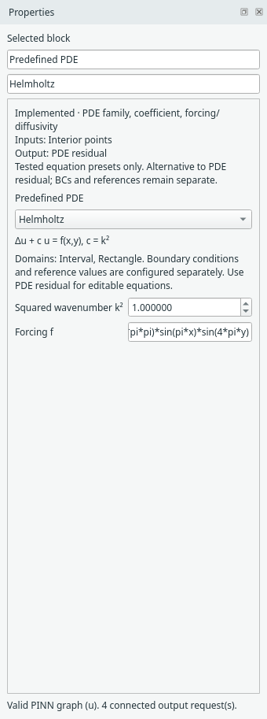
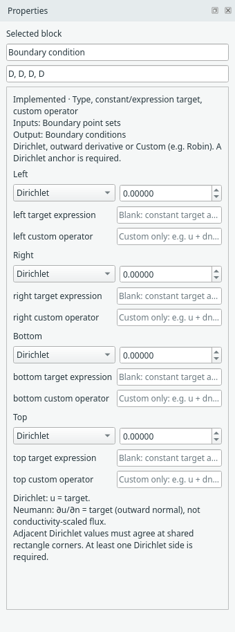

# PDEs and boundary conditions

Keep three choices separate: where points are located, what PDE they must
satisfy, and what conditions apply on the boundary. A PDE preset does not choose
a reference solution or boundary conditions for you.

## Choose a preset or an expression

Use **Predefined PDE** for a tested family, or **PDE residual** for a restricted
mathematical expression. Both fill the same PDE input on the trainer: choose
one producer, not two residual blocks connected sequentially.

{ .portrait }

*The Helmholtz preset exposes squared wavenumber and its forcing expression. [Open full size](../../assets/screenshots/manual-helmholtz-pde.png).*

The current families include Poisson, reaction–diffusion, 1D advection–diffusion,
Helmholtz and steady 2D incompressible flow. Coefficient meanings and signs differ;
read the equation displayed in Properties. The [example catalogue](../problem-examples.md)
shows complete configurations. Loading an example is the simplest way to start.

Custom expressions use an allowlisted mathematical language, not Python scripts.
For example, `laplace(u)+c` is a scalar Poisson residual. `D(u,x)` denotes a
derivative. See the [expression and component reference](../components.md) before
writing a different operator; unsupported syntax is rejected rather than executed.

## Assign each named boundary

Select **Boundary condition**, choose a side, and assign its supported type and
target. Dirichlet specifies a field value; Neumann specifies its outward normal
derivative. A custom operator can express supported Robin-like conditions.

{ .portrait }

*Boundary-condition settings assign physics to the independently sampled sides. [Open full size](../../assets/screenshots/manual-boundary-condition.png).*

Normal orientation matters. The scalar Neumann value is an outward derivative,
not automatically a conductivity-scaled flux. Current scalar problems require a
Dirichlet anchor. Adjacent Dirichlet values must agree at shared rectangle corners.
The dedicated hard-Dirichlet method has stricter equal-constant box conditions.

For steady flow, boundary settings apply to `u`, `v` and `p`, and a pressure gauge
fixes the pressure reference. Start from **2D incompressible flow** for a complete
working graph; scalar and vector contracts are not interchangeable.

## Reference values are optional

A Reference block is needed only when you request a Comparison. Examples may
supply an explicit expression; your own problem may have no exact solution.
Do not add a reference merely to make the graph look complete.

**Next:** [Choose networks and PINN methods](networks.md).
