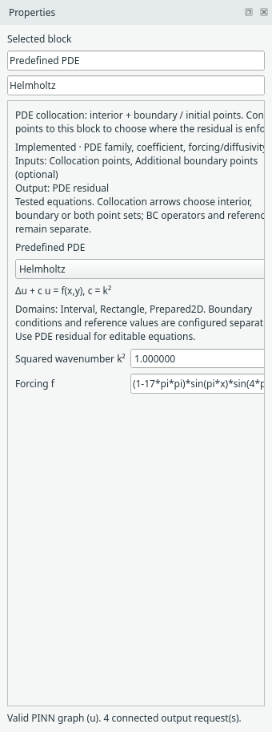
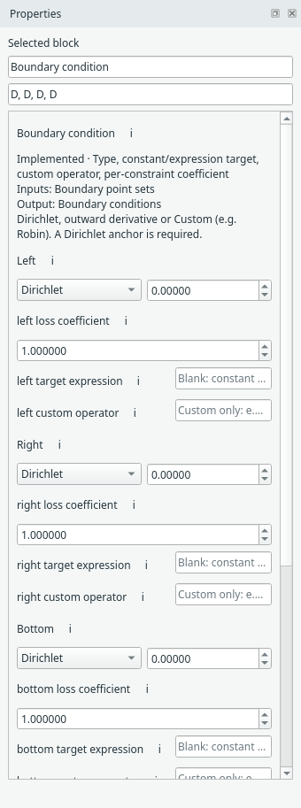
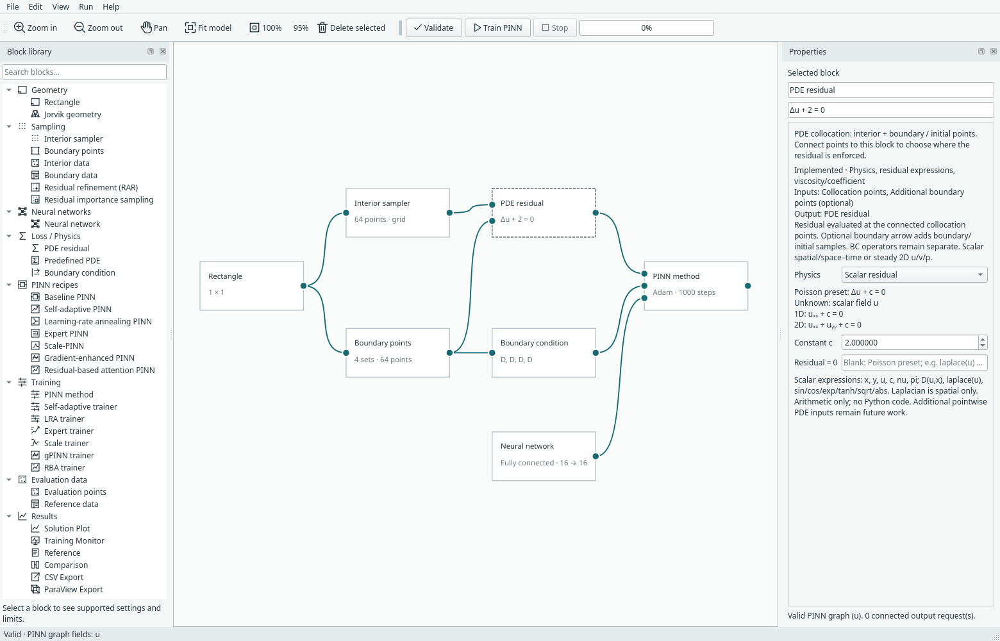
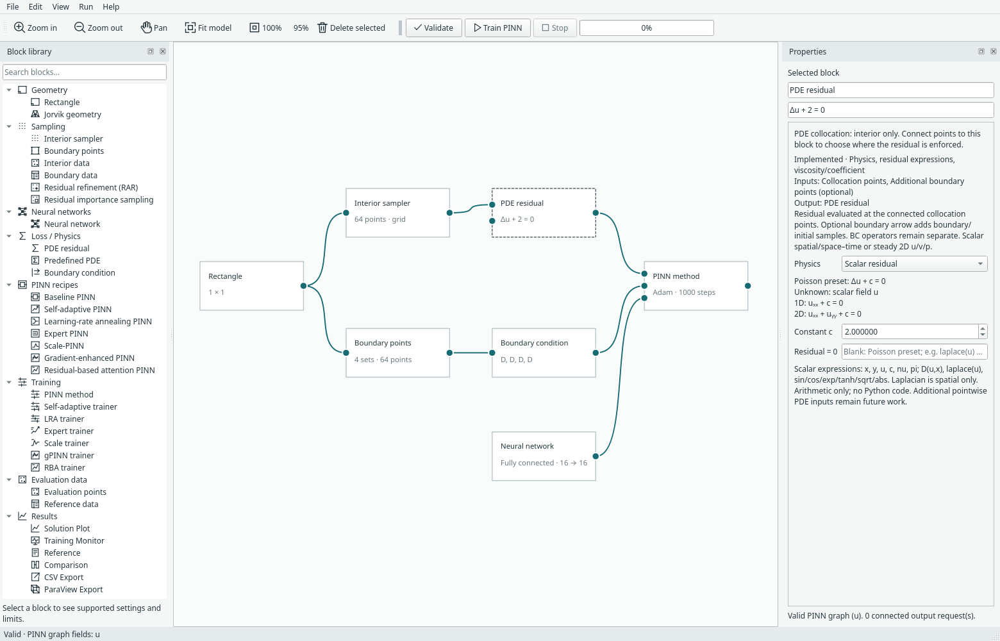

# PDEs and boundary conditions

Keep three choices separate: where points are located, what PDE they must
satisfy, and what conditions apply on the boundary. A PDE preset does not choose
a reference solution or boundary conditions for you.

## Choose a preset or an expression

Use **Predefined PDE** for a tested family, or **PDE residual** for a restricted
mathematical expression. Both fill the same PDE input on the trainer: choose
one producer, not two residual blocks connected sequentially.

{ .portrait }

*The Helmholtz preset exposes squared wavenumber and its forcing expression. [Open full size](../../assets/screenshots/manual-helmholtz-pde.png).*

The current families include Poisson, reaction–diffusion, 1D advection–diffusion,
Helmholtz and steady 2D incompressible flow. Coefficient meanings and signs differ;
read the equation displayed in Properties. The [example catalogue](../problem-examples.md)
shows complete configurations. Loading an example is the simplest way to start.

Custom expressions use an allowlisted mathematical language, not Python scripts.
For example, `laplace(u)+c` is a scalar Poisson residual. `D(u,x)` denotes a
derivative. See the [expression and component reference](../components.md) before
writing a different operator; unsupported syntax is rejected rather than executed.

## Assign each named boundary

Select **Boundary condition**, choose a side, and assign its supported type and
target. Dirichlet specifies a field value; Neumann specifies its outward normal
derivative. A custom operator can express supported Robin-like conditions.

{ .portrait }

*Boundary-condition settings assign physics to the independently sampled sides. [Open full size](../../assets/screenshots/manual-boundary-condition.png).*

Normal orientation matters. The scalar Neumann value is an outward derivative,
not automatically a conductivity-scaled flux. Current scalar problems require a
Dirichlet anchor. Adjacent Dirichlet values must agree at shared rectangle corners.
The dedicated hard-Dirichlet method has stricter equal-constant box conditions.

For steady flow, boundary settings apply to `u`, `v` and `p`, and a pressure gauge
fixes the pressure reference. Start from **2D incompressible flow** for a complete
working graph; scalar and vector contracts are not interchangeable.

## Reference values are optional

A Reference block is needed only when you request a Comparison. Examples may
supply an explicit expression; your own problem may have no exact solution.
Do not add a reference merely to make the graph look complete.

**Next:** [Choose networks and PINN methods](networks.md).

For physical time dependence, start with [Burgers — 1D + time](../burgers.md).
It uses `(x,t)` coordinates, two spatial BC traces and a separate initial profile,
with no final-time condition. Its preset uses `u_t + u*u_x - nu*u_xx = 0`.


## Arrows choose where the PDE is enforced

The PDE block accepts **Collocation points** and **Additional boundary points
(optional)**. This applies to both PDE residual and Predefined PDE.

- An interior source connected to Collocation points enforces the PDE there.
- A boundary source connected to the additional input adds those boundary rows to
  the PDE loss. Without that arrow, boundary rows are not added.
- A boundary source can instead connect directly to Collocation points for a
  boundary-only residual; remove the unused interior sampler in that graph.
- The independent arrow from Boundary data/points to Boundary condition controls
  BC losses. Connecting a boundary source to the PDE does not remove its BC loss.



*Both arrows: residual evaluated on the combined point rows; boundary operators
are still evaluated separately through the Boundary condition block.*



*No boundary arrow to the PDE means no extra boundary PDE rows.*

New templates and File → Examples include the boundary-to-PDE arrow. Existing
saved models retain their original wiring and sampling behaviour. The low-level
`PoissonConfig` API keeps `pde_points='interior'` for compatibility; scripts can
explicitly select `'both'` or `'boundary'`. Example scripts select their intended
mode explicitly. Points are concatenated without deduplication: shared corners or
repeated input rows retain their sampling multiplicity. The PDE term is one mean
squared residual over the selected rows, not an additional BC term. Preset forcing
is evaluated at the added rows too. For transient problems, the connected boundary
source may also contain initial points. Periodic examples include paired faces;
pressure gauges and mean-velocity anchors are not geometric boundary point sets.

RAR retains the boundary PDE anchors while growing the interior set. Importance
sampling resamples interior rows with inverse-probability weights and retains
boundary anchors at unit weight. RAR's maximum is the total active PDE-row budget,
including connected boundary anchors. Fixed SA/RBA masks include all selected PDE
rows. Expert causal weighting bins added rows by their physical time, preserving
complete coordinate tuples, and Scale refreshes the selected point sets together.

**Integral loss is different:** its PDE term is a domain-volume quadrature.
Disconnect the extra boundary PDE arrow for that mode; otherwise validation explains
the incompatibility. Boundary operators keep their own boundary measure. Margam
never assigns volume quadrature weights to extra boundary points automatically.

Boundary collocation is an explicit modelling choice. Imported points are not
geometrically filtered, and users may omit nonsmooth corners or incompatible
initial traces from the PDE dataset. There is no universal paper convention: for
example, the [upstream gPINN Burgers residual-only setup](https://github.com/lu-group/gpinn/blob/main/src/burgers.py) explicitly uses zero
boundary/initial samples. The graph supports either choice.


The [CPU](../../assets/benchmarks/pde-collocation-cpu.json) and
[CUDA](../../assets/benchmarks/pde-collocation-cuda.json) checks verify selected
PDE row counts and exact same-device continuation for baseline, importance, gPINN,
RBA and Expert training. These are correctness checks, not accuracy benchmarks.

```sh
CUDA_VISIBLE_DEVICES='' .venv/bin/python -m examples.pde_collocation --device cpu --output build/pde-collocation-cpu.json
.venv/bin/python -m examples.pde_collocation --device cuda --output build/pde-collocation-cuda.json
```


## Set individual boundary loss coefficients

Each named constraint in **Boundary condition** has a **loss coefficient**, default
1. For ordinary scalar problems the objective is

`PDE_weight × PDE_loss + BC_weight / number_of_constraints × Σ(coefficient_i × BC_loss_i)`.

For two boundaries, overall BC weight 3, and coefficients 2 and 0.5, their fixed
multipliers are 3 and 0.75. Increasing one does not renormalize the others. The raw
errors and point counts are unchanged. Use a positive coefficient between 1e-6
and 1e6; zero is not a way to remove a required anchor.

Transient initial and periodic constraints, and coupled flow component constraints,
also have individual coefficients under their actual constraint names. Pressure
gauges retain their existing separate gauge weight, multiplied by their own
coefficient. Paper presets retain their previous normalization. SA, LRA and Expert
can apply additional adaptive weights; a manual coefficient does not freeze or
replace their balancing algorithms. In integral mode the unweighted term already
includes its physical measure.

The [Training Monitor](../use/results.md#read-the-losses-in-context) can show raw
and actual weighted loss for a selected constraint. The
[Jorvik example](../jorvik.md#weight-named-boundaries-and-inspect-their-contributions)
shows the controls with independently named curved boundaries.

The Python setting is `PoissonConfig(bc_weights={'inner': 2.0, 'outer': 0.5})`.
Keys are constraint names (`initial` for a time-zero set, `left:u` for a coupled
velocity component). Inactive entries do not contribute to the current objective.
Model format 27 stores the mapping; older models default to unit coefficients.

## Expression syntax cheat sheet and snippets

Restricted expressions in **PDE residual**, **Predefined PDE** forcing, **Boundary
condition** operators/targets, and **Reference** blocks are parsed through an
allowlisted mathematical AST (never Python `eval`).

| Construct | Syntax | Notes |
| --- | --- | --- |
| Spatial / temporal coordinates | `x`, `y`, `t` | Available names depend on domain (`Interval`: `x`; `Rectangle`: `x, y`; `SpaceTime1D`: `x, t`) |
| Solution fields | `u` (scalar) or `u, v, p` (2D flow) | Prohibited in target/forcing/reference expressions (`target=True`) |
| Constants and parameters | `pi`, `c`, `nu` | `c` binds `config.source`; `nu` binds `config.viscosity` |
| Outward unit normal components | `nx`, `ny` | Boundary expressions only (`ny` requires a 2D domain) |
| Coordinate partial derivative | `D(expr, x)` | Nest for higher orders, e.g. `D(D(u, x), x)` or mixed `D(D(u, x), y)` |
| Spatial Laplacian | `laplace(expr)` | $\partial_{xx} + \partial_{yy}$ over active coordinates |
| Outward normal derivative | `dn(expr)` | $\nabla(\text{expr}) \cdot \mathbf{n}$ on boundary point sets |
| Elementary functions | `sin`, `cos`, `tan`, `tanh`, `exp`, `log`, `sqrt`, `abs` | Standard unary mathematical functions |

### Snippet: 2D PDE with mixed Dirichlet, Neumann and Robin boundary conditions

```python
import torch
from margam.templates.poisson import PoissonConfig, build_pinn

# Solve -laplace(u) + c*u = f(x, y) on [0, 1]^2 with:
# - left (x=0) & bottom (y=0): Dirichlet u = sin(pi*x) + y^2
# - right (x=1): outward Neumann dn(u) = -pi
# - top (y=1): custom Robin operator u + 0.5*dn(u) = sin(pi*x) + 2.0
config = PoissonConfig(
    shape="Rectangle",
    points=100,
    boundary_points=20,
    pde_points="both",
    source=1.0,
    pde_expression="-laplace(u) + c*u - ((pi*pi + 1)*sin(pi*x) - 2 + c*y*y)",
    bc_types={
        "left": "Dirichlet",
        "bottom": "Dirichlet",
        "right": "Neumann",
        "top": "Custom",
    },
    bc_values={"left": 0.0, "bottom": 0.0, "right": 0.0, "top": 0.0},
    bc_targets={
        "left": "y*y",
        "bottom": "sin(pi*x)",
        "right": "-pi",
        "top": "sin(pi*x) + 2.0",
    },
    bc_operators={"top": "u + 0.5*dn(u)"},
    bc_weights={"left": 2.0, "bottom": 2.0, "right": 1.0, "top": 1.0},
    layers=(32, 32),
    lr=0.005,
    iterations=500,
    device="cpu",
)

model = build_pinn(config)
model.train(200, display_every=0)
grid = torch.tensor([[0.5, 0.5], [0.25, 0.75]])
print("Predicted u(x, y):", model.predict(grid).squeeze(-1).tolist())
```

### Snippet: 1D transient heat / reaction–diffusion equation on `SpaceTime1D`

On a `SpaceTime1D` domain, coordinates are `(x, t)` where `y_min` / `y_max`
define the time interval $[t_{\min}, t_{\max}]$, `bottom` is the initial condition
at $t = t_{\min}$ (reported as constraint `'initial'`), and `left` / `right` are
the spatial boundary traces:

```python
from margam.templates.poisson import PoissonConfig, build_pinn

# u_t - nu * u_xx = 0 on x in [0, 1], t in [0, 0.5]
# Exact solution: u(x, t) = exp(-nu * pi^2 * t) * sin(pi * x)
transient_cfg = PoissonConfig(
    shape="SpaceTime1D",
    x_min=0.0,
    x_max=1.0,
    y_min=0.0,
    y_max=0.5,
    viscosity=0.1,
    pde_expression="D(u, t) - nu * D(D(u, x), x)",
    bc_types={"left": "Dirichlet", "right": "Dirichlet", "bottom": "Dirichlet", "top": "Dirichlet"},
    bc_values={"left": 0.0, "right": 0.0, "bottom": 0.0, "top": 0.0},
    bc_targets={"bottom": "sin(pi * x)"},
    points=128,
    boundary_points=24,
    layers=(32, 32),
    lr=0.005,
    iterations=500,
    device="cpu",
)

transient_model = build_pinn(transient_cfg)
transient_model.train(200, display_every=0)
print("Constraint terms:", [k for k in transient_model.loss_history[-1] if not k.startswith("weighted:")])
```
Changing an active coefficient is rejected when loading a checkpoint from a
previously different objective.
