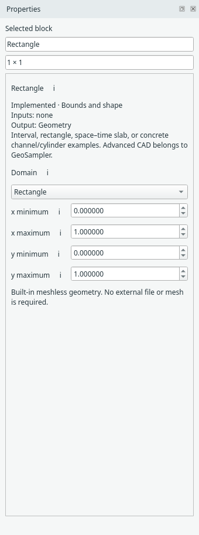
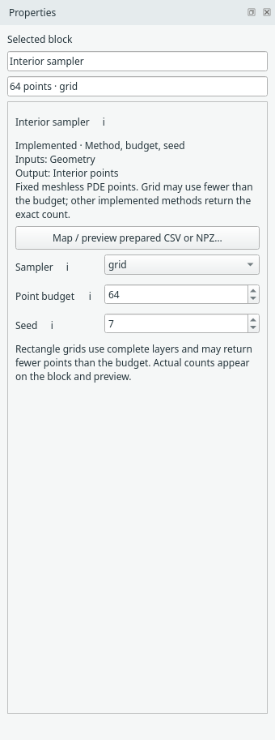
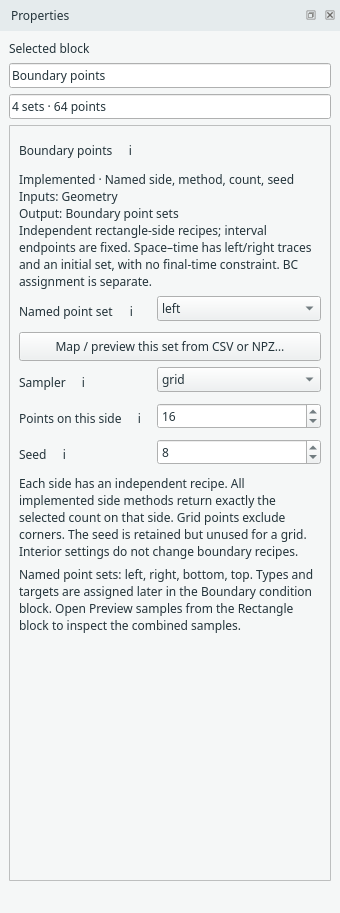
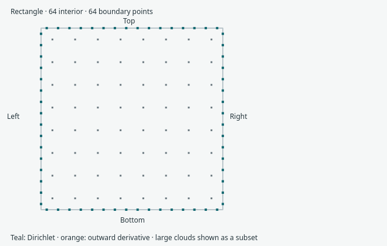
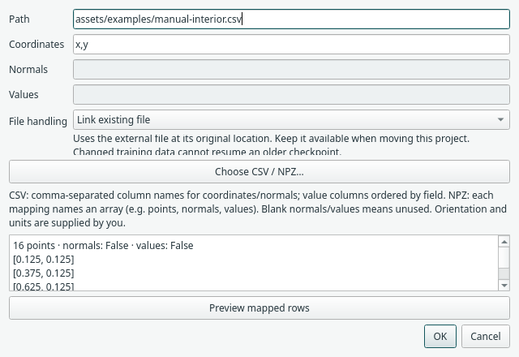

# Geometry, sampling and prepared data

You can solve simple domains without a geometry file. The built-in domain choices
are **Interval** (a 1D line segment), **Rectangle** (2D), and **1D space–time**
for the [Burgers initial-value problem](../burgers.md). Bounds are physical
coordinates used by sampling, derivatives and the network's coordinate mapping.

{ .portrait }

*Select the domain block to choose its shape and physical bounds. [Open full size](../../assets/screenshots/manual-domain.png).*

## Interior points and boundary points are separate

Select **Interior sampler** for the PDE-point count, sampler and seed. Grid,
random, Hammersley and stratified sampling are implemented. Current training uses
fixed samples per compiled run by default. To adapt interior points during training,
replace this block with **Residual refinement (RAR)** or **Importance sampling**. Importance scoring uses PDE residuals by default, or
a selected field’s spatial-gradient magnitude for steady problems; see the
[adaptive sampling guide](../adaptive-sampling.md).

{ .portrait }

*Interior sampler settings control the PDE collocation points. [Open full size](../../assets/screenshots/manual-interior.png).*

Select **Boundary points** to choose a named side, sampling method, count and seed.
For a 1D line segment, the two boundary sets are its endpoints. For rectangles,
each side has its own sampling recipe. This block creates point sets; the separate
Boundary condition block assigns the physics on them.

{ .portrait }

*Rectangle sides have independent point-set settings. [Open full size](../../assets/screenshots/manual-boundary-points.png).*

Right-click the Rectangle block and choose **Preview samples** to check the basic
rectangle's points. The preview is intentionally specific to this geometry; it is
not a CAD or general 3D viewer.



*The Rectangle sample preview shows the current interior and boundary samples. [Open full size](../../assets/screenshots/manual-samples.png).*

## Bring prepared CSV or NPZ points

Use the sampler's **Map / preview…** action. Choose a file, explicitly map its
coordinate columns/array, then **Preview mapped rows** before applying.



*The mapping dialog previews the selected coordinates before accepting them. [Open full size](../../assets/screenshots/manual-map-data.png).*

For a small mapping exercise, choose [manual-interior.csv](../../assets/examples/manual-interior.csv)
and set **Coordinates** to `x,y`. It has 16 interior points in the unit square.
This is a data-mapping fixture, not an adequately sampled accuracy study. Interior
imports use coordinates only. CSV column names can differ; supply their names in
coordinate order. For NPZ, use the array name, such as `points`.

Boundary imports can additionally map outward unit normals and supported target
values. Make the coordinate orientation and units consistent with your model.
The [prepared Jorvik contract](../jorvik-contract.md) covers the supported
planar schema and label selection. It does not import arbitrary CAD or FEM meshes.

## Training locations are not export locations

Prediction/export blocks use a separate regular grid by default. Random training
samples are compatible with VTI export. The separate Evaluation points block
accepts supplied CSV/NPZ coordinates and IDs; Reference data provides optional
pointwise reference values. Mesh connectivity and direct Jorvik evaluation-point
transfer remain [planned work](../todo.md#future-evaluation-and-export-at-supplied-points).
The existing [Jorvik geometry block](../jorvik.md) supplies planar training samples.

**Next:** [PDEs and boundary conditions](physics.md).


For prediction at imported coordinates, use the separate
[Evaluation points and Reference data blocks](../evaluation-points.md). These
leave the interior/boundary training samplers unchanged.


## Separate prepared training sources

**Sampling → Interior data / Boundary data** provide dedicated CSV/NPZ source
blocks. For non-rectangular steady scalar geometry, select **Prepared 2D points**
and map user-named boundary sets. Assign their conditions downstream; use explicit
evaluation points rather than a bounding-box output grid. Try the triangle under
File → Examples. See [the illustrated guide](../training-data.md).

## Geometry in an external editor

Use [Jorvik geometry](../jorvik.md) for an owned geometry document and explicit
NetCDF sample updates. The first supported workflow is planar 2D scalar physics.

## Sampling and prepared-data Python snippets

### Snippet: Built-in box samplers and per-side boundary recipes

You can call `sample_box` directly for low-discrepancy or stratified point clouds,
or configure independent per-side `BoundarySampling` recipes on a `Rectangle`:

```python
from margam.components.sampling import sample_box
from margam.templates.poisson import BoundarySampling, PoissonConfig, sample_problem

# Direct box sampling in 2D: 'grid', 'random', 'hammersley', or 'stratified'
pts_hammersley = sample_box(([0.0, 0.0], [2.0, 1.0]), count=64, method="hammersley", seed=7)
pts_stratified = sample_box(([0.0, 0.0], [2.0, 1.0]), count=64, method="stratified", seed=7)
print("Sampled rows:", len(pts_hammersley), len(pts_stratified))

# Independent per-side rectangle boundary recipes
rect_cfg = PoissonConfig(
    shape="Rectangle",
    x_min=0.0,
    x_max=2.0,
    y_min=0.0,
    y_max=1.0,
    points=100,
    sampling="hammersley",
    boundary_sampling={
        "left": BoundarySampling(points=24, method="grid", seed=1),
        "right": BoundarySampling(points=24, method="grid", seed=2),
        "bottom": BoundarySampling(points=32, method="random", seed=3),
        "top": BoundarySampling(points=32, method="hammersley", seed=4),
    },
)
interior, boundaries = sample_problem(rect_cfg)
print("Side counts:", {side: len(rows) for side, rows in boundaries.items()})
```

### Snippet: Adaptive interior sampling (RAR and importance sampling)

Enable **Residual refinement (RAR)** or **Importance sampling** by setting
`adaptive_sampling` on `PoissonConfig`:

```python
from margam.templates.poisson import PoissonConfig, build_pinn

# Residual-based Adaptive Refinement (RAR): adds the highest-residual candidates every interval
rar_cfg = PoissonConfig(
    shape="Interval",
    points=16,
    pde_points="both",
    adaptive_sampling={
        "method": "rar",
        "interval": 50,
        "candidates": 256,
        "add": 4,
        "maximum": 64,
        "pool": "refresh",
    },
    iterations=150,
    device="cpu",
)
rar_model = build_pinn(rar_cfg)
rar_model.train(150, display_every=0)
print("Active PDE rows after RAR:", len(rar_model.collocation_point_sample))

# Importance sampling: resamples interior points with inverse-probability loss weights
imp_cfg = PoissonConfig(
    shape="Rectangle",
    points=32,
    adaptive_sampling={
        "method": "importance",
        "interval": 50,
        "candidates": 256,
        "uniform_fraction": 0.2,
        "score": "field_gradient",
        "field": 0,
        "pool": "fixed",
    },
    iterations=100,
    device="cpu",
)
imp_model = build_pinn(imp_cfg)
imp_model.train(100, display_every=0)
print("Importance events recorded:", len(imp_model.sampling_controller.history))
```

### Snippet: Non-rectangular `Prepared2D` domain from CSV/NPZ files

For non-rectangular steady planar domains (such as the bundled right triangle in
`assets/training/triangle`), map `interior_data` and named `boundary_data` sets
with outward unit normals (`nx,ny`):

```python
from margam.templates.prepared_triangle import prepared_triangle_config
from margam.templates.poisson import build_pinn

# Uses assets/training/triangle/{interior,base,upright,slope}.csv
tri_cfg = prepared_triangle_config("assets/training/triangle")
tri_cfg.iterations = 50
tri_cfg.device = "cpu"

tri_model = build_pinn(tri_cfg)
tri_model.train(50, display_every=0)
print("Prepared2D named boundary sets:", tri_cfg.sides)
```
