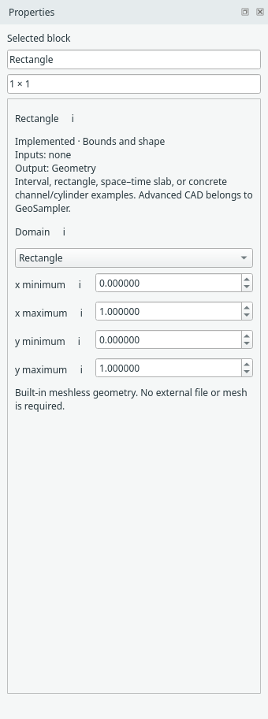
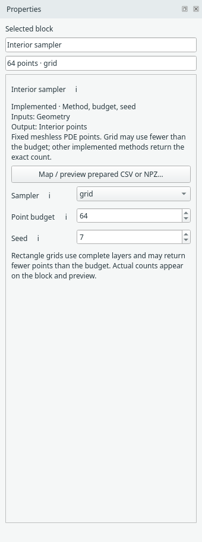
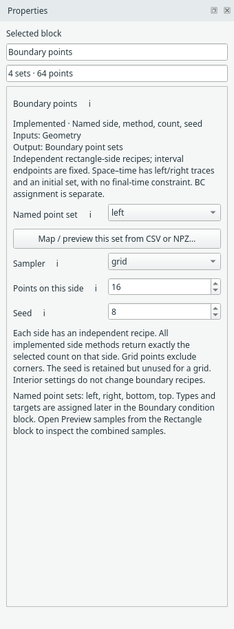
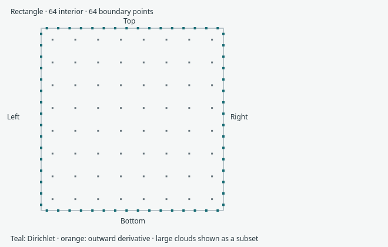
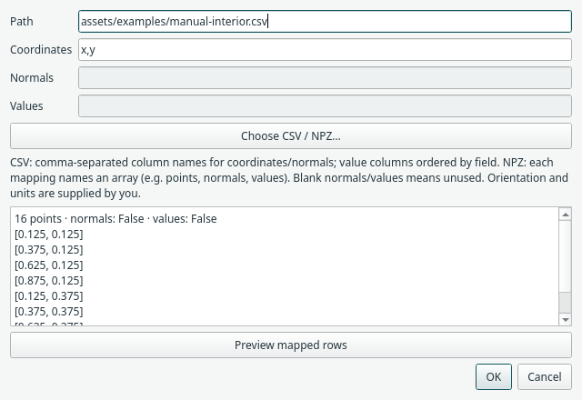

# Geometry, sampling and prepared data

You can solve simple domains without a geometry file. The built-in domain choices
are **Interval** (a 1D line segment) and **Rectangle** (2D). Bounds are physical
coordinates used by sampling, derivatives and the network's coordinate mapping.

{ .portrait }

*Select the domain block to choose its shape and physical bounds. [Open full size](../../assets/screenshots/manual-domain.png).*

## Interior points and boundary points are separate

Select **Interior sampler** for the PDE-point count, sampler and seed. Grid,
random, Hammersley and stratified sampling are implemented. Current training uses
fixed samples per compiled run by default. To adapt interior points during training,
replace this block with **Residual refinement (RAR)** or **Residual importance
sampling**; see the [adaptive sampling guide](../adaptive-sampling.md).

{ .portrait }

*Interior sampler settings control the PDE collocation points. [Open full size](../../assets/screenshots/manual-interior.png).*

Select **Boundary points** to choose a named side, sampling method, count and seed.
For a 1D line segment, the two boundary sets are its endpoints. For rectangles,
each side has its own sampling recipe. This block creates point sets; the separate
Boundary condition block assigns the physics on them.

{ .portrait }

*Rectangle sides have independent point-set settings. [Open full size](../../assets/screenshots/manual-boundary-points.png).*

Right-click the Rectangle block and choose **Preview samples** to check the basic
rectangle's points. The preview is intentionally specific to this geometry; it is
not a CAD or general 3D viewer.

*The Rectangle sample preview shows the current interior and boundary samples. [Open full size](../../assets/screenshots/manual-samples.png).*

## Bring prepared CSV or NPZ points

Use the sampler's **Map / preview…** action. Choose a file, explicitly map its
coordinate columns/array, then **Preview mapped rows** before applying.

*The mapping dialog previews the selected coordinates before accepting them. [Open full size](../../assets/screenshots/manual-map-data.png).*

For a small mapping exercise, choose [manual-interior.csv](../../assets/examples/manual-interior.csv)
and set **Coordinates** to `x,y`. It has 16 interior points in the unit square.
This is a data-mapping fixture, not an adequately sampled accuracy study. Interior
imports use coordinates only. CSV column names can differ; supply their names in
coordinate order. For NPZ, use the array name, such as `points`.

Boundary imports can additionally map outward unit normals and supported target
values. Make the coordinate orientation and units consistent with your model.
The [prepared GeoSampler contract](../geosampler-contract.md) covers the supported
planar schema and label selection. It does not import arbitrary CAD or FEM meshes.

## Training locations are not export locations

Current prediction/export blocks evaluate on a separate regular grid. Random
training samples are compatible with VTI export. Evaluating and exporting at the
original GeoSampler/FEM nodes, preserving their IDs/connectivity and optional
pointwise reference errors, is [planned work](../todo.md#future-evaluation-and-export-at-supplied-points).

**Next:** [PDEs and boundary conditions](physics.md).
