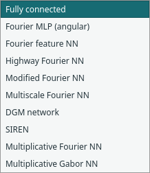

# Pointwise neural networks for PINNs

[Documentation index](README.md) · [Illustrated walkthrough](visual-guide.md) · [Components](components.md) · [Results](results.md#pointwise-network-compatibility)

Select a **Neural network** block and choose **Architecture** in Properties.
The same block/port works with baseline and self-adaptive PINN. No PhysicsNeMo
installation or new dependency is needed. Library search for Fourier, DGM, SIREN
or Gabor finds the network component; select the architecture in its properties.

## Choose and edit a network

1. Load a problem from **File → Examples**. Different examples select their own starting architectures.
2. If the PINN is compact, double-click it to expose the network/trainer pair.
3. Select **Neural network → Architecture**, then choose the implementation.
4. Edit its own frequency/gate/omega settings and hidden widths/seed. Equal-width
   restrictions are listed below; changing architecture resets its options.
5. Select the trainer separately for learning rate, update budget and loss/mask
   settings. Architecture selection does not retune these automatically.
6. Validate/train and open only the connected output views you need. Save the run
   before changing architecture if you want to retain its weights/results.



The [worked example](visual-guide.md#3-configure-the-siren-worked-example) separates
SIREN omega controls from the SA trainer controls. For example, `omega=10` belongs
to the network; `lr=0.001` belongs to training. [Fourier control screenshot](visual-guide.md#example-highway-fourier-controls)
shows the different options for the highway architecture. These screenshots are
UI evidence; the measured comparisons and their settings are in [results](results.md).

## Scope and common contract

Every supported network maps independent coordinate rows `(N,D)` to field rows
`(N,C)`: D=1 or 2 and C=1 for scalar physics or 3 for steady u/v/p. Domain bounds
supply fixed [0,1] coordinate normalisation for the original networks. Affine
Fourier NN instead uses physical coordinates by default, with an explicit option
to normalize first. Both preserve physical-coordinate chain rules and avoid
batch-dependent predictions/derivatives. Seeded initialisation
and Fourier/Gabor sampling use Torch's RNG. No batch normalisation, dropout, grid
input or dependencies between sample rows are introduced.

These are **pointwise networks**, including coordinate Fourier features and filters.
They are not FNO/AFNO, spectral convolutions, graph/attention operators or learned
maps between discretised functions. Those operator architectures were deliberately
excluded. DGM here is a network architecture; it does not add a separate DGM
sampling/training algorithm. The selected PINN method still owns the physics loss
and training procedure.

## Implemented architectures

| UI choice / config key | Construction | File |
| --- | --- | --- |
| Fully connected / `fcnn` | Original tanh, Xavier-normal MLP, unchanged | [FCNN.py](../margam/nn/FCNN.py) |
| Fourier MLP (angular) / `fourier_mlp` | Raw coordinates + sine/cosine of exp-spaced angular frequencies → smooth MLP | [fourier.py](../margam/nn/fourier.py) |
| Affine Fourier NN / `affine_fourier` | Explicit affine inputs → trainable dense projection → sine → smooth trunk | [affine_fourier.py](../margam/nn/affine_fourier.py) |
| Fourier feature NN / `fourier` | Raw coordinates + fixed 2π Fourier features → smooth MLP | [fourier.py](../margam/nn/fourier.py) |
| Highway Fourier NN / `highway_fourier` | Fourier trunk with a shared sigmoid transform gate and linear carry projection | [highway.py](../margam/nn/highway.py) |
| Modified Fourier NN / `modified_fourier` | Two fixed input encoders mixed multiplicatively through hidden states | [modified_fourier.py](../margam/nn/modified_fourier.py) |
| Multiscale Fourier NN / `multiscale_fourier` | Several Gaussian Fourier branches, one shared MLP, concatenated readout | [multiscale_fourier.py](../margam/nn/multiscale_fourier.py) |
| DGM network / `dgm` | Gated hidden-state updates driven by coordinates and state | [dgm.py](../margam/nn/dgm.py) |
| SIREN / `siren` | Sine activations with distinct first/hidden/output initialisation | [siren.py](../margam/nn/siren.py) |
| Multiplicative Fourier NN / `fourier_filter` | Learned sinusoidal filters multiplied through affine hidden stages | [multiplicative_filter.py](../margam/nn/multiplicative_filter.py) |
| Multiplicative Gabor NN / `gabor_filter` | Learned sinusoidal filters with trainable positive Gaussian envelopes | [multiplicative_filter.py](../margam/nn/multiplicative_filter.py) |

Shared smooth layers/scaling are in [pointwise.py](../margam/nn/pointwise.py).
[factory.py](../margam/nn/factory.py) selects the concrete implementation; the
Torch-free [settings catalogue](../margam/components/network_config.py) supplies UI
choices and validated serialisation. The original FCNN constructor, parameter
names, initialisation and predictions remain bitwise identical at the same seed.

## Settings and equations

All architectures retain hidden-layer widths and the independent network seed.
Use 1–6 hidden layers and 1–256 neurons per layer. Highway/modified Fourier, DGM
and multiplicative filters require equal widths (for example `32,32`). Skip
connections also require equal widths. Other architectures allow unequal widths.

Changing architecture resets its architecture-specific options; trainer settings
are unchanged. The change is one undoable edit, so Undo restores the previous
architecture and options together. Invalid layer drafts remain editable but cannot
train. List controls accept comma-separated finite numbers.

### Fourier encodings

Standard/highway/modified Fourier use `sin(2π x B), cos(2π x B)`, concatenated with
normalised raw coordinates. `axis`, `full` Cartesian-product and `diagonal`
encodings use the specified frequency list; `gaussian` draws a fixed random matrix
with configurable feature count and scale. Deterministic encodings also apply the
frequency scale. Frequencies are cycles per normalised coordinate, not necessarily
cycles per physical metre. Axis/diagonal redundant zero/repeated directions follow
the inspected upstream layout.

Defaults: axis frequencies `0,1,2,3`, scale 1; Gaussian count 16 when selected.
Lists contain 1–16 frequencies within [-64,64]; Gaussian features 1–128; scale
0.001–64. Fourier MLP instead uses angular frequencies `scale*exp(linspace(0,π,modes))`
without an additional 2π; default 4 modes and scale 1. It generalises the upstream
pointwise FourierMLP feature construction to the chosen Margam hidden widths and
field readout.

Highway uses `T=sigmoid(project_T(features or raw x))`, `P=project_P(features or raw x)`
and `h = T*activation(W h+b) + (1−T)*P` at each hidden stage. The gate uses Fourier
features by default; the carry projector uses raw coordinates by default. Both
switches are exposed. Modified Fourier uses encoders U,V and hidden state Z with
`h=U+(V−U)*Z`; Z follows the selected smooth activation and is not necessarily a
convex mixing coefficient. These are distinct architectures, not aliases.

Multiscale uses independent Gaussian matrices at up to four scales, with one shared
MLP and a linear readout of concatenated branch states. Defaults: scales `1,2`,
16 features per scale. Smooth tanh (default), SiLU or sine and optional upstream-style
skip connections are available for these Fourier networks.

### DGM and SIREN

DGM forms Z,G,R from coordinate/state affine pairs, forms H using the R-gated
state, then updates `S=(1−G)*H+Z*S`. The configured smooth activation is applied
to all four gates, as in the inspected NVIDIA implementation; the default here is
tanh, while NVIDIA's inspected full DGM class defaults to sine. Depth is the number
of hidden-width entries: one initial layer plus depth−1 gated cells.

SIREN exposes first-layer and hidden-layer omega, both default 30 (range 0.01–100).
Its first weight bound is 1/input-width, hidden bound sqrt(6/input-width)/omega,
and final linear-layer bound sqrt(6/input-width), following NVIDIA's supplied
SirenLayer variant. Biases use ±sqrt(1/input-width). The last layer has no sine.
The hidden omega initialisation cancels its activation scale; first omega still
strongly influences derivatives. Retune rates/frequencies rather than assuming
FCNN training defaults suit every SIREN problem.

### Multiplicative filters and explicit adaptations

Filter frequencies/phases are learned network parameters. Input scale (default 1)
is divided by sqrt(depth+1); each stage multiplies an affine state by a fresh
coordinate filter. There are depth+1 filters and depth affine mixing stages.
Gabor adds centres and Gamma-initialised widths (shape 6, rate 1 by default).
Widths use a softplus parameterisation to stay positive. Squared distance is
computed directly as a sum of squares, avoiding the undefined second derivative
of a norm at a filter centre. These two changes from upstream are intentional for
PINN Hessians. Tests include evaluation exactly at a Gabor centre.

No weight normalisation, learned activation parameters, dictionary/key wrappers,
parameter-input encodings or upstream normalisation framework was imported.
Margam uses small defaults, fixed domain scaling, its own field contract and explicit
settings; this is an adaptation, not upstream checkpoint/config compatibility.

## Recipes, models and checkpoints

Baseline and SA recipes share the architecture setting. Expand a compact recipe
to choose/edit its network, then collapse its trainer to retain the complete
architecture and option dictionary. Individual network blocks remain replaceable
through the existing typed network input. Examples still default to FCNN unless
explicitly configured otherwise; architecture changes do not silently retune rates.

Model format **10** reads formats 1–9 and migrates older network/compact records to
FCNN with empty options. New run checkpoints include a network specification
(type, canonical options, widths, dimensions, bounds and seed), in addition to
weights/buffers and optimiser state. Resume rejects changed settings even when
parameter shapes match, such as changed SIREN omega or a same-sized Fourier basis.
Earlier FCNN checkpoints without that specification remain supported; new
architectures require it. Run archives remain format 2 and use restricted loading.

## Use from Python

```python
from margam.templates.poisson import PoissonConfig, build_pinn

config = PoissonConfig(shape='Interval', points=32, layers=(16,16),
                       network_type='siren',
                       network_options={'first_omega':10., 'omega':10.},
                       method='self_adaptive', lr=.001, boundary_weight=10.)
model = build_pinn(config)
model.train(700, display_every=0)
```

To obtain only the network, use `margam.nn.factory.build_network(config)`; the
selected field contract supplies its input/output dimensions. Direct classes live
in the files above. Neural-operator type strings and unknown/unsafe settings are
rejected, not dynamically imported or executed.

## Verification and evidence

[Network tests](../tests/test_pointwise_networks.py) check first/second derivatives
against numerical differentiation in float64, output shape, per-row independence,
Fourier basis and physical-coordinate scaling, gating equations, positive/smooth
Gabor behaviour, original FCNN identity, exact checkpoint resume and setting-mismatch
rejection. Real u/v/p training is exercised for every architecture with baseline
and SA, plus hard-Dirichlet wrapping of DGM. [UI tests](../tests/test_network_ui.py)
exercise every architecture through selection, compact/expanded conversion,
clipboard, model/run save/open and resume. No result views open automatically.

A [recorded compatibility study](results.md#pointwise-network-compatibility) trains
all ten choices with both methods on one small Poisson problem. It uses explicit
low-frequency options and a lower SIREN rate, not all UI defaults; parameter counts
also differ. It establishes working cases, not universal accuracy or a ranking.
High frequencies amplify PDE derivatives and can require different sampling/rates.
Current evidence is CPU-only; stiff/multiscale benchmarks and CUDA remain unverified.

Source provenance/licences: [THIRD_PARTY.md](../THIRD_PARTY.md). Local layer revision
`96b7cd1…`; full PhysicsNeMo Sym models at `0c5f18c…`. These sources were inspected
and adapted; the original checkouts were not modified.

## Random weight factorization

Fully connected, Fourier feature and modified Fourier networks expose optional
**Random weight factorization** with log-scale mean/std controls. It preserves
the initialized effective function and trains exponential row scales plus direction
weights. Existing disabled settings preserve checkpoint architecture descriptions.
The [Expert PINN guide](expert-pinn.md#random-weight-factorization) explains its
paper reference, initialization and derivative checks. This is reusable outside
the Expert recipe and is not a new neural-operator architecture.


## Affine Fourier NN

The additional `affine_fourier` architecture applies explicit affine coordinate
expressions, a trainable dense projection and sine features before its shared
trunk. Unlike the existing fixed Gaussian features, both projection weights and
bias optimize with the network. Physical coordinates are the default; optional
normalization is explicit. See [settings, example equations and limits](scale-pinn.md#affine-inputs-and-trainable-sine-features).
