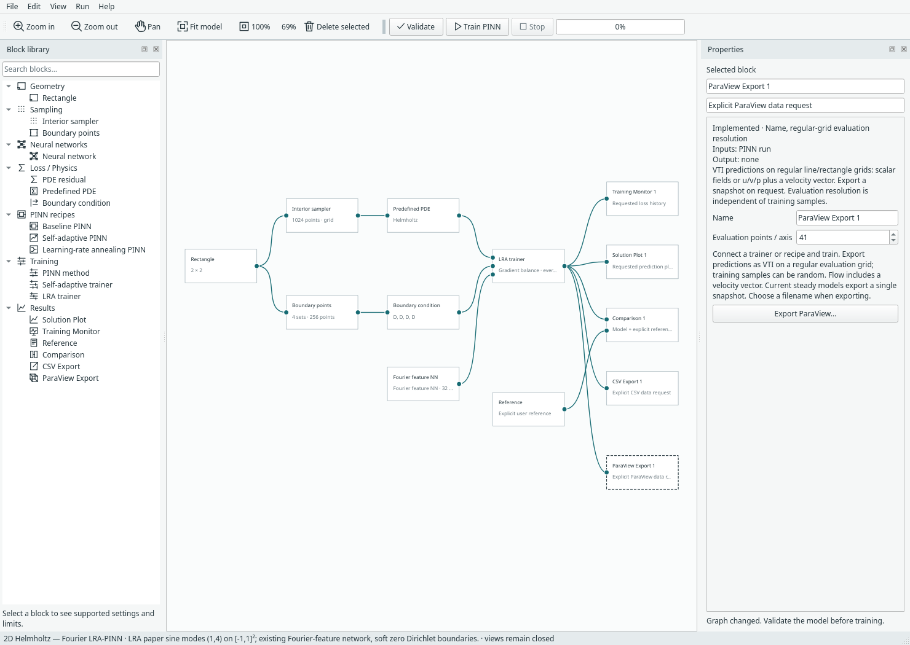

# ParaView export

[Documentation index](README.md) · [Inputs and future evaluation/export work](todo.md#future-evaluation-and-export-at-supplied-points)

## Explicit block, no default export

Add **Results → ParaView Export** and connect a trainer or compact recipe to it.
Set its evaluation resolution, train, then right-click **Export ParaView…** or use
its inspector button. It writes steady predicted fields as a `.vti` file and Burgers space–time
predictions as a `.pvd` physical-time series. The Burgers example includes a
connected export block; startup graphs retain opt-in insertion. No file is written by training,
and no viewer is launched. CSV Export remains a separate, unchanged block.
Saved runs retain the requested predictions so they can be exported after reopening.



**Random training points work.** The block evaluates the learned network on its
own regular grid. That grid includes the domain endpoints/edges; resolution N
means N points on a line or N×N on a rectangle. It does not export training samples
or GeoSampler/mesh nodes. Evaluation at supplied nodes is future work, recorded
in TODO; it must preserve original coordinates, IDs and field associations.

Scalar results have point array `u`; current flow results have scalar arrays `u`,
`v`, `p` and a three-component `velocity=(u,v,0)` array suitable for vector filters.
Coordinates retain the model's physical bounds. 2D lies at z=0, not in a fabricated
volume. Reference/error arrays, material/cell fields, units and meshes are not part
of this initial writer. No reference solution is assumed or evaluated.

## VTI, VTU and time

- **VTI** means uniform structured ImageData: implicit origin, spacing and extents.
- **VTU** means an unstructured grid with explicit points/cells, not time dependence.
- **PVD** is a collection of snapshots with explicit physical-time values.

The [VTK XML specification](https://docs.vtk.org/en/v9.6.1/vtk_file_formats/vtkxml_file_format.html)
defines ImageData and point arrays. The [ParaView animation guide](https://docs.paraview.org/en/latest/UsersGuide/animation.html)
explains that time-varying inputs supply the timesteps for playback.
Each temporal VTI also contains a `TimeValue` field. Times need not be uniformly
spaced and are not network-training updates or epochs. Time is never written as
an extra spatial coordinate. Timestamp units are whatever physical units the
caller supplies; no seconds or other units are inferred.

Steady Margam problems export one snapshot without inventing a time value.
The [Burgers space–time example](burgers.md) exports playable physical-time frames
through the same explicit block. The writer API also accepts transient snapshots:

```python
from margam.components.paraview_export import export_pvd

# Each data object contains regular spatial points, prediction values and
# optional field names. The caller evaluates the model at that physical time.
export_pvd('solution.pvd', [(0.0, data_at_t0), (0.125, data_at_t0125), (0.9, data_at_t09)])
```

This API is ready for a future transient executor; there is no transient UI solver
or time-selection control yet. It requires increasing finite times, matching grids
and field schemas. It writes one VTI per snapshot and a PVD index referencing them
with relative paths. Keep the PVD and companion folder together. ParaView opens
the **PVD**, not individual snapshots, to play the entire series.

## Playable test dataset

[Standing-wave demo](../assets/examples/paraview-demo/standing-wave.pvd) is a known-value
**synthetic format test, not a PINN prediction or physics benchmark**. It has 21
frames, times 0 through 1, a 21×21 grid on [−1,1]² and scalar field
`demo_scalar=sin(pi*x)*sin(pi*y)*cos(2*pi*t)`. All companion snapshots are included
in that folder. Nonuniform timestamps are covered separately by tests at
0, 0.125 and 0.9.

In ParaView: **File → Open** the PVD, **Apply**, colour by **demo_scalar**, then
press **Play**. Generate another dataset without training:

```sh
mkdir -p benchmark-results
.venv/bin/python -m examples.export_paraview_demo --output benchmark-results/playback.pvd
```

## Dependencies, correctness and scope

Runtime needs only the existing NumPy and Python XML/file tools: no VTK, PyVista,
meshio or ParaView installation inside Margam. Output is uncompressed ASCII XML.
The writer rejects incomplete, irregular or incorrectly ordered grids rather than
silently changing their geometry. VTK ordering is x fastest, then y. Writes are
staged and replaced atomically; invalid data or a failed index write preserves
an existing export. Replacing a PVD uses a new companion folder and retains old
companions rather than deleting files that may still be in use elsewhere.

Tests check line/rectangle coordinates, field values, velocity components,
XML escaping, finite values, time ordering, per-frame metadata and rollback on
failure. A real **VTK 9.7.1** reader was installed only in an isolated temporary
validation directory; it is not a project dependency or virtual-environment change.
It reads the generated grids, arrays and `TIME_STEPS` metadata. The full demo is
also checked against its known formula. ParaView itself is not installed on this
host, so its actual graphical Play button has not been exercised here; the PVD
manifest and snapshot time metadata are verified.

```sh
.venv/bin/python -m unittest discover -s tests -p 'test_paraview*.py' -v
```

The optional real-reader test skips if VTK is absent; normal writer/UI tests still
run. Model format 12 reads formats 1–11; run archives remain format 2. Existing CSV
models/archives retain their behaviour. No viewer embedding, irregular geometry,
FEM connectivity export or input-node evaluation is included in this first pass.
