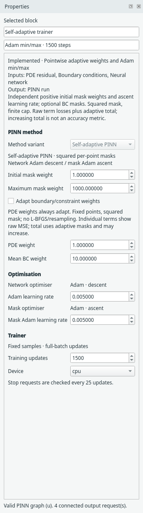
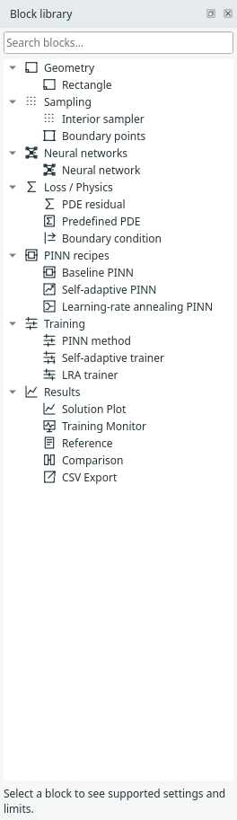

# PINN recipes: compact and expanded

A recipe is one reusable method construction, not a complete physics problem.
Keep **one file per recipe** under `margam/recipes/`. Implemented recipes are `baseline.py`, `self_adaptive.py`, `learning_rate_annealing.py`, `expert.py` and `scale.py`. Each defines the internal components, connections, defaults,
external ports and exposed settings. Both insertion forms use this same file.

Numerical methods remain one file each under `margam/methods/`; baseline training
is `pinn.py`. Shared networks, samplers and losses remain in their existing modules.
A recipe composes them instead of copying their implementations. Physics examples
live under `margam/templates/` and appear in File → Examples.

For actual screenshots of a configured SIREN/SA pair before and after collapse,
see the [compact/expanded walkthrough](visual-guide.md#4-understand-expanded-and-compact-recipes).
It also shows that optimiser controls and network controls belong to different blocks.

## Using the baseline recipe

Choose **File → Insert PINN recipe → Baseline PINN · compact** or **expanded**.
The block library's Baseline PINN entry inserts the compact form. Insertion adds
components without replacing an existing method: remove the old trainer/network
if building on an existing example, or collapse that trainer directly.

The compact form exposes training steps, learning rate and device. It defaults to a
seeded tanh fully connected network, loss weights and full-batch Adam training.
The selected pointwise architecture and its options are also retained.
PDE residual and boundary-condition inputs stay outside. Geometry and sampling
also stay outside and can be edited using their existing blocks. Outputs connect
to the recipe's PINN run port just as they connect to the original trainer.

Double-click the compact block, use its inspector button, or right-click and
choose **Expand into components**. This opens its two editable components directly
on the canvas: Neural network → PINN method. There is no separate nested editor.
Choose an [architecture](neural-networks.md), edit widths/seed/options, or delete
the network and connect a replacement supported Neural network block. The existing network port contract supplies domain coordinates
and scalar u or coupled u/v/p outputs; it accepts the implemented pointwise architectures, not neural operators.
Loss weights are edited on the expanded trainer. Adam is currently the only UI
optimiser; there is no nonfunctional optimiser selector.

Right-click the trainer and choose **Collapse as Baseline PINN** to hide it and its
connected network. Every component parameter is retained, including custom widths,
seed, loss weights and training settings. The method's identifier and external
physics/output connections are retained. Expanding places the network beside the
trainer; individual layout offsets are not stored in the compact block. Undo
restores the exact prior expanded layout and wiring.

A shared network cannot be collapsed, because hiding it would remove another
trainer's input. Hard Dirichlet is a distinct method and is not relabelled as this
baseline recipe. Unsupported or incomplete graphs still fail validation.

## Persistence and checks

Model format 23 stores compact recipes, gPINN/RBA settings and separate data
sources while reading formats 1–22. Compact
settings contain the complete component parameters; loading a saved model does
not replace them with recipe defaults. Copy/paste gives the block a fresh identity.
Expand/collapse and expanded insertion are each one undoable edit. They are disabled
during training and invalidate previous run data just like other graph edits.

Regression checks cover save/load, clipboard, undo/redo, network replacement,
scalar and coupled graph equivalence, training through the compact block, and
identical numerical predictions after training compact/expanded configurations
from the same seed. Result views remain explicit and closed until opened.

Self-adaptive PINN has its own trainer and recipe file, with the same insertion and
expand/collapse interactions. See [SA-PINN](self-adaptive-pinn.md) for its pointwise
mask settings, checkpoint contract and numerical evidence.

Learning-rate annealing also has dedicated compact/expanded forms. Its trainer
reuses existing networks and adds scalar gradient balancing; see [LRA](lra-pinn.md).

### Inspector control groups

Compact recipes and expanded trainers separate **PINN method** (variant, loss
weights and method-specific adaptation), **Optimisation** (network Adam learning
rate and, for SA, its separate mask Adam ascent rate), and **Trainer** (update
budget and device). These are inspector labels, not new graph blocks or a change
to numerical training, recipe ownership or checkpoint format. LRA balancing
settings belong to the method; they do not decay Adam's base learning rate.

The collapsible block library separates **PINN recipes** (Baseline, SA and LRA
compact constructions) from **Training** (their expanded method/trainer blocks).
Optimisation settings remain in the inspector; no standalone optimiser block is
currently implemented. Existing block names, saved models and connections stay valid.

## Expert PINN

**Expert PINN** / **Expert trainer** use the same compact/expanded recipe contract,
with one definition in `margam/recipes/expert.py`. This is Margam’s name for the
[Expert’s Guide v1 pipeline](expert-pinn.md), not a name used by its authors. The
first runnable case is File → Examples → 1D examples → Burgers — Expert PINN.

[Scale-PINN](scale-pinn.md) adds its own correction trainer and compact recipe. It stores the previous optimizer iterate and preserves replaceable networks; physical PDE diagnostics remain separate from the corrected training loss.
