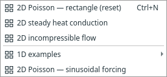
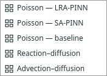

# Problem examples and predefined equations

File → Examples is the catalogue of complete runnable desktop graphs. Existing
Poisson, heat and steady incompressible flow examples remain available. The [Burgers example](burgers.md) adds the original 1D space–time initial-value
problem, with prediction/export blocks and no assumed exact reference. Other
manufactured cases exercise the new Predefined PDE block:

| Example | Equation | Reference (domain noted where different) |
| --- | --- | --- |
| Interval Poisson | uₓₓ + 2 = 0 | x(1−x) |
| Interval reaction–diffusion | −uₓₓ + u = (π²+1)sin(πx) | sin(πx) |
| Interval advection–diffusion | uₓ − 0.1uₓₓ = 1 | x |
| 2D Helmholtz — Fourier LRA-PINN | Δu + u = (1−17π²)sin(πx)sin(4πy), on [−1,1]² | sin(πx)sin(4πy) |
| Rectangle sine Poisson | Δu + 2π²sin(πx)sin(πy) = 0 | sin(πx)sin(πy) |

Dirichlet endpoints/edges follow the reference. The advection case has unequal
endpoint values. Reaction–diffusion and sine Poisson use the existing hard
Dirichlet method; the others use the baseline method. Training Monitor, Solution
Plot, Comparison and CSV Export are wired explicitly; no view opens automatically.

Predefined PDE and PDE residual are alternatives, not sequential stages. The
former chooses a tested family (Poisson, reaction–diffusion, interval
advection–diffusion, Helmholtz, or steady incompressible flow); the latter retains editable
restricted expressions. Both produce the same typed residual connection. The
supported graph has one PDE producer. A preset supplies neither BCs nor a
reference solution. Source/coefficient, coordinate forcing and viscosity settings
belong to the selected block. Forcing uses the existing restricted mathematics
parser; no Python scripts are executed.

Poisson uses Δu+c+f=0; reaction–diffusion uses −Δu+cu=f;
advection–diffusion uses cuₓ−νuₓₓ=f with positive ν and an interval domain.
Flow retains the existing steady u/v/p equations and rectangular domain contract.
Changing a family does not automatically replace BCs, outputs or reference
expressions: update these to describe the intended problem.

Model format 16 persists spatial/space–time block settings and compact recipes and
reads earlier formats 1–15. Burgers has dedicated correctness checks rather than
the manufactured-reference accuracy checks below.
The tests check manufactured residuals and train the smaller examples for 700 CPU
updates, Helmholtz for 2,000, with RMS prediction error below 0.05 across the full domain. This is a regression check for these
configured cases, not a guarantee for arbitrary coefficients or domains.

File → Examples also includes Poisson — SA-PINN, using its
separate trainer and the same explicit interval reference. See self-adaptive-pinn.md.

**Poisson — LRA-PINN** uses the same explicit reference,
FCNN 16×16, 32 points, Adam rate 0.001, 2,000 updates, alpha 0.9, interval 10 and
cap 100 (an explicit practical guard). Its 700-update regression also requires
RMSE <0.05. See [algorithm and measured comparison](lra-pinn.md).

File → Examples → **1D examples** groups the five line-domain cases: baseline,
SA and LRA Poisson, reaction–diffusion and advection–diffusion. The 2D rectangle,
heat, incompressible flow and sinusoidal Poisson cases stay in the parent menu
with explicit 2D names. No new dimension or physics support is implied.

The [2D Helmholtz example](helmholtz.md) uses the LRA paper problem with our existing
Fourier-feature network, not its proposed architecture. It remains in the parent
Examples menu as an explicitly 2D case.

## Expert PINN examples

The dedicated **File → Examples → Expert PINN examples** submenu contains Allen–Cahn, advection, Stokes channel/cylinder, Kuramoto–Sivashinsky, lid-driven cavity, torus and transient cylinder, alongside Expert Burgers. Read the [equations, initial-field variations and limitations](expert-examples.md).

## Scale-PINN starters

**File → Examples → Scale-PINN examples** contains Allen–Cahn (1D + time) and lid-driven cavity (2D, Re=3200), using the existing physics with a replaceable Fourier network and Scale trainer. See [correction settings, diagnostics and differences from the paper](scale-pinn.md).
