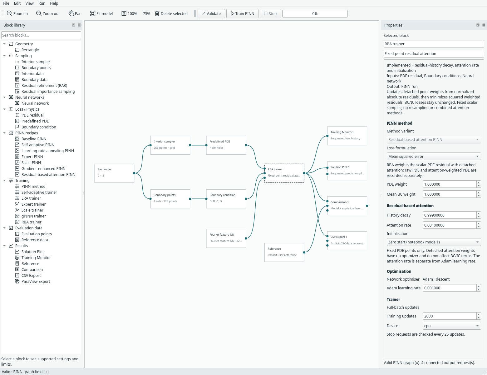
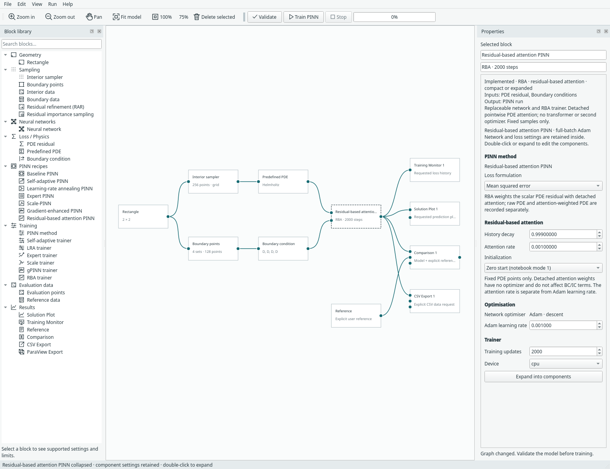
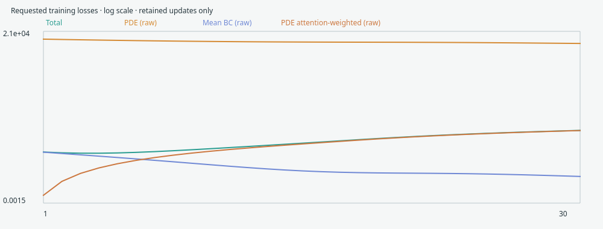

# Residual-based attention PINN

Choose **File → Examples → RBA examples** for Allen–Cahn or 2D Helmholtz.
**Residual-based attention PINN** is also a compact recipe under **PINN recipes**,
with a separate **RBA trainer** under **Training**. The network remains replaceable.



*RBA attention settings are separate from Adam learning rate and network settings.
[Open full size](../assets/screenshots/manual-rba-trainer.png).*

RBA here means **pointwise residual weighting**, not Transformer self-attention.
There are no queries/keys/values and no extra attention network or optimizer.
It follows Anagnostopoulos, Toscano, Stergiopulos and Karniadakis,
[Residual-based attention in physics-informed neural networks](https://doi.org/10.1016/j.cma.2024.116805),
with verification against the [authors' code](https://github.com/soanagno/rba-pinns).

## The update rule

For each fixed scalar PDE point, compute its physical residual error r, including
its PDE target. Before the network update:

```text
q = abs(r) / max(abs(r))
lambda_next = gamma*lambda + eta*q
L_PDE_attention = mean((stop_gradient(lambda_next)*r)²)
L_total = w_PDE*L_PDE_attention + sum_j w_j*L_BC_or_IC_j
```

The maximum is over the fixed PDE point set. If every residual is zero, q is
explicitly zero, avoiding a 0/0 division. The old attention then decays normally.
The **weight multiplies the residual before squaring**; this is not mean(λr²).
Normalization, recurrence and attention weights are detached from autograd.
Gradients still flow through r into the network parameters.

Boundary/initial-condition operators and losses are unchanged. Attention applies
to PDE rows only. The same point retains its accumulated history at every update.
The candidate mask is committed only after finite-loss/gradient checks and the
successful optimizer step. Validation, inspection and output evaluation do not
advance attention.

## Controls and initialization

| Control | Meaning | Default |
| --- | --- | --- |
| History decay | γ, retained contribution of previous attention | 0.999 |
| Attention rate | η, residual-history increment; separate from Adam rate | 0.001 |
| Initialization | First-step attention rule | Zero start (mode 1) |

Both notebook modes are available:

- **Zero start:** λ starts at zero; the first increment is ηq.
- **Normalized first residual:** λ starts at zero, but the first increment is q
  rather than ηq. Later increments use ηq. This reproduces notebook mode 2.

There is no arbitrary mask clamp. For normalized residuals in [0,1], the
recurrence's asymptotic scale is η/(1−γ). A normalized first step can temporarily
exceed that scale; its global envelope also includes the initial maximum one.
The checkpoint validator allows conservative floating-point tolerance around the
bound, checks finite nonnegative values and exact row count, and requires zero
masks for an untrained checkpoint.

Decay must be between 0 and 0.999999 and attention rate between 10⁻⁸ and 1000.
These numeric limits keep the controls finite and γ representable below one in
the supported float32 workflow. They are not tuned performance recommendations.



*The single definition in `margam/recipes/residual_attention.py` supplies both
representations. Expand it to replace the neural network; attention stays with
the trainer.*

## Monitor raw and weighted losses



The monitor separately records:

- `pde`: ordinary, unweighted physical PDE MSE.
- `pde_weighted`: attention-weighted PDE MSE, before global PDE weight.
- Existing boundary/initial terms, unchanged by attention.
- `total`: the actual weighted training objective.

Early in zero-start training, `pde_weighted` can be very small because attention
has not accumulated yet. It is not evidence of a small physical residual or a
more accurate solution. Raw and attention-weighted curves can move differently.
The trainer/compact recipe's right-click **Attention statistics** shows the saved
step and mask minimum/mean/maximum; the asymptotic scale is also shown.
These statistics remain available after reopening a run.

## Included examples and differences

**Allen–Cahn · 1D + time** reuses Margam's existing equation, x²cos(πx) initial
profile and periodic field/first-derivative constraints on x∈[−1,1], t∈[0,1]. It
uses a replaceable fully connected network and fixed random collocation points.
There is no final-time constraint and no assumed exact later-time reference.

**Helmholtz · 2D** reuses the existing sine-forced problem on [−1,1]², with
u=sin(πx)sin(4πy) as an explicitly connected reference and the existing Fourier
network. The second coordinate is spatial y, not physical time.

These are starting examples for the RBA algorithm, not paper reproductions.
Margam retains its own point budgets, network controls, soft initial/boundary
constraints, mean-loss grouping and fixed Adam learning rate. The upstream hard
transforms, enhanced architectures, learning-rate schedule, datasets and reported
accuracy/speedups are not bundled or claimed. Existing heatmaps are not expanded;
views/files remain explicit requests.

## Fixed-point and checkpoint contract

The first implementation supports scalar interval/rectangle/1D space–time models,
prepared 2D scalar data and the concrete Allen–Cahn case. Integral quadrature,
RAR/importance resampling, minibatches, coupled/vector residual weighting, inverse
parameters and combinations with SA/LRA/gPINN/Scale/Expert time marching are not
silently enabled. Moving attention requires a separate transfer contract.

Training rejects changed compiled points/targets, including a reordered point set.
Actual resume reconstructs and fingerprints ordered data, normals and targets.
Checkpoints retain the detached mask, RBA settings/configuration, network/Adam
state and raw/weighted loss history. Changed data, mask counts or attention settings
are rejected. Canonical CPU target fingerprints allow GPU checkpoints to validate
and resume on CPU; cross-device training is not claimed bitwise identical.

Model format **23** adds RBA settings and reads formats 1–22. Existing methods
migrate the unused defaults without changing their losses. Archived predictions
can be viewed/exported without original files, while actual training resume needs
its source data. Masks belong to training points, not independent evaluation
locations; result exports do not invent attention values at new points.

## Reproduce the checks

From the repository root using its existing environment:

```bash
python -m examples.rba --device cpu --steps 6 --output /tmp/rba-cpu.json
python -m examples.rba --device cuda --steps 6 --output /tmp/rba-cuda.json
python -m unittest tests.test_rba tests.test_rba_ui -v
python -m examples.capture_rba --overwrite
```

[CPU](../assets/benchmarks/rba-cpu.json) and
[CUDA](../assets/benchmarks/rba-cuda.json) records cover both initialization modes
on both examples, six updates, detached masks, raw/weighted losses, identical
same-device continuation and requested field evaluation. These are software
checks, not tuned accuracy experiments. Tests also verify the recurrence and
squared-weight derivative analytically, zero-residual handling, failed-step mask
atomicity, all network choices, reordered-point/corrupt-mask rejection, older
method migrations, UI persistence, CPU loading of GPU archives and Allen–Cahn
physical-time PVD export.

The [source record](../assets/benchmarks/rba-reference.json) stores paper/notebook
hashes and the inspected MIT-licensed upstream revision. No upstream code/data is
copied into the independent implementation. The
[capture manifest](../assets/screenshots/manual-rba-captures.json) identifies the
actual isolated desktop screenshots.
