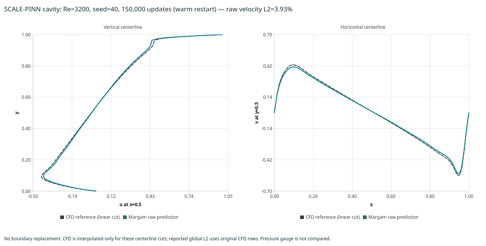
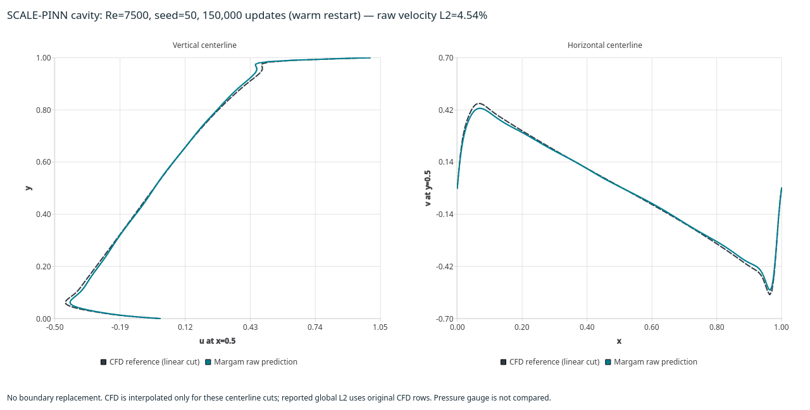

# SCALE cavity reproduction attempts

This is a separate, paper-sized research protocol for the lid-driven cavity (LDC).
The editable **File → Examples → Scale-PINN examples** entries remain starter
presets. Their current network, sampling, gauge and BC normalization are not the
complete published training protocol.

The source is Chiu et al., [Scale-PINN v1](https://arxiv.org/abs/2602.19475v1),
section 4.5.1, Table A1 and Figure 3. The inspected local reference repository is
[chiuph/SCALE-PINN](https://github.com/chiuph/SCALE-PINN), revision
`5ff8219d2604de8a57a5b7a9c7db9b435c5c3257`. Its source/data are not bundled here.
Margam's network, derivative implementation and driver are independently written.

## Protocol

| Setting | Re=3200 | Re=7500 |
| --- | --- | --- |
| Updates / cosine decay budget | 50,000 | 50,000 |
| Total draws per update | 400 | 1,000 |
| Additional boundary draws | 50 | 50 |
| Shared trunk | 128 Fourier features → 32 → 32 | 256 Fourier features → 64 → 64 |
| Three separate u/v/p heads | 32 → 32 → 32 → 1 each | 64 → 64 → 64 → 1 each |
| Parameters | 15,424 | 59,520 |
| Initial Adam learning rate | 0.0005 | 0.0005 |
| Final rate / cosine exponent | 1e-10 / 0.8 | 1e-10 / 1.2 |
| τsc / τα / γ | 0.06 / 1 / 1/Re | 0.095 / 0.5 / 1/Re |
| Boundary loss coefficient | 15 | 10 |
| Notebook's single-run seed | 50 | 20 |

The input expansion is `(x,y,x-1,y-1)`. A trainable He-initialized projection
is followed by `sin(2πz)`, shared SiLU layers and separate SiLU heads. Output
layers have no bias. These are ordinary importable PyTorch modules, not a new
GUI-wide network registration or a compiled-training toggle.

The local CSVs contain 102×102 and 152×152 rows respectively, including wall
rows around the nominal 100×100 and 150×150 interior grids. Four corner rows are
excluded from training. Each update draws `batch-50` points from the complete
corner-free cloud and 50 from its boundary subset, with replacement. Consequently
some all-domain draws are also boundary rows; the actual BC count can exceed 50.

For this research protocol, boundary rows contribute only velocity BC loss and
are masked out of the PDE objective. There is no pressure gauge. The PDE loss
sums the two momentum and continuity MSEs, while BC loss sums the global u and v
boundary MSEs. Only boundary velocity labels enter training. Interior CFD values
are evaluation-only. Margam's normal arrow-controlled PDE-source behavior is
unchanged.

## Reproduce a run

From the repository root, with the existing `.venv` and the local reference
repository as a sibling directory:

```bash
.venv/bin/python -m examples.scale_cavity_benchmark \
  --reference-directory ../SCALE-PINN/ns-ldc \
  --reynolds 3200 --seed 50 --output build/scale-cavity/re3200-new

.venv/bin/python -m examples.scale_cavity_benchmark \
  --reference-directory ../SCALE-PINN/ns-ldc \
  --reynolds 7500 --seed 20 --output build/scale-cavity/re7500-new
```

Choose a fresh output directory. `--updates` can stop at a smaller budget without
changing the 50,000-step decay schedule. Continue a matching research checkpoint
with `--resume path/to/checkpoint.pt`, retaining its Adam moments, previous iterate,
sampling RNG and history. Changed reference bytes or protocol/backend settings
are rejected. `--device cpu --eager` is available for small checks.

Each reporting interval writes `checkpoint.pt`, `report.json` and raw
`predictions.csv` with x/y/u/v/p. These **research checkpoints are not native GUI
run archives**. A loaded `ScaleCavityNetwork` can evaluate the trained weights
without executing upstream code. Pressure is determined only up to a constant;
the main comparison concerns velocity.

## Explicit refinement experiments

A weights-only warm restart is a **changed training protocol**, not exact
checkpoint continuation or a 50,000-update paper result:

```bash
.venv/bin/python -m examples.scale_cavity_benchmark \
  --reynolds 7500 --seed 50 \
  --output build/scale-cavity/re7500-seed50-new

.venv/bin/python -m examples.scale_cavity_benchmark \
  --reynolds 7500 --seed 50 --learning-rate 0.0001 \
  --warm-start build/scale-cavity/re7500-seed50-new/checkpoint.pt \
  --output build/scale-cavity/re7500-refine-new

.venv/bin/python -m examples.scale_cavity_benchmark \
  --reynolds 7500 --seed 50 --learning-rate 0.00005 \
  --batch-size 4000 --boundary-draws 200 --retain-best \
  --warm-start build/scale-cavity/re7500-refine-new/checkpoint.pt \
  --output build/scale-cavity/re7500-large-refine-new
```

This starts a new 50,000-update cosine phase from the saved network, resetting
Adam, the sampling stream and the previous iterate. The report records the source
checkpoint SHA-256, prior update count/cost, new learning rate and cumulative
training updates/cost. Resuming that phase instead uses `--resume` and the same
learning-rate override; it restores its optimizer/sampler rather than resetting
them. Original paper-budget attempts are retained separately.

For a standalone centerline comparison and ParaView vertex cloud:

```bash
.venv/bin/python -m examples.plot_scale_cavity \
  --run build/scale-cavity/re7500-large-refine-new --best \
  --output build/scale-cavity/re7500-centerlines-new.png \
  --vtu build/scale-cavity/re7500-predicted-new.vtu
```

The helper independently reloads the checkpoint on CPU, verifies its reference
identity and raw metric, then exports predicted u/v/p and a velocity vector. It
does not fabricate mesh connectivity. The centerline figure linearly interpolates
the **local CFD reference only for its cuts**; global error metrics retain original
CFD rows without interpolation. Warm-restart figures show cumulative updates.

## Fast derivatives and correctness

`margam.research.scale_cavity` propagates values, x/y first derivatives and xx/yy
second derivatives through the affine, sine and SiLU layers. Parameter gradients
remain ordinary differentiable PyTorch operations. This permits compilation of
the complete case-specific loss without placing `autograd.grad(create_graph=True)`
inside an AOTAutograd-compiled network.

The derivative channels, loss and **every parameter gradient** are checked against
ordinary autograd and Margam's native `ScalePINN`. The compiled CUDA loss and
parameter gradients are independently compared with eager evaluation. This is
not a generalized compiler backend for all PINNs.

## Compare errors and timing honestly

The main metric is the raw two-component velocity relative L2 on the provided
CFD coordinates, excluding only the four corners. Interior-only and complete-grid
metrics are also recorded. A separate boundary-replaced diagnostic is explicitly
labelled and never substitutes for raw predictions.

Figure 3 reports velocity relative errors of 1.73% at Re=3200 and 2.97% at
Re=7500, with about 90 and 150 seconds on an RTX 3090/JAX setup. Cached upstream
notebook outputs vary by seed. Match the reference, budget and metric before
comparing those numbers.

Local training time is synchronized and excludes evaluation/checkpoint I/O.
Compilation/first-backward time and total wall time are separate. The compiler
may reuse its persistent cache. Local GPU model, Torch version, source hashes and
reference-file hashes are recorded. PyTorch and JAX random streams/initial weights
are different; using the same numeric seed does not imply identical initialization.
Low PDE loss alone is not evidence of the correct high-Re flow.

Exact local notebook protocols/reference fields are currently available for
Re=3200 and 7500. The higher-Re GUI starters are not automatically promoted to
validated paper reproductions. No reference fields are fabricated for them.

`--batch-size` and `--boundary-draws` explicitly change the mini-batch protocol.
The larger-batch refinement uses 4,000 total draws with 200 additional boundary
draws at Re=7500, and 500 at Re=3200. `--retain-best` separately saves
`best-checkpoint.pt`, `best-report.json` and `best-predictions.csv` using the
lowest raw CFD error among reporting intervals. This is **reference-based model
selection**, not a final fixed-budget iterate. Its search cost includes the
complete training phase. Plotting it requires `--best`; the default remains final.

## Recorded attempts

[Complete numerical evidence](../assets/benchmarks/scale-cavity-reproduction-2026-11-13.json)
retains all **11 full-budget training phases** and the two selected snapshots.
All models were independently reloaded and their raw metrics verified against
the original reference bytes. Exact hash-matching executed driver revisions are
preserved locally under `build/scale-cavity/sources/`; future runs save their own
source snapshots. The snapshots and trained weights remain local artifacts.

The hardware is an **RTX 3060 Laptop GPU**, using Torch 2.14.1+cu130 and float32.
Across all attempts, measured training totals **2,360 s (39.3 minutes)**, excluding
compilation and evaluation/checkpoint I/O. This is the complete study cost, not
one model's time.

### Original 50,000-update budget

| Re | Paper relative L2 | Local best final relative L2 | Seeds measured | Local training per seed |
| --- | --- | --- | --- | --- |
| 3200 | 1.73% | 4.17% | 10, 20, 30, 40, 50 | 195–206 s |
| 7500 | 2.97% | 18.36% | 20, 50 | 199–202 s |

The other Re=7500 seed ended at 37.76%; it is retained, not discarded. The local
Re=3200 final errors span 4.17–5.98%. These runs establish fast execution of the
matched mathematical case; they **do not match the published accuracy**.

### Changed-protocol refinements

Both selected initial models received 50,000 more updates at learning rate
0.0001 with their original batches, followed by 50,000 at 0.00005 with 4,000-row
batches. Adam and sampling were reset at each phase; the equations, architecture
and Scale correction were unchanged.

| Re / seed | Final raw relative L2 | Cumulative updates | Cumulative training | Reference-selected snapshot | Updates at selection |
| --- | --- | --- | --- | --- | --- |
| 3200 / 40 | 3.93% | 150,000 | 599 s | 3.70% | 101,000 |
| 7500 / 50 | 4.54% | 150,000 | 756 s | 3.95% | 135,000 |

The selected snapshots were identified retrospectively from the full phase;
their lower creation-time cost is not presented as the total selection cost.
The published 1.73%/2.97% targets remain unmatched. Low residuals alone do not
justify claiming a reproduced or more accurate CFD solution.





*Final iterates after 150,000 cumulative updates. The legend and axes use raw
network velocities; no boundary values are replaced. CFD interpolation applies
only to the pictured cuts, not the tabulated full-field metrics.*

[Selected Re=3200 figure](../assets/benchmarks/scale-cavity-re3200-selected.png) ·
[Selected Re=7500 figure](../assets/benchmarks/scale-cavity-re7500-selected.png)

The code/objective/derivative implementation is qualified against native Scale;
the remaining accuracy and convergence-speed gap is an open reproduction issue.
Re=10,000/20,000 were not claimed solved from the existing starter presets.
