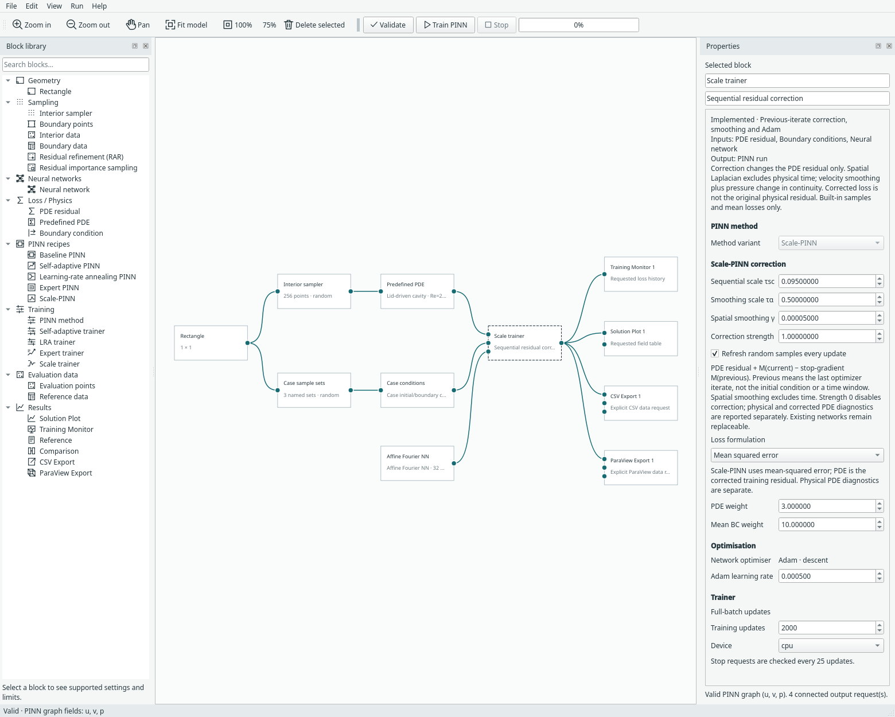
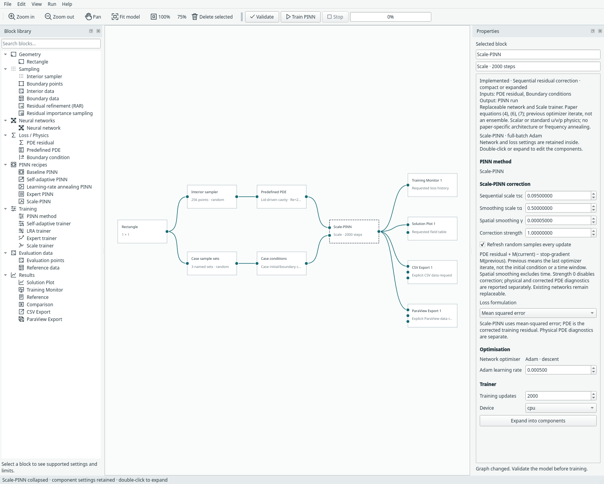
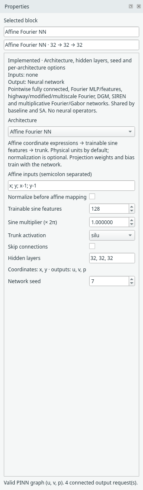

# Scale-PINN: sequential correction

Choose **File → Examples → Scale-PINN examples** for Allen–Cahn, five cavity
Reynolds numbers through **Re=20,000**, Kuramoto–Sivashinsky and Korteweg–de Vries.
New examples use a replaceable **Affine Fourier NN**, with the input equations
from their corresponding notebooks and a trainable sinusoidal projection. **Scale-PINN** is also available as a compact recipe
under **PINN recipes**, with a separate **Scale trainer** under **Training**.


This is an independent PyTorch implementation of the core algorithm in
Chiu, Wong, Ooi, Wei, Fan and Ong, *Scale-PINN: Learning Efficient Physics-Informed
Neural Networks Through Sequential Correction*,
[arXiv:2602.19475v1, 23 February 2026](https://arxiv.org/abs/2602.19475v1).
The name expands to **Sequential Correction Algorithm for Learning Efficient PINN**.

## Available problems

| Example | Domain and conditions | Starting correction settings (τsc, τα, γ) |
| --- | --- | --- |
| Allen–Cahn | x∈[−1,1], t∈[0,1]; x²cos(πx) initially; periodic u/uₓ | (0.45, 1.5, 0.0001) |
| Cavity Re=400 | 2D unit square; moving lid, stationary other walls, one pressure gauge | (0.06, 1, 1/400) |
| Cavity Re=3200 | Same geometry/conditions, ν=1/3200 | (0.06, 1, 1/3200) |
| Cavity Re=7500 | Same geometry/conditions, ν=1/7500 | (0.095, 0.5, 1/7500) |
| Cavity Re=10,000 | Same geometry/conditions, ν=1/10,000 | (0.095, 0.5, 1/10,000) |
| Cavity Re=20,000 | Same geometry/conditions, ν=1/20,000 | (0.095, 0.5, 1/20,000) |
| Kuramoto–Sivashinsky | x∈[0,2π], t∈[0,0.4]; cos(x)(1+sin(x)) initially; periodic through third derivative | (0.2, 1.5, 100/16²) |
| Korteweg–de Vries | x∈[−1,1], t∈[0,1]; cos(πx) initially; periodic through second derivative | (0.1, 20, 0.022) |

Each cavity is an independent steady problem. There is no Reynolds continuation,
curriculum or automatic sweep. ν=γ=1/Re for unit lid speed/length. The PDE block
shows the Reynolds number implied by the current lid speed, height and viscosity.
Changing viscosity does not silently update the independently editable γ.

**Re=400, 10,000 and 20,000 are starting configurations**, borrowing correction
settings from the inspected Re=3200/7500 notebooks. The Reynolds numbers and
physical equations follow the paper; these are not claims that their full tuned
configurations or high-Re accuracy were reproduced. Existing 256-point,
32-wide starter networks are deliberately editable, not paper benchmark budgets.
At high Re, matching a steady residual does not establish physical flow stability.

KS uses uₜ+(100/16)uuₓ+(100/16²)uₓₓ+(100/16⁴)uₓₓₓₓ=0. The fourth-order coefficient
follows the paper's Figure 1 and inspected notebook. One prose line in section
4.4.2 prints 16² instead; it is not used. Positive second-derivative and
fourth-derivative signs are preserved.

KdV uses uₜ+uuₓ+νuₓₓₓ=0, ν=0.022². Its Scale smoothing γ=0.022 is √ν, not ν.
The new predefined PDE exposes the nonlinear and dispersion coefficients, with
fixed case-specific initial/periodic conditions. KdV currently supports baseline
or Scale training; Expert time marching is not implicitly enabled for it. Both
transient examples export physical-time PVD frames through the explicit export
block, with no final-time training condition.

## What changes in training

Scale changes the **PDE residual**, leaving the specified initial/boundary
operators intact. At optimizer step k, let fₖ be the current network and fₖ₋₁ its
previous iterate. Equations (4) and Algorithm 1 give:

```text
M(f) = f / τsc − (γ / τα) Δspace f
corrected residual = physical residual + M(fₖ) − stop_gradient(M(fₖ₋₁))
```

The same freshly sampled coordinates are used for both networks. The previous
network's parameters are frozen, but spatial derivatives of its output still
require coordinate autograd. The result M(fₖ₋₁) is detached after those derivatives
are computed. **Time is excluded from the smoothing Laplacian.**

Initially w₋₁=w₀: the correction's value is zero, but its derivative through the
current network remains active. Detaching the entire correction would therefore
implement a different algorithm. Before Adam updates wₖ to wₖ₊₁, Margam saves wₖ
as the next previous iterate. This is a one-step lag, not an EMA, an ensemble,
a sequence of correction networks or the previous physical-time window.



## Scalar and flow equations

For a scalar field, the formula applies directly to its existing residual,
including its forcing/target. Spatial dimensions follow the geometry: x for a
1D space–time problem, x/y for a steady 2D problem. γ is an explicit coefficient;
changing the PDE diffusivity does not silently change it.

For standard incompressible u/v/p flow, equations (6)–(7) prescribe a specific
mapping rather than adding three identical smoothing terms:

| Physical residual | Added correction |
| --- | --- |
| Momentum x | (uₖ−uₖ₋₁)/τsc − (γ/τα) Δspace(uₖ−uₖ₋₁) |
| Momentum y | (vₖ−vₖ₋₁)/τsc − (γ/τα) Δspace(vₖ−vₖ₋₁) |
| Continuity | (pₖ−pₖ₋₁)/τsc |

Pressure does **not** receive a smoothing Laplacian. The standard residual order
must be momentum x, momentum y, continuity; altered custom flow residuals are
rejected. The torus auxiliary-vorticity formulation has no implemented Scale
mapping and is rejected instead of silently applying a velocity/pressure rule.

The Allen–Cahn starter solves uₜ−0.0001uₓₓ+5(u³−u)=0 on x∈[−1,1], t∈[0,1],
with initial x²cos(πx), periodic u/uₓ and no final-time condition. The cavity is a
unit square with lid velocity (1,0), stationary other walls and one pressure gauge.
These reuse the [existing physical problem contracts](expert-examples.md).

## Controls and starter configurations

| Control | Meaning |
| --- | --- |
| Sequential scale τsc | Positive divisor of the field change; not a physical time step or Adam learning rate |
| Smoothing scale τα | Positive divisor of spatial smoothing |
| Spatial smoothing γ | Nonnegative smoothing coefficient; paper AC uses diffusivity and flow uses viscosity |
| Correction strength | Margam control multiplying the entire correction; 1 implements the formula, 0 gives the uncorrected shared MSE objective |
| Refresh random samples every update | New built-in PDE and condition coordinates each optimizer update; requires random sampling recipes |

The Allen–Cahn starter uses τsc=0.45, τα=1.5, γ=0.0001 and combined constraint-weight budget
100: the shared contract assigns 50 to each initial/periodic named loss. The Re=3200 cavity starter uses τsc=0.06, τα=1, γ=1/3200, boundary-budget control 15
and Adam rate 0.0005. Its effective lid/walls coefficients are 5 each and the
pressure-gauge coefficient is 1. These correction coefficients were checked against the
corresponding authors' notebooks. Network, training budget and boundary-set loss
normalization are Margam choices, not a reproduction of their full configuration.

The shared reported PDE loss is **component-mean MSE**. The cavity starter sets
PDE weight 3 so its objective sums the two momentum and continuity contributions,
as in the paper. Existing named-condition weighting and one pressure gauge are
preserved. The cavity lid/wall corner discontinuities are handled by excluding
corner samples; the lid is not silently smoothed.

## Inspect the right diagnostic

The monitor's **pde** curve is the **corrected training residual**. It is not the
original physical PDE error. The training log reports all three quantities:

- Physical PDE MSE, without sequential correction.
- Corrected PDE MSE, used for training.
- Correction RMS, measuring the added term.

Right-click the trainer or compact recipe and choose **Scale correction
diagnostics** to inspect the latest values, including after reopening a run.
All are measured before that optimizer update. No solution accuracy follows
from a small corrected loss alone, and no analytical reference is assumed.

## Compact, expanded and saved runs



The single recipe definition is `margam/recipes/scale.py`; both forms use the same
network/trainer settings. Expand to replace the network with an existing supported
pointwise architecture. Shared sampling, physics, views, CSV and ParaView blocks
retain their existing roles. Training creates no file or default view.

Model format 19 adds Scale settings and migrates older models. Run archives use
restricted tensor/primitive loading and store **both current and previous network
states**, Adam, phase, deterministic sampling identity and diagnostics. Omitting
the previous iterate would change the first resumed update. CPU continuation is
tested bitwise; GPU comparisons use rtol=1e−5, atol=1e−7 and record bitwise identity
separately. Previous Expert/time-marching archives retain their default Scale
settings through migration.

## Included scope and differences

This implementation covers the **sequential-correction method** with existing
scalar and standard u/v/p physics. It currently uses mean MSE, built-in points
and Adam. Fixed sampling is available by unchecking refresh. Imported points,
RAR/importance sampling and integral quadrature are rejected until their explicit
composition rules are implemented. Scale is an independent trainer; it does not
silently combine with SA masks, LRA/NTK balancing or Expert time marching.

The paper's branch/concatenation architectures, sine-first-layer frequency
annealing and warmup-cosine schedule are **not included**. These starter examples
use existing Margam networks and fixed Adam rate. Gray–Scott, Rayleigh–Bénard, airfoil and multiple-obstacle benchmark
configurations remain future work. These require concrete concentration/temperature,
initial-data or geometry contracts; no upstream datasets are silently bundled. Published timings, convergence and accuracy are not reproduced.

The upstream [repository](https://github.com/chiuph/SCALE-PINN), reviewed at
`5ff8219d2604de8a57a5b7a9c7db9b435c5c3257`, states **all rights reserved**. Its
source and datasets are not copied or bundled. The paper's equations were
implemented independently; no JAX, Flax, Optax, evojax or evosax installation is
needed. Existing NVIDIA-derived networks retain their separate attribution in
[third-party notes](../THIRD_PARTY.md).

## Recorded checks

[CPU evidence](../assets/benchmarks/scale-cpu.json) and
[CUDA evidence](../assets/benchmarks/scale-cuda.json) record short, fully specified
runs for all eight examples, frozen-iterate continuation and an uncorrected strength-zero control using
the same sampling sequence. They report training diagnostics, **not solution
error**. No accuracy or speedup conclusion should be drawn from these runs.

```bash
python -m examples.scale_pinn --device cpu
python -m examples.scale_pinn --device cuda
python -m unittest tests.test_scale tests.test_scale_ui -v
python -m examples.capture_scale --overwrite
```

Tests additionally cover the spatial-only polynomial Laplacian, pressure-to-
continuity mapping, first-step correction gradients, disabled-correction baseline
equivalence, non-finite updates, corrupted previous states, graph expansion and
saved GUI runs.


## Affine inputs and trainable sine features

Select the Neural network block and choose **Affine Fourier NN**. The architecture
is available to other PINN recipes too; it is separate from the Scale correction
algorithm. Existing saved Gaussian-Fourier networks retain their original settings
and weights when reopened. No checkpoint is silently converted.

{ .portrait }

| Scale example | Affine inputs in physical coordinates | Sine projection |
| --- | --- | --- |
| Cavity, all five Re presets | `x; y; x-1; y-1` | sin(2π(Wφ+b)) |
| Allen–Cahn | `t; x` | sin(2π(Wφ+b)) |
| KdV | `t; x; t-1` | sin(2π(Wφ+b)) |
| KS | `t; x/(2*pi); t-0.4` | sin(4π(Wφ+b)) |

These match the inspected notebook input equations, including Margam's named
(x,t) coordinate convention. Allen–Cahn does not add shifted copies. The KS
shift is its example's physical end time; if you change that time, edit the
explicit mapping as needed. The new compact Scale recipe uses physical identity
inputs by default, because a generic recipe has no specific physical example.

The projection weights **and bias train** with the network. This differs from
our existing fixed Gaussian Fourier feature matrix. Physical coordinates are
used by default: **Normalize before affine mapping** is off for these examples.
Turning it on explicitly maps bounds to [0,1] first, changing the meaning of the
affine expressions and frequency scale.

Expressions are semicolon-separated coordinate combinations, using x/y/t as
available, constants, `pi`, addition/subtraction and multiplication/division by
constants. For example `x-1`, `(x-2)/4` and `2*x-y` are valid. Nonlinear expressions,
functions, executable Python, missing coordinates and zero denominators are
rejected. Blank means the current coordinate order. Limits are 16 expressions,
1024 characters and finite coefficients with magnitude at most 10⁶.

**Trainable sine features** controls projection width (1–256); **Sine multiplier
(× 2π)** controls phase scaling. Cavity examples default to 128 features; the
scalar examples use 32. Trunk activation/layers remain independently configurable.
The trunk receives sine features rather than an implicit raw-input/sine/cosine
concatenation. Fixed/standard Fourier architectures remain available separately.

This is an independent implementation of the observed input equations and
learned sine mapping. It retains Margam's shared replaceable trunk/output layer;
it does not reproduce the cavity's branched heads or KdV/KS's concatenation of
intermediate activations. The projection uses independent He-uniform weight
initialization and zero bias; the existing trunk initialization remains unchanged.
A shifted affine expansion can collapse algebraically to another affine map,
but its parameterization and initialization differ. It is not a claim that every
shift adds an independent frequency.

Sources: upstream [cavity notebook](https://github.com/chiuph/SCALE-PINN/blob/main/ns-ldc/plot_benchmark_pinn_ldc3200.ipynb),
[KdV notebook](https://github.com/chiuph/SCALE-PINN/blob/main/kdv/plot_benchmark_kdv.ipynb),
[KS notebook](https://github.com/chiuph/SCALE-PINN/blob/main/ks/plot_benchmark_ks.ipynb) and
[Allen–Cahn notebook](https://github.com/chiuph/SCALE-PINN/blob/main/ac/plot_benchmark_ac.ipynb).
The [inspection record](../assets/benchmarks/affine-fourier-reference.json) stores
source hashes and implementation differences. Upstream declares all rights reserved;
no code or data was copied into the new implementation.

The [affine CPU record](../assets/benchmarks/scale-affine-cpu.json) and
[affine CUDA record](../assets/benchmarks/scale-affine-cuda.json) exercise all eight
cases with smaller networks, short training, checkpoint continuation and an
uncorrected control. These are implementation checks, not accuracy comparisons.
Earlier Gaussian-network evidence above remains historical. Unit tests verify
affine values, physical-coordinate derivatives through fourth order, trainable
projection updates, invalid-expression rejection, old-network loading and UI
persistence through compact/expanded recipes.
