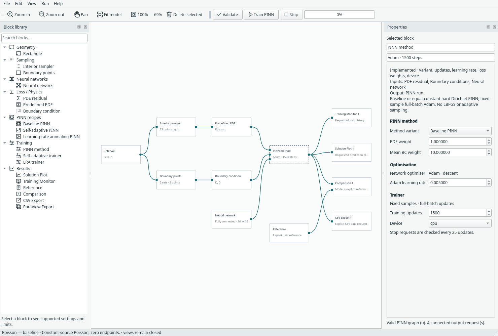
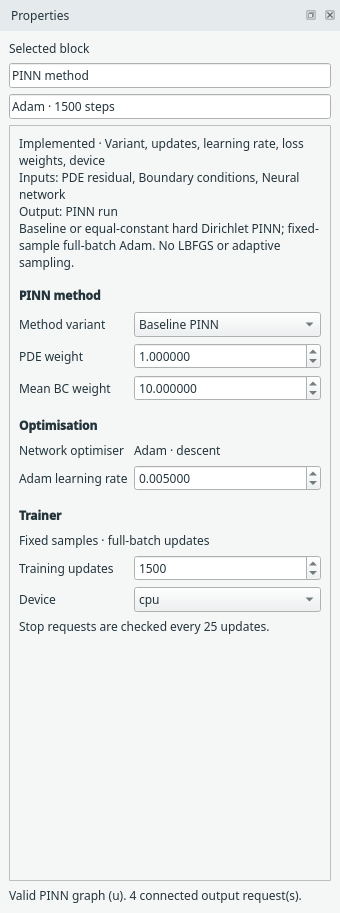
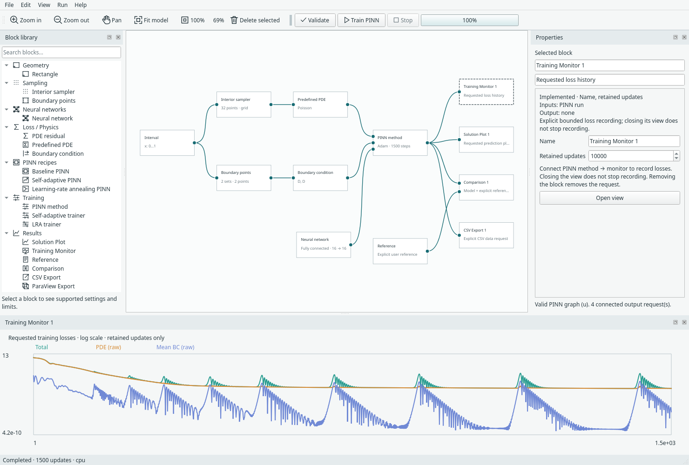
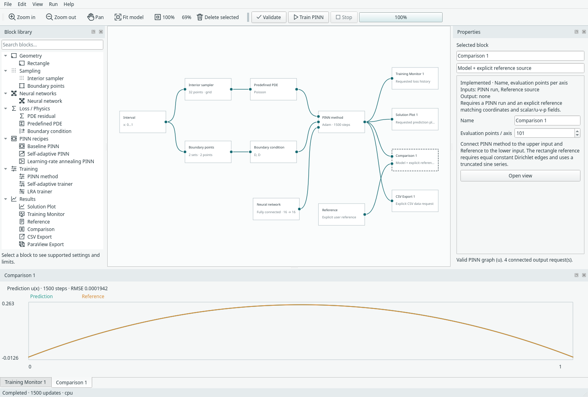

# Your first PINN

This walkthrough opens a ready-wired 1D Poisson problem, trains it, opens optional
results and saves the work. You do not need to draw the graph or import geometry.

## 1. Open a complete example

Choose **File → Examples → 1D examples → Poisson — baseline**. Save or discard
existing unsaved edits if asked. The example opens as a new editable model.

{ .portrait }

*The 1D submenu groups baseline, SA and LRA Poisson with two other scalar examples. [Open full size](../../assets/screenshots/manual-examples-1d.png).*

The problem is `u_xx + 2 = 0` on `0 <= x <= 1`, with zero values at the two ends.
Its separate Reference block supplies `x*(1-x)` for the Comparison output.
“Interval” in the geometry controls means a 1D line segment, not a time interval.

## 2. Read the graph

Follow the connections: domain → interior points → PDE; domain → boundary
points → BCs; network → trainer. The trainer connects to the requested outputs.
Click a block to see its settings in **Properties** on the right.

*A complete 1D example with separate network and trainer and explicitly connected outputs. [Open full size](../../assets/screenshots/manual-expanded.png).*

## 3. Find the training controls

Select **PINN method**. Properties separates **PINN method**, **Optimisation** and
**Trainer**. The default example uses a fully connected network with 16×16 hidden
layers, Adam, and 1,500 updates. You can change these later; use the defaults for
this tour.

{ .portrait }

*The three settings groups distinguish the method, Adam and the run budget. [Open full size](../../assets/screenshots/manual-training-settings.png).*

## 4. Validate and train

Click **Validate**, then **Train PINN** or press **F5**. The progress indicator
shows training progress. Editing is locked during the run; canvas navigation
remains available. **Stop** retains a partial run and is checked between batches.

Training does not open figures or write export files. This is intentional.

## 5. Open the results you requested

Double-click **Training Monitor** to see losses. Double-click **Comparison** to
see predictions alongside the explicitly connected reference. Each view belongs
to its output block. Closing or hiding a view does not remove its block.

*Training Monitor opened explicitly after the default example completed. [Open full size](../../assets/screenshots/manual-monitor.png).*

*Comparison uses the separate Reference connection; normal prediction outputs do not assume one. [Open full size](../../assets/screenshots/manual-comparison.png).*

The screenshots illustrate where information appears, not an accuracy target.
For what each loss curve means, read [Training and results](../use/results.md).

## 6. Save the model and the trained run

Choose **File → Save model as…** to save the graph as `.margam.json`. If you want
the trained weights, results and ability to continue, also choose **Save run and
checkpoint…** for a `.margam-run.pt` file. These files have different jobs.

**Next:** [Learn the workspace](workspace.md), [change a network](../modeling/networks.md),
or [save and resume in detail](../use/saving.md).
