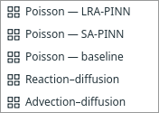
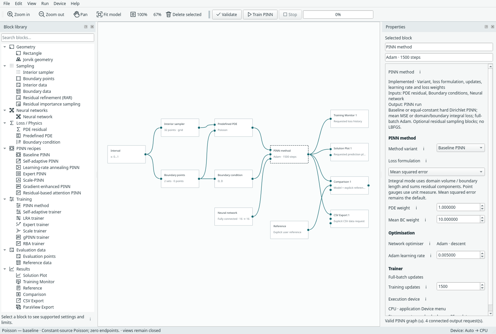
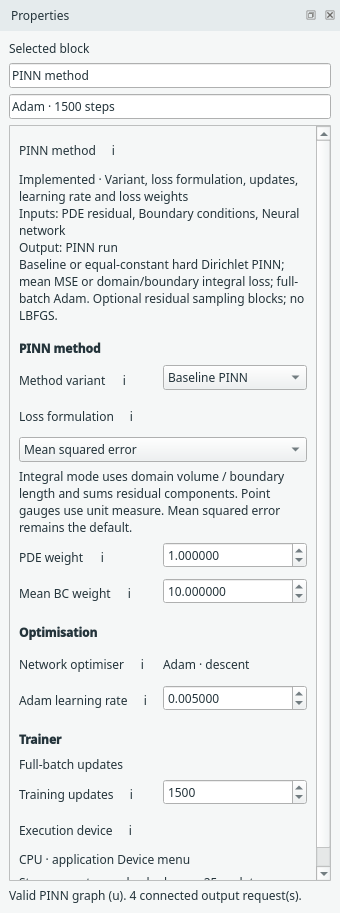
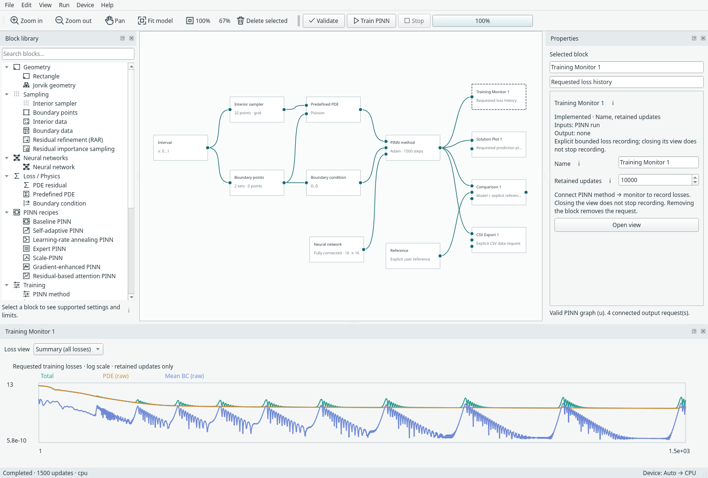
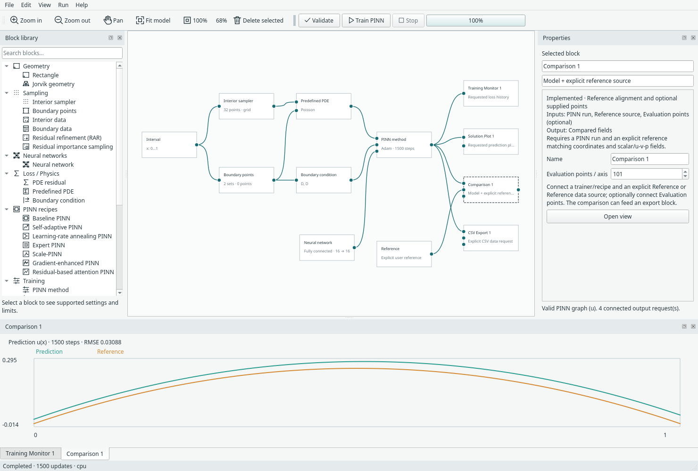

# Your first PINN

This walkthrough opens a ready-wired 1D Poisson problem, trains it, opens optional
results and saves the work. You do not need to draw the graph or import geometry.

## 1. Open a complete example

Choose **File → Examples → 1D examples → Poisson — baseline**. Save or discard
existing unsaved edits if asked. The example opens as a new editable model.

{ .portrait }

*The 1D submenu groups baseline, SA and LRA Poisson with two other scalar examples. [Open full size](../../assets/screenshots/manual-examples-1d.png).*

The problem is `u_xx + 2 = 0` on `0 <= x <= 1`, with zero values at the two ends.
Its separate Reference block supplies `x*(1-x)` for the Comparison output.
“Interval” in the geometry controls means a 1D line segment, not a time interval.

## 2. Read the graph

Follow the connections: domain → interior points → PDE; domain → boundary
points → BCs; network → trainer. The trainer connects to the requested outputs.
Click a block to see its settings in **Properties** on the right.



*A complete 1D example with separate network and trainer and explicitly connected outputs. [Open full size](../../assets/screenshots/manual-expanded.png).*

## 3. Find the training controls

Select **PINN method**. Properties separates **PINN method**, **Optimisation** and
**Trainer**. The default example uses a fully connected network with 16×16 hidden
layers, Adam, and 1,500 updates. You can change these later; use the defaults for
this tour.

{ .portrait }

*The three settings groups distinguish the method, Adam and the run budget. [Open full size](../../assets/screenshots/manual-training-settings.png).*

## 4. Validate and train

Click **Validate**, then **Train PINN** or press **F5**. Review the run summary
and choose **Train new run**. The progress indicator
shows training progress. Editing is locked during the run; canvas navigation
remains available. **Stop** retains a partial run and is checked between batches.

Training does not open figures or write export files. This is intentional.

## 5. Open the results you requested

Double-click **Training Monitor** to see losses. Double-click **Comparison** to
see predictions alongside the explicitly connected reference. Each view belongs
to its output block. Closing or hiding a view does not remove its block.



*Training Monitor opened explicitly after the default example completed. [Open full size](../../assets/screenshots/manual-monitor.png).*



*Comparison uses the separate Reference connection; normal prediction outputs do not assume one. [Open full size](../../assets/screenshots/manual-comparison.png).*

The screenshots illustrate where information appears, not an accuracy target.
For what each loss curve means, read [Training and results](../use/results.md).

## 6. Save the model and the trained run

Choose **File → Save model as…** to save the graph as `.margam.json`. If you want
the trained weights, results and ability to continue, also choose **Save run and
checkpoint…** for a `.margam-run.pt` file. These files have different jobs.

## 7. Run the same 1D Poisson problem from Python

Every desktop graph in Margam compiles to a `PoissonConfig` and uses the same
numerical builder. You can run the exact 1D Poisson problem from a terminal or
Python script without opening the GUI:

```python
import torch
from margam.components.outputs import OutputRequest, evaluate_outputs
from margam.templates.poisson import PoissonConfig, build_pinn, make_interval_reference

# 1. Configure the 1D Poisson problem: u_xx + 2 = 0 on [0, 1], u(0) = u(1) = 0
config = PoissonConfig(
    shape="Interval",
    x_min=0.0,
    x_max=1.0,
    points=32,
    pde_points="both",
    layers=(16, 16),
    lr=0.005,
    boundary_weight=10.0,
    iterations=1500,
    device="cpu",
)

# 2. Build, compile and train the PINN
model = build_pinn(config)
model.train(config.iterations, display_every=500)
print("Final losses:", model.loss_history[-1])

# 3. Evaluate on 101 points against the analytical reference u(x) = x*(1 - x)
reference = make_interval_reference(config)
request = OutputRequest("cmp", "comparison", resolution=101, reference=reference)
results = evaluate_outputs(model, config, [request])["cmp"]
print(f"Comparison RMSE: {results['rmse']:.4e}, max error: {results['max_abs']:.4e}")

# 4. Predict directly at arbitrary tensor coordinates
query = torch.tensor([[0.25], [0.5], [0.75]])
print("Predictions at x = 0.25, 0.5, 0.75:", model.predict(query).squeeze(-1).tolist())
```

To try a different PINN trainer on the same problem, change `method` on the
configuration:

```python
from dataclasses import replace

# Self-adaptive PINN (per-point squared masks with Adam ascent)
sa_config = replace(config, method="self_adaptive", sa_lr=0.005, sa_boundary=True)
sa_model = build_pinn(sa_config)
sa_model.train(700, display_every=0)
print("SA mask summary:", sa_model.adaptive_summary())

# Learning-rate annealing PINN (gradient-norm constraint balancing)
lra_config = replace(config, method="lra", lr=0.001, boundary_weight=1.0, lra_interval=10)
lra_model = build_pinn(lra_config)
lra_model.train(1000, display_every=0)
print("LRA balancing weights:", lra_model.balancing_summary())
```

**Next:** [Learn the workspace](workspace.md), [change a network](../modeling/networks.md),
or [save and resume in detail](../use/saving.md).
