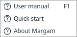

# Install and launch

Use the repository's single `.venv`. Run the commands below from your Margam
checkout directory.

## Open the application

From the repository root:

```sh
.venv/bin/python -m margam.ui
```

If your terminal already shows `(.venv)`, `python -m margam.ui` is equivalent.
Do not create another environment inside `margam/ui` or a documentation folder.
The [repository README](../../README.md) gives fresh-checkout setup commands;
development currently uses Python 3.14.

## Open this illustrated manual

Choose **Help → User manual** or press **F1**. It opens the locally built guide in
your browser. Once built, reading and searching the guide does not need internet.

If the app says the manual has not been built, run these once from the repository:

```sh
uv pip install --python .venv/bin/python -e ".[docs]"
.venv/bin/python -m examples.documentation build
```

Press F1 again. The optional documentation tools do not change how PINNs train.
The Markdown pages remain readable directly in `docs/`.

{ .portrait }

*Help provides the illustrated manual on F1 and a short reminder. [Open full size](../../assets/screenshots/manual-help.png).*

**Next:** [Run your first PINN](first-pinn.md).
