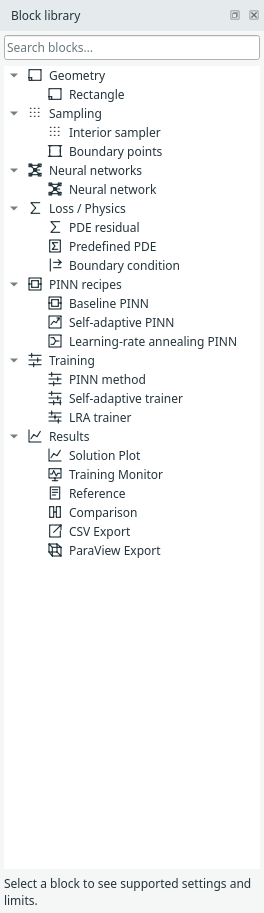
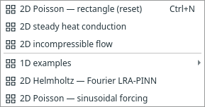

# Find your way around

The desktop has three main areas: the **Block library** on the left, the **canvas**
in the centre, and **Properties** on the right. Requested result views appear in
dockable tabs when you open them. Messages describe operational issues separately.

*The default workspace keeps the graph central and starts without result panes. [Open full size](../../assets/screenshots/manual-workspace.png).*

Scroll Properties when its controls extend below the visible pane.

## Browse or search the library

Expand a category or type in **Search blocks…**. **PINN recipes** contains compact
constructions; **Training** contains the expanded method/trainer blocks. Geometry,
sampling, physics, networks and results have their own categories.

{ .portrait }

*The searchable block library separates recipes, training and results. [Open full size](../../assets/screenshots/manual-library.png).*

Double-click a block entry, press Enter on it, or drag it to the canvas. Category
headings expand/collapse; they do not insert a block. Clear search to return to
your prior expanded/collapsed state.

## Navigate the canvas

| Action | Control |
| --- | --- |
| Zoom around the pointer | Mouse wheel |
| Pan temporarily | Middle-drag or Space + left-drag |
| Stay in pan mode | Toolbar **Pan**; Escape returns to selection |
| Frame the graph | **Fit model**, or tap Space on the canvas |
| Actual size | **100%**, or Ctrl+0 on the canvas |
| Select/delete | Click a block or connection; use Delete selected |
| Undo/redo | Ctrl+Z / Ctrl+Y, or Edit menu |
| Help | F1 |

Use View to show hidden panes or restore the default layout. A result tab can be
floated or docked elsewhere. Hiding a view preserves its data request; deleting
the output block removes the request.

## Examples versus recipes

{ .portrait }

*Examples are complete problems; 1D examples have their own submenu and the other cases are labelled 2D. [Open full size](../../assets/screenshots/manual-examples.png).*

**File → Examples** replaces the current model after the normal unsaved-work
check. **File → Insert PINN recipe** adds a construction to the existing graph.
The current executor supports one active problem root: do not leave the old
trainer connected and add a second complete trainer expecting a study to run.

**Next:** [Blocks and connections](../modeling/blocks.md).
