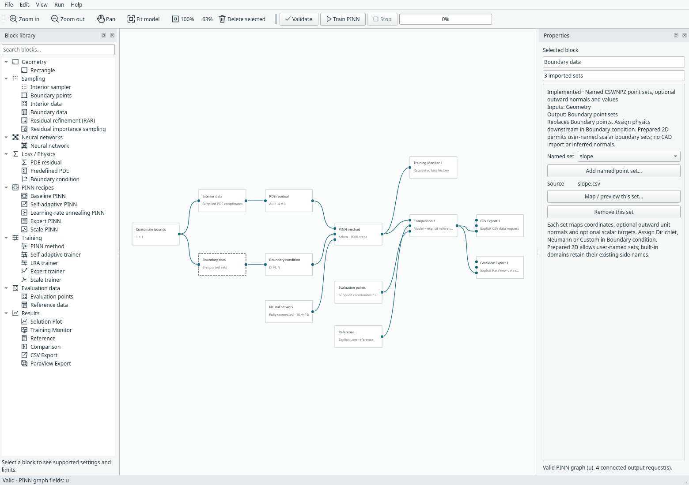
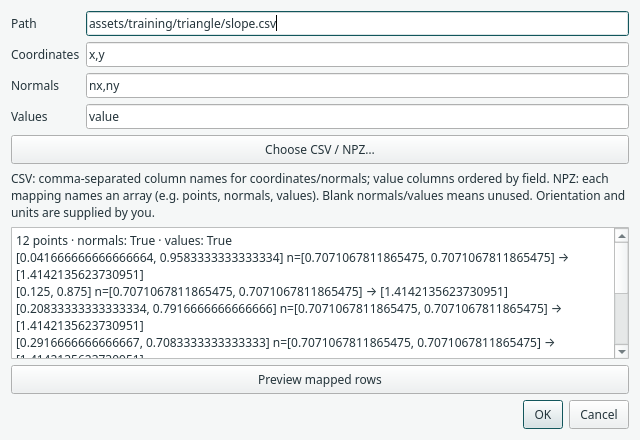
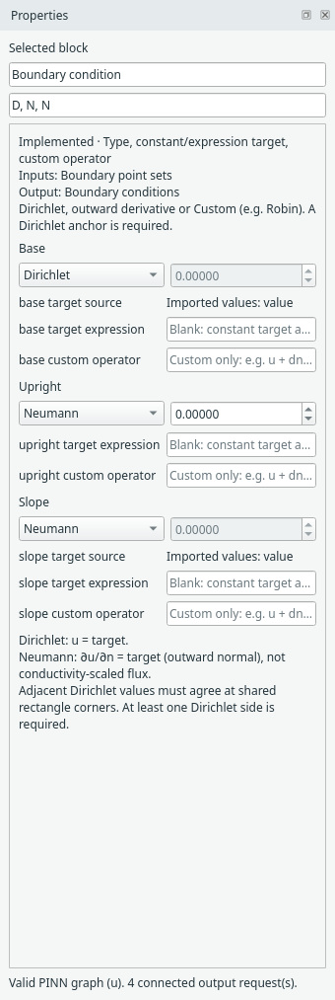

# Train on prepared point sets

Use **Sampling → Interior data** and **Sampling → Boundary data** when your
collocation points already exist in CSV/NPZ files. They replace Interior sampler
and Boundary points, respectively. The data blocks supply coordinates; **PDE
residual / Predefined PDE** and **Boundary condition** still assign the physics.
The existing sampler inspectors retain their older import controls for compatibility.

## Start with a non-rectangular example

Open **File → Examples → 2D prepared triangle · imported data**. Click Validate,
then Train PINN. Open Training Monitor or Comparison explicitly to see results;
training alone opens no view and writes no file. The graph includes opt-in CSV
and ParaView export blocks fed by Comparison.



*Actual desktop graph. Coordinate bounds define the scaling/checking box; the
triangle itself is represented by the supplied points. There is no CAD viewport
or inferred mesh. [Open full size](../assets/screenshots/manual-training-data-blocks.png).*

The manufactured problem uses the triangle x≥0, y≥0, x+y≤1 and
u=x²+y², so Δu−4=0. Its imported sets are:

| Set | Condition assigned downstream | Mapped data |
| --- | --- | --- |
| `base` | Dirichlet u=x² | Coordinates and scalar values |
| `upright` | Neumann ∂u/∂n=0 | Coordinates and outward normals (−1,0); constant target zero |
| `slope` | Neumann ∂u/∂n=√2 | Coordinates, outward normals (1,1)/√2 and scalar values |

There are 55 interior rows and 12 rows per boundary set. Boundary samples exclude
vertices. The example separately evaluates 58 supplied locations with IDs, including
the vertices, and uses an explicit reference expression. The fixture is independently
generated demonstration data, not imported FEM results or a reproduced paper case.

## Choose the domain mode

For non-rectangular scalar data, select the geometry block and choose **Prepared
2D points**. It becomes **Coordinate bounds**. Set x/y bounds enclosing every
training/evaluation point. They control neural-network coordinate scaling and
basic validation; they do not specify the actual domain boundary.

Wire the same bounds block into Interior data and Boundary data, then connect:

- Interior data → PDE residual (or a supported scalar Predefined PDE).
- Boundary data → Boundary condition.
- Physics, conditions and the chosen neural network → trainer or compact recipe.

Prepared 2D requires both imported sources and at least one named boundary set.
It never fills missing sets with rectangle samples. Use a separate **Evaluation
points** block on every requested prediction/comparison/export; a regular bounding
box grid would include points outside an unknown domain and is rejected.

On built-in interval/rectangle domains, the data blocks also accept the existing
named side imports. Those retain the earlier import semantics and can combine
mapped sides with built-in samples for unmapped sides. The new free-label workflow
is specifically the Prepared 2D scalar mode.

## Map interior coordinates

Select Interior data and choose **Map / preview interior coordinates…**. CSV
mappings name columns (e.g. `x,y`); NPZ mappings name an N×D array (e.g. `points`).
Interior imports contain coordinates only. Normals, target values and additional
pointwise PDE inputs are deliberately unavailable here.

The supplied rows are fixed. Point budgets, random seeds and sampler choices do
not create or replace imported points. CSV/NPZ readers support at most 100,000
rows per source and a 64 MiB file/expanded-NPZ limit; NPZ uses `allow_pickle=False`.

## Add named boundary sets

Select Boundary data, click **Add named point set…**, enter a name and map its file.
Use **Named set** to select an existing mapping, preview/edit it, or remove it.
These are undoable model edits. No file is deleted by removing a mapping.

Prepared names begin with an ASCII letter and contain letters, digits, `_` or `-`,
up to 64 characters; `pde` and `total` are reserved for loss records. Up to 64 sets and 100,000 boundary rows in
total are supported. Names such as `inlet`, `outer_wall` or `edge-17` have no implied
normal direction or topology.



*The existing mapping dialog previews supplied rows. This sloped edge maps
`x,y`, `nx,ny` and `value`; its Neumann interpretation is chosen separately.*

Boundary coordinates are required. Outward unit normals are optional for ordinary
Dirichlet conditions, and required for Neumann or any Custom operator/target that
uses a normal. Prepared 2D never substitutes a box normal, even if a set is named
`left`. Normals must be finite, unit length and match the coordinate row count;
the preparer is responsible for outward orientation.

Optional target values mean the value of the condition assigned downstream:
u for Dirichlet, ∂u/∂n for Neumann, or the Custom operator's target. They are not
universally solution values. In particular, Neumann is an outward derivative,
not automatically conductivity-scaled flux.

## Assign conditions downstream

{ .portrait }

*Types and expressions remain in Boundary condition. A mapped target source is
shown explicitly and the unused constant field is disabled.*

Choose Dirichlet, Neumann or Custom for each named set. Without imported target
values, use the constant or a restricted coordinate expression. With imported
values, clear any target expression: using both is a validation error. Custom
operators use the existing restricted expression language, including `dn(u)`.
At least one Dirichlet set is required for this scalar workflow.

Prepared validation checks finite dimensions/values, coordinate bounds, required
normal mappings and incompatible target sources before starting a worker. It
cannot verify an arbitrary shape from points alone, determine whether a point
is truly interior, orient normals, detect every geometric gap, or construct cells.
Keep coordinates and targets in consistent units before import.

## Supported methods and persistence

The first non-rectangular workflow supports steady 2D scalar baseline, LRA, gPINN and
fixed-point SA-PINN trainers, with the existing replaceable networks. Poisson,
Helmholtz and reaction–diffusion presets support Prepared 2D; PDE residual also
accepts restricted scalar expressions. No special network is required.

Hard box Dirichlet transforms, integral loss without quadrature weights,
RAR/importance candidate generation on unknown geometry, Expert/Scale fresh
sampling, arbitrary flow data and transient/physical-3D prepared geometry remain
outside this milestone. The built-in geometry workflows keep their existing scope.

Model format 22 stores block-owned mappings and named conditions while reading
formats 1–21. Saved runs retain evaluated rows and weights; archived results can
be reopened/exported without training files. Resuming training requires the
original numerical coordinates, targets and operator normals. Changing these
rejects a checkpoint rather than continuing against different data.

## GeoSampler and further work

The existing [planar GeoSampler preparation helper](geosampler-contract.md)
converts supported labelled NPZ exports to explicit point/normal arrays. Map those
prepared files into these blocks; the new named sets avoid pretending CAD labels
are rectangle sides. Direct CAD loading, automatic manifest-to-graph wiring,
mesh connectivity, unit conversion and region-field metadata remain future work.
For output mappings and preserved IDs, see [Evaluate supplied points](evaluation-points.md).

## Checks and recorded results

From the repository root, using its existing environment:

```bash
python -m examples.training_data --device cpu --output-dir /tmp/margam-training-data-cpu
python -m examples.training_data --device cuda --output-dir /tmp/margam-training-data-cuda
python -m examples.capture_training_data --overwrite
```

[CPU](../assets/benchmarks/training-data-cpu.json) and
[CUDA](../assets/benchmarks/training-data-cuda.json) records cover 100 initial
updates plus two resumed updates, exact same-device continuation, source hashes,
row counts, loss terms and supplied-point CSV/VTU export. Errors are recorded
without an accuracy threshold or tuning claim. Numerical tests also substitute
the manufactured solution directly into the PDE and mapped boundary operators.
The [capture manifest](../assets/screenshots/manual-training-data-captures.json)
identifies the actual UI screenshots. ParaView GUI playback was not part of this
steady-data check; the file contains vertices, not triangular cells.
