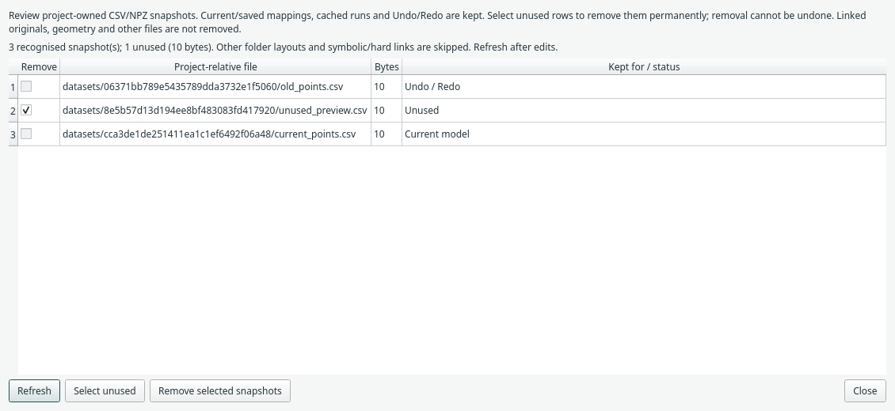

# Clean up unused imported datasets

Each **Copy into project** import creates an immutable snapshot. Replacing a
mapping keeps the previous snapshot so Undo can restore its original rows. Over
time, some copies are no longer referenced by the model or its history.

Open **View → Clean up unused imports…** to review those copies. Cleanup is
explicit: this pruning operation runs only when you remove selected snapshots.



## Review and remove

1. Open the cleanup window and press **Refresh** after model/file changes.
2. Review the project-relative filename, size and reason each snapshot is kept.
3. Check unused rows, or press **Select unused**. Protected rows cannot be checked.
4. Press **Remove selected snapshots** to permanently remove eligible copies.

Removal cannot be undone. The window rechecks references and file identity before
removing anything: a row that became used or changed after review is kept.
A changed/replaced project requires a new review. Training and geometry editing
block removal; the window remains available for inspection.

Cleanup leaves the current model, Undo history, trained weights, predictions and
freshness unchanged. It does not save the project, clear history or open data
mapping dialogs.

## Why is a snapshot kept?

| Status | What still refers to the copy |
| --- | --- |
| Current model | A current block mapping, including disconnected blocks |
| Saved model | The last saved definition on disk, which may differ from unsaved edits |
| Cached run | A retained training/evaluation configuration |
| Undo / Redo | An edit that may restore the mapping |
| Unused | No tracked dependency currently needs this recognised snapshot |

The editor records references before and after each undoable command. Undo/Redo,
macros, merged edits and Save As retain those references. Pins are conservative:
snapshots may remain protected until the corresponding history entries disappear.
The bounded Undo stack eventually drops older commands; discarding a Redo branch
also releases its entries. Reopening a saved project starts without old Undo
history, while its saved/current mappings remain protected.

The cleanup window does not offer to discard Undo history just to free space.
An unrecognised third-party undo command, unreadable saved definition or ambiguous
owned path makes cleanup unavailable; it does not guess which files can be lost.

## Scope

Only Margam's managed layout is eligible:

```text
model_files/
  datasets/
    <32-character import ID>/
      input.csv
```

The import directory must contain exactly one regular CSV or NPZ snapshot with
the generated filename shape. Symbolic links, hard links, extra files, unknown
folders and other layouts are skipped. File identity, size and timestamps are
checked again before removal, using anchored directory operations.

**Linked originals, original files copied from elsewhere, Jorvik documents,
NetCDF exports and other project files are not removed.** An emptied managed
snapshot directory is removed; other folder contents are retained. This initial
implementation requires POSIX descriptor-based filesystem operations (available
on the current Linux development platform). Unsupported platforms report cleanup
unavailable while preserving files.

Inspection reads model metadata and filesystem information; it does not open
CSV/NPZ contents, regenerate geometry, accept new fingerprints or recreate a
missing owned folder. Use [Project data overview](saving.md) to check current
input availability and changed bytes.

Existing saved run archives, recovery copies and independent Save As projects
are separate artifacts and are not rewritten by cleanup. Future archives and
normal recovery snapshots use the remaining project files.
