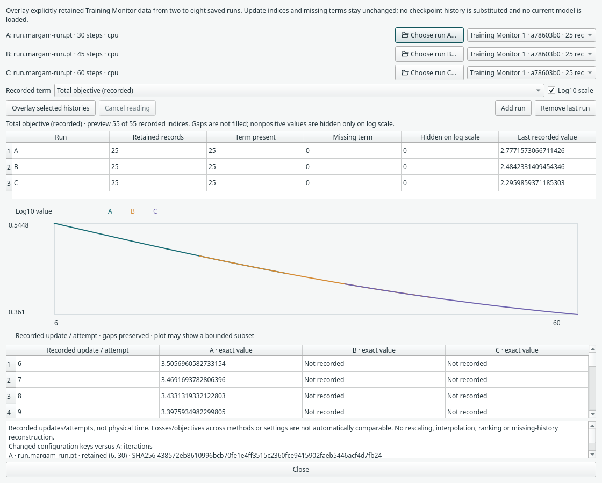
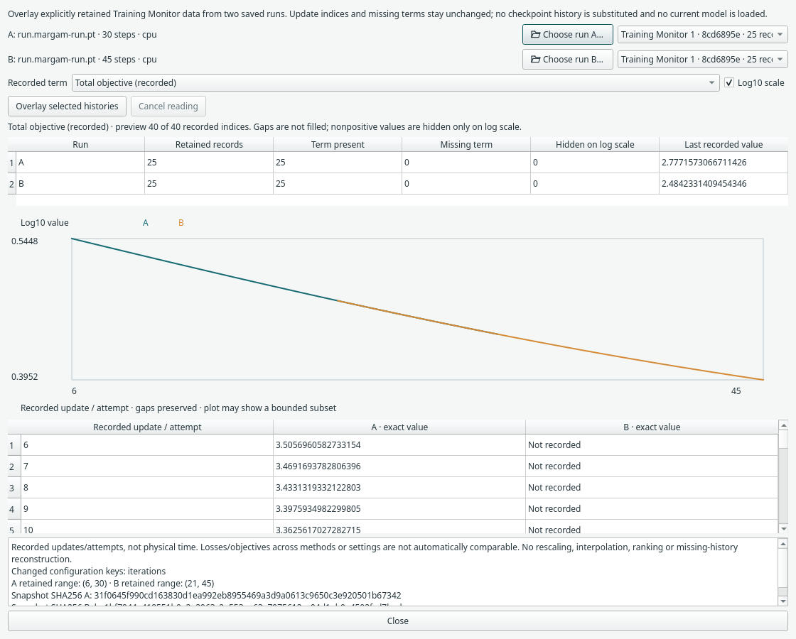

# Overlay saved training histories

Choose **View → Compare saved training histories…**. Choose native run archives for
**A** and **B**, select a saved Training Monitor from each, choose a recorded loss
term, then press **Overlay selected histories**. This is an explicit comparison
window; it adds no default plot to the canvas.

Use **Add run** for **C** through **H**, up to eight runs total. Choose an archive
and monitor for every added row before overlaying. **Remove last run** removes
the last row and invalidates the old overlay; it never changes archive files.
You can select the same archive again as a control. File/monitor changes and
adding/removing rows require a fresh overlay. Slot changes are disabled while
a read is active.

*Three actual CPU runs with 30/45/60 updates, retaining 25 records each. A, B and C
keep ranges 6–30, 21–45 and 36–60. This demonstrates recording semantics, not
solution accuracy.*

*Two actual CPU runs with 30/45 updates, retaining only the last 25 monitor records
each. The overlay keeps ranges 6–30 and 21–45 rather than restarting them at zero.
This checks history behavior, not numerical accuracy.
[Open full size](../../assets/screenshots/manual-history-comparison.png).*

## Only explicitly recorded monitor data

An archive needs saved **Training Monitor** records. Checkpoint loss history is
never substituted. If you did not request a monitor, or its retained records are
empty, the view cannot invent earlier curves. Different monitor blocks can retain
different lengths; select the one you intend to inspect.

The term selector lists the union of actual recorded keys in all selected
monitors. **PDE (raw)** and individual raw constraint terms stay separate from
**objective contribution (recorded)** terms and the **recorded total objective**.
RBA's attention-weighted PDE term is labelled before its global coefficient.
Older records lacking weighted contributions remain missing; the view never
reconstructs them from current coefficients or masks.

## Read gaps and scale correctly

The horizontal axis is the **recorded update/attempt index**, not physical time,
epochs, elapsed seconds or equal compute cost. Each run keeps its own indices.
No sorting, renumbering, alignment to an intersection, rescaling or missing-value
padding is performed.

Lines break at missing update indices, missing terms and nonpositive values on
log scale. **Log10 scale** displays logarithms of positive recorded values; zero
and negative values remain in the table and are counted as hidden, rather than
clamped to an artificial positive floor. Turn log scale off and overlay again to plot them.

The summary reports each run's retained-record count, term availability and last
recorded value. The table previews up to 200 exact recorded indices from their
union, with **Not recorded** for absent values. The plot can draw a bounded subset
of long histories; the retained counts and gaps still come from all records.

Matching term names do not establish identical physics, data, weights, units or
training objectives. Changed numerical configuration keys versus A are listed as context, alongside
each snapshot name, retained range and SHA-256.
The view does not rank runs or infer accuracy. For solution comparisons use
[Compare saved predictions](compare-runs.md) with matching evaluation rows.

## Snapshots and lifecycle

Reads run in a cancellable background worker with a bounded private archive copy
and restricted CPU payload validation. No network or optimizer is restored, no
checkpoint/output payload is retained in this view, and no external dataset is
reopened. Your current model, Undo, results, device and CPU/CUDA RNG remain unchanged.

Snapshots stay fixed when original files change; choose a file again to refresh.
A failed or cancelled read invalidates that row and its old overlay. Closing the
dialog releases snapshots and joins its reader. Model replacement/checkpoint
continuation remains part of the normal **Open saved run** workflow.
