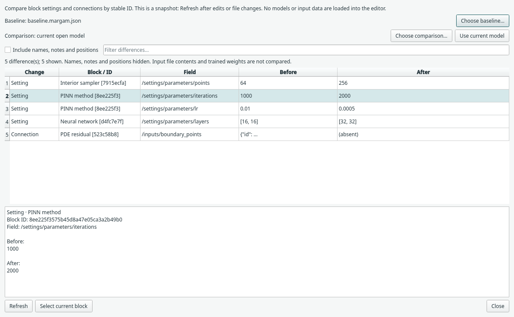

# Compare model definitions

Use **View → Compare model definitions…** to review an experiment's settings
and connections before training it. You can compare two saved model files or a
saved baseline against the model currently open in the editor.

## Choose the models

1. Press **Choose baseline…** and select a `.margam.json` or `.json` model.
2. The comparison initially uses the **current open model**, including settings
   already committed in its inspector. Pending text still being edited is not
   committed by opening this read-only view.
3. To compare two saved definitions, press **Choose comparison…** and choose the
   second model. **Use current model** switches back to the editor snapshot.
4. Press **Refresh** after changing the open graph or either saved file. The
   comparison is a snapshot and does not watch files or follow edits automatically.

Choosing a comparison file does not open it in the canvas or discard your work.
The existing bounded model reader validates the file; missing/invalid models are
reported in the comparison window. Incomplete saved drafts can be compared too.
Inspection remains available while training or editing geometry.

## Read the differences

| Change | Meaning |
| --- | --- |
| Setting | A block-owned parameter, data mapping or output setting changed |
| Connection | A named input gained, lost or changed its source block |
| Added / Removed block | That stable block ID occurs in only one model |
| Block type | A retained ID has a different kind |
| Data metadata | A recorded import fingerprint or Jorvik declaration changed |
| Presentation | A label, title, position or note text changed, when explicitly included |

Select a row for full **Before** and **After** values. The table shortens long
values for readability; the details pane shows complete JSON values as literal
text. `(absent)` means a value or endpoint was not present. Fields use slash
paths; `~1` represents a slash in a dictionary key and `~0` a tilde.

Use **Filter differences…** to search fields, values, names or full IDs.
**Include names, notes and positions** reveals presentation changes, including
independent block labels, retained compact-network labels and
added/removed notes. Those differences are hidden by default so layout changes
do not obscure numerical settings.

When comparing against the current model, **Select current block** selects and
centres the relevant surviving block. A removed block cannot be selected. If
that ID has disappeared since Refresh, the dialog reports it safely. Navigation
is disabled when the comparison side is a saved file rather than the open model.

## What is compared?

Blocks are matched by saved **IDs**, not by similar names or screen positions.
Two independently created versions of the same example may therefore appear as
removed/added blocks. Save a baseline and edit copies of that model when you want
settings to be compared directly. Compact and expanded recipes are reported as
their actual block/connection changes; no mathematical equivalence is inferred.

Older supported model versions use the normal decoder/default migrations before
comparison. The obsolete inspector configuration cache and model-format version
are not treated as independent numerical differences: current execution settings
belong to the blocks and their connections.

File references and recorded fingerprints are compared **as declared**. The
comparison does not read CSV/NPZ/NetCDF datasets, check whether linked bytes have
changed, resolve owned files, launch Jorvik or recreate missing project folders.
Use [Project data overview](saving.md) for current input
availability and byte-change diagnostics. Identical references are not proof of
identical external data; differing paths are not proof of different numerical rows.

The view preserves the model, Undo history, trained weights, output data and
freshness. It does not merge definitions, edit either file, compare learned
weights or score the accuracy of two runs. Use normal validation and explicit
results/reference blocks for those separate checks.
