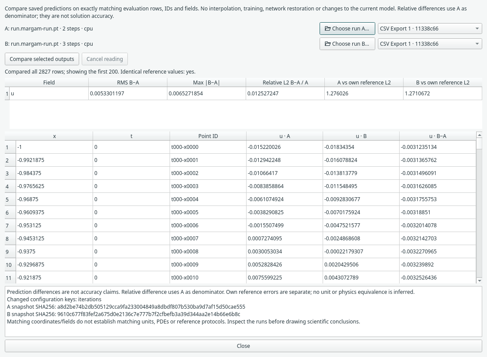

# Compare two saved predictions

Choose **View → Compare saved predictions…**, then choose native
`.margam-run.pt` archives for **A** and **B**. These can be standalone saved runs
or completed trial archives collected through a [study results folder](study-results.md).
Choose the desired saved output from each dropdown and press **Compare selected outputs**.
Nothing is trained or loaded into your current model.

*Actual saved Burgers predictions after two and three updates. The small budgets
exercise the workflow, not solution accuracy.
[Open full size](../../assets/screenshots/manual-run-comparison.png).*

## Matching is explicit

Both outputs must have exactly matching coordinate names/order, coordinate rows,
field names/order and point IDs, including ID types when supplied. No interpolation,
sorting, nearest-neighbor matching or automatic field mapping is performed. Physical
time is part of the coordinate rows for transient problems, so the same time samples
must be present too. Duplicate rows stay duplicated.

If matching fails, evaluate both models on the same explicit evaluation dataset
and save new runs. If an archive has no saved prediction outputs, choose another
archive or evaluate it first. Merely having trained weights is insufficient.

## Read the numbers

Each field has its own diagnostics over **all matching rows**:

- **RMS B−A** and **Max |B−A|** describe the difference between predictions.
- **Relative L2 B−A / A** uses prediction A as its denominator. This is a
  difference diagnostic, not error against an exact solution.
- **A/B vs own reference L2** recomputes each run's error against its own explicitly
  saved reference values. Missing references remain missing; zero-reference
  denominators retain an explicit undefined status.

Diagnostics use float64 discrete rows, without quadrature or unit normalization.
The table beneath previews the first 200 rows, including coordinates, original
point IDs and A, B, B−A for each field. Preview truncation does not truncate metrics.
Overflow is reported explicitly rather than presented as a finite value.

The view states whether saved reference values are numerically identical on these
rows and lists changed configuration keys. Matching rows and fields do **not**
establish matching units, PDEs, domains, reference definitions or accuracy protocols.
Inspect these before drawing scientific conclusions. Margam does not rank the runs,
combine fields with different units or infer which solution is better.

## Snapshots and safety

Archive reads happen in a cancellable background worker. Each read makes a bounded
private copy, checks the native container/data contract and uses restricted CPU
loading. It constructs no neural network, restores no optimizer and retains no
checkpoint/owned-file payload for this view. Full checkpoint restoration remains
part of **File → Open saved run…**, rather than comparison inspection.

Browsing/comparing preserves your current model, Undo, results, application device
and CPU/CUDA RNG. Files remain unchanged, and no referenced input file is reopened.
Snapshots stay fixed if the original archive later changes: choose it again to
refresh. Failed or cancelled reads clear the affected side and invalidate the old
comparison. Closing the dialog releases its snapshots and joins any reader.

This first comparison covers two saved prediction outputs. For retained loss curves use [Compare saved training histories](compare-histories.md).
Automatic study ranking, comparison-data export and further multi-run plotting remain
separate work. It adds no default plots or heatmaps.
