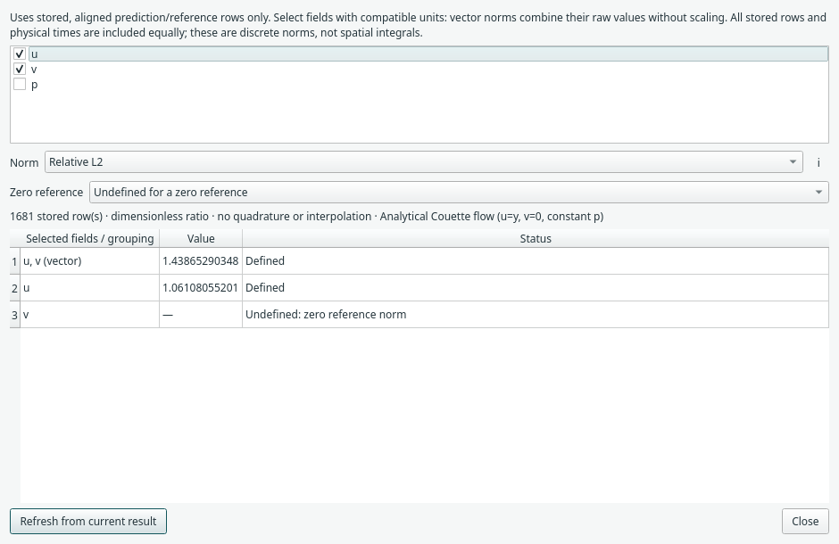

# Inspect scalar and vector error norms

Right-click a **Comparison** block and choose **Error norms…**, or use its
Properties button. The report uses that block's existing prediction/reference
arrays. Train, evaluate or reopen a run containing comparison data first; no
reference is invented and opening the report does not run inference.



*The two-update Couette run demonstrates the report lifecycle. These numbers are
not an accuracy benchmark. The reference vertical velocity is zero, so its
relative component error is undefined by default.*

## Select fields and a norm

Check one field for a scalar norm, or multiple fields for a mathematical vector.
The first field is selected initially. A vector selection produces a combined
row plus separate component rows.

**Select compatible units.** Fields are combined as raw values, without automatic
scaling. For example, select `u,v` for a velocity vector and inspect pressure `p`
separately. Do not combine quantities of different units unless you have already
made an explicit compatible/nondimensional definition.

Let `m_i` be the Euclidean magnitude of the selected prediction error at row `i`,
and `a_i` the Euclidean magnitude of the selected reference. With one field these
are ordinary absolute values.

| Choice | Discrete definition |
| --- | --- |
| Relative L2 | `sqrt(sum_i m_i²) / sqrt(sum_i a_i²)` |
| Relative max magnitude | `max_i m_i / max_i a_i` |
| RMS magnitude | `sqrt(mean_i m_i²)` |
| Mean magnitude | `mean_i m_i` |
| Max magnitude | `max_i m_i` |
| Discrete L2 | `sqrt(sum_i m_i²)` |

The **i** button shows these definitions and the zero-reference rule. Relative
values are dimensionless ratios: `0.01` means one percent. Absolute norms retain
the selected field units. Discrete L2 depends on the row count.

These norms use **all stored rows equally**, including every physical-time frame
and any repeated coordinates. They do not infer mesh integration/quadrature,
interpolate references, filter a time interval or normalize field scales. For
weighted spatial norms, prepare the intended calculation separately.

For multiple fields, RMS magnitude divides by the number of rows, not by rows
times components. The older comparison caption's pooled RMSE and per-component
RMSE remain available; a vector RMS magnitude can therefore differ from that
pooled number without either being inconsistent.

Relative max is a ratio of two global maxima, not the maximum of pointwise
relative errors. A few zero reference rows do not make a nonzero global reference
norm undefined.

## Zero references and floating-point range

The default rule reports **Undefined: zero reference norm**, including `0/0`.
The optional **Zero only when prediction and reference are exactly zero**
convention returns zero for that one case. A nonzero prediction against a zero
reference remains undefined under both policies. No epsilon is inserted.

Changing to an absolute norm lets you quantify error against a zero reference
without division. Zero-policy choices apply only to relative norms.

Calculations use float64 and scaled reductions. Large/tiny finite values avoid
unnecessary squaring overflow/underflow; a mathematically out-of-range result is
reported explicitly as overflow/underflow with no numeric value. Undefined/range
cases use `None` in the Python API, not fabricated finite errors, NaN or infinity.

## Refresh and saved runs

Changing field/norm choices recomputes the report from the current stored arrays.
It preserves the graph, Undo history, weights, predictions and result freshness.
It does not reopen datasets, change training-loss weights or alter CSV/VTK output.

Changing model physics, starting another run or replacing results clears old
norms. Press **Refresh from current result** after new data is available. Removing
the owning Comparison block closes its report. Renaming or moving a block leaves
valid norms available.

Choices are temporary report controls, not saved model parameters. Run archives
already retain the compared arrays; you can reopen those runs and recompute norms
without original source files. Old run formats and existing metric fields are
unchanged. The report does not write files automatically.

## Use the same calculation in research scripts

```python
import json
from margam.research import error_norms

report = error_norms(
    [[6.0, 4.0, 0.0], [0.0, 4.0, 0.0]],
    [[3.0, 0.0, 0.0], [0.0, 4.0, 0.0]],
    fields=("u", "v", "p"),
    selected=("u", "v"),
    norm="relative_l2",
    zero_reference="undefined",
)
assert report["value"] == 1.0
print(json.dumps(report, allow_nan=False))
```

The implementation is also directly importable from
`margam.components.error_norms`. Inputs can be finite real NumPy/list values or
PyTorch tensors, with matching `(N,C)` shapes; `(N,)` scalar fields are accepted.
There is no broadcasting. Field names and selections must be unique. If names
are omitted the API generates names and selects all supplied components; the GUI
starts with just the first field.

Array rows must already be aligned to the same coordinates/IDs. The desktop's
existing comparison pipeline performs that alignment; this standalone function
cannot infer it from values alone. Tensor inputs are detached and copied to CPU
as needed: this is a postprocessing diagnostic, not a differentiable training loss.

The returned record includes the value/status, norm, selected fields, row/component
counts and zero-reference policy. It is suitable for an explicit JSON report in
your own research script. See [Research API](../research.md).
