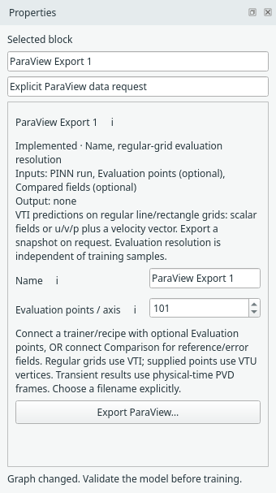

# Export for CSV or ParaView

Add the output block you want from **Results**, connect it to the trainer or
compact recipe, and train. Double-click the block or use its right-click export
action to choose a filename. Training alone writes no export file.

## Choose a format

| Block | File | Data |
| --- | --- | --- |
| CSV Export | `.csv` | Coordinates and predicted scalar or `u,v,p` columns |
| ParaView Export | `.vti` | Regular-grid scalar fields; flow also includes `(u,v,0)` velocity |

Select the export block to set **Evaluation points / axis**. A value N requests N
points for 1D or N×N for a rectangle. These are independent of grid/random or other
training samples. CSV Export remains available alongside the ParaView block.

{ .portrait }

*The optional ParaView Export block has its own resolution and explicit export button. [Open full size](../../assets/screenshots/manual-paraview.png).*

CSV exports have `x,u`, `x,y,u`, or `x,y,u,v,p` columns. Comparison-fed CSV exports additionally include reference values and signed
pointwise errors. Training losses remain in the monitor/run archive.
Use a saved run when you also need training state and recorded output histories.

## Open a VTI snapshot

In ParaView, open the exported `.vti`, click Apply and choose a field for colouring.
VTI means a uniform grid. VTU means an unstructured grid, not a time-dependent
version of VTI. Steady problems write one snapshot; Burgers writes physical-time frames. It does not infer physical time from training updates.

## Try time-series playback

The [known-value playback dataset](../../assets/examples/paraview-demo/standing-wave.pvd)
contains 21 changing synthetic snapshots. Open its PVD in ParaView, Apply, colour
by `demo_scalar`, then Play. Keep its companion snapshot folder beside it.
This is a file-format test, not a trained PINN result. Snapshot fields and time
metadata were read back with VTK; GUI playback has not been exercised on this host.

The [Burgers space–time example](../burgers.md) now uses the block to write
physical-time PVD collections directly. Its evaluation resolution sets the spatial
and temporal counts. The Expert examples also support 2D transient flow exports.
Read the [ParaView format guide](../paraview-export.md) for the exact scope.

## Evaluate supplied points

Use the separate **Evaluation points** block for CSV/NPZ coordinates and optional
IDs. Add **Reference data** for matching numerical values, connect it to Comparison,
then connect Comparison to an export block to include reference/error arrays.
Supplied steady points use VTU vertex cells; transient points use physical-time
PVD/VTU frames. See the [illustrated supplied-point guide](../evaluation-points.md).
Mesh connectivity and direct Jorvik integration remain future work.

For [Burgers](../burgers.md), CSV headings are `x,t,u`. ParaView Export writes a
PVD collection of 1D spatial VTI frames with physical-time stamps; open the PVD
and press Play. Time is not exported as a spatial axis.

## Programmatic export and run-comparison snippets

You can also evaluate outputs, write ParaView `.vti` / `.vtu` / `.pvd` files, and
compare saved native run archives directly from Python without launching the GUI.

### 1. Export steady regular-grid predictions to ParaView VTI

```python
from pathlib import Path
from margam.components.outputs import OutputRequest, evaluate_outputs
from margam.components.paraview_export import export_vti
from margam.templates.poisson import PoissonConfig, build_pinn, make_rectangle_reference

cfg = PoissonConfig(
    shape="Rectangle",
    bounds=([0.0, 0.0], [1.0, 1.0]),
    interior_points=256,
    boundary_points=32,
    layers=[32, 32],
    iterations=300,
    seed=0,
)
model = build_pinn(cfg)
model.train(cfg.iterations, display_every=0)

outputs = evaluate_outputs(
    model,
    cfg,
    [OutputRequest("paraview_grid", "paraview", resolution=41, reference=make_rectangle_reference(cfg))],
)

out_path = Path("build/poisson-steady.vti")
out_path.parent.mkdir(parents=True, exist_ok=True)
export_vti(out_path, outputs["paraview_grid"])
```

### 2. Export space–time predictions to a playable physical-time PVD series

```python
from pathlib import Path
from margam.components.outputs import OutputRequest, evaluate_outputs
from margam.components.paraview_export import export_spacetime_pvd
from margam.templates.burgers import build_burgers_pinn, make_burgers_config

cfg = make_burgers_config()
cfg.iterations = 200
model = build_burgers_pinn(cfg)
model.train(cfg.iterations, display_every=0)

outputs = evaluate_outputs(
    model,
    cfg,
    [OutputRequest("burgers_pvd", "paraview", resolution=31)],
)

pvd_path = Path("build/burgers-series.pvd")
pvd_path.parent.mkdir(parents=True, exist_ok=True)
export_spacetime_pvd(pvd_path, outputs["burgers_pvd"])
```

### 3. Export supplied point clouds with integer or text IDs to VTU

```python
from pathlib import Path
from margam.components.evaluation_data import load_evaluation_points
from margam.components.outputs import OutputRequest, evaluate_outputs
from margam.components.point_export import export_supplied
from margam.templates.poisson import PoissonConfig, build_pinn

cfg = PoissonConfig(shape="Rectangle", bounds=([0.0, 0.0], [1.0, 1.0]), iterations=100)
model = build_pinn(cfg)
model.train(cfg.iterations, display_every=0)

# Load explicit evaluation coordinates (and optional point_id column) from CSV/NPZ
pts = load_evaluation_points(
    "assets/training/triangle/eval.csv",
    shape="Rectangle",
    coordinates={"x": "x", "y": "y"},
    id_column="id",
)
outputs = evaluate_outputs(
    model,
    cfg,
    [OutputRequest("supplied_cloud", "paraview", point_data=pts)],
)

vtu_path = Path("build/supplied-cloud.vtu")
vtu_path.parent.mkdir(parents=True, exist_ok=True)
export_supplied(vtu_path, outputs["supplied_cloud"])
```

### 4. Compare predictions across two or more saved `.margam-run.pt` archives

Use `margam.run_comparison` to compare explicit saved predictions on identical
ordered coordinates, field names and point IDs without deserializing or executing
the neural network:

```python
from margam.run_comparison import compare_prediction_group, compare_predictions, read_predictions

run_a = read_predictions("results/my-study-run/DP0001/artifacts/run.margam-run.pt")
run_b = read_predictions("results/my-study-run/DP0002/artifacts/run.margam-run.pt")

# Pick the first recorded output request ID from each archive
out_id_a = next(iter(run_a["outputs"]))
out_id_b = next(iter(run_b["outputs"]))

# Pairwise difference (B - A) with RMS, max and relative_l2 diagnostics
diff = compare_predictions(run_a, out_id_a, run_b, out_id_b)
for diag in diff["diagnostics"]:
    print(diag["field"], "RMS(B-A)=", diag["rms_difference"]["value"])
print("Changed settings:", diff["configuration_differences"])

# Multi-run comparison (2 to 8 runs against baseline A)
group = compare_prediction_group([(run_a, out_id_a), (run_b, out_id_b)])
print("Compared rows:", group["rows"], "Headers:", group["headers"])
```
