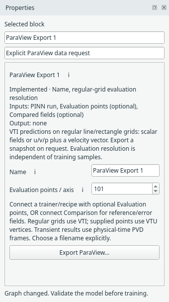

# Export for CSV or ParaView

Add the output block you want from **Results**, connect it to the trainer or
compact recipe, and train. Double-click the block or use its right-click export
action to choose a filename. Training alone writes no export file.

## Choose a format

| Block | File | Data |
| --- | --- | --- |
| CSV Export | `.csv` | Coordinates and predicted scalar or `u,v,p` columns |
| ParaView Export | `.vti` | Regular-grid scalar fields; flow also includes `(u,v,0)` velocity |

Select the export block to set **Evaluation points / axis**. A value N requests N
points for 1D or N×N for a rectangle. These are independent of grid/random or other
training samples. CSV Export remains available alongside the ParaView block.

{ .portrait }

*The optional ParaView Export block has its own resolution and explicit export button. [Open full size](../../assets/screenshots/manual-paraview.png).*

CSV exports have `x,u`, `x,y,u`, or `x,y,u,v,p` columns. Reference values, pointwise
errors and training losses are not included in these prediction files.
Use a saved run when you also need training state and recorded output histories.

## Open a VTI snapshot

In ParaView, open the exported `.vti`, click Apply and choose a field for colouring.
VTI means a uniform grid. VTU means an unstructured grid, not a time-dependent
version of VTI. Steady problems write one snapshot; Burgers writes physical-time frames. It does not infer physical time from training updates.

## Try time-series playback

The [known-value playback dataset](../../assets/examples/paraview-demo/standing-wave.pvd)
contains 21 changing synthetic snapshots. Open its PVD in ParaView, Apply, colour
by `demo_scalar`, then Play. Keep its companion snapshot folder beside it.
This is a file-format test, not a trained PINN result. Snapshot fields and time
metadata were read back with VTK; GUI playback has not been exercised on this host.

The [Burgers space–time example](../burgers.md) now uses the block to write
physical-time PVD collections directly. Its evaluation resolution sets the spatial
and temporal counts. Higher-dimensional transient systems remain future work.
Read the [ParaView format guide](../paraview-export.md) for the exact scope.

## What comes later

Evaluation at supplied GeoSampler/FEM nodes, preserved node IDs/connectivity and
optional pointwise reference errors are [recorded in TODO](../todo.md#future-evaluation-and-export-at-supplied-points).
The current export evaluates the network on a regular line/rectangle grid.

For [Burgers](../burgers.md), CSV headings are `x,t,u`. ParaView Export writes a
PVD collection of 1D spatial VTI frames with physical-time stamps; open the PVD
and press Play. Time is not exported as a spatial axis.
