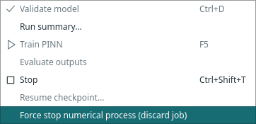

# Stop or recover an isolated numerical job

Desktop training and **Evaluate requested outputs** now run in a separate Python
process using the same installed Margam environment. The GUI supervises progress
and retains CPU checkpoint/result data after the child exits. Neural networks,
optimizer updates and prediction execute in the child, without Qt or a display.
A small startup delay is expected when a new process imports the numerical libraries.

## Stop normally

Use **Stop** to request cooperative cancellation. Training checks between batches
of up to 25 updates, just as before. A normally stopped run can retain valid
partial results and a checkpoint. Output evaluation finishes its current operation;
Stop does not interrupt a kernel or change requested coordinates. The application
stays locked against numerical edits until the child has exited and results have
been transferred.

## Discard an unresponsive job

Choose **Run → Force stop numerical process (discard job)** when cooperative Stop
is insufficient. This explicit action requests termination of that numerical
process. It discards the current job, including any unpublished result/checkpoint;
it does not promote a partly updated optimizer state to a valid saved run.

*Actual menu during a small isolated CPU job. The capture deliberately force-stops
that job afterward and verifies cleanup; it does not exhaust real memory.*

After the process is reaped, controls become available again. Previously saved
run files remain unchanged. Reopen a saved run for checkpoint continuation, or
start a new experiment. If the child exits abnormally, Messages reports the exit
status and available diagnostics; an OS memory kill is one possible cause, not an
automatically proven diagnosis. Late force-stop requests also prevent adoption
of a result still being transferred.

## What is preserved?

- Device selection remains application-wide. Training, inference and continuation
  use the selected CPU/CUDA target in the child. Retained tensors in the GUI are
  stored on CPU; a displayed run device records where computation occurred.
- Progress, retained losses, adaptive-sampling events and method diagnostics still
  arrive during execution. Views remain optional and owned by their blocks.
- Checkpoint identity, architecture/data validation, physical-time output rows,
  supplied IDs and explicit reference semantics retain their existing contracts.
  Re-evaluation uses trained weights without optimizer updates.
- Model/run file versions remain unchanged. Existing archives open and resume;
  new archives contain the same tensor/primitive numerical state.
- Normal window close requests cooperative cancellation and waits for process
  cleanup before releasing the owning project workspace. If the GUI disappears
  abruptly, closing its control pipe asks the child to stop, followed by bounded
  child-side shutdown if it does not finish.

The private desktop `last_run.model` is now a retained CPU-state handle, not a
live trainer or GPU module. Application code should inspect its checkpoint data
or use the asynchronous Evaluate action. Research scripts continue to use actual
PyTorch networks through [margam.research](../research.md); that API and its direct
training loop have not been moved into a hidden GUI process.

## Data-only job boundary

Jobs carry explicit configuration, tensors and primitive data. Preset references,
restricted expressions and mapped-data declarations are reconstructed in the
child; arbitrary Python reference callbacks are not pickled across this boundary.
Point/reference snapshots preserve row order and IDs. Custom Python experiments
belong to the script API.

Private temporary job files use restricted `weights_only=True` CPU loading, bounded
256 MiB input/output transfers and atomic publication. Session IDs, ordered events,
child identity and successful exit are checked before the GUI accepts a result.
Oversized, malformed, incomplete, crashed or discarded jobs produce no new result.
Stderr capture is bounded and remains local. Temporary files are cleaned on normal
success/failure; an abrupt whole-application kill can leave temporary files for the
operating system to clean. This is failure containment, not an execution sandbox.

## Bounded prediction batches

Native output jobs evaluate at most **2,048 points per network forward** and assemble
complete results on CPU. This covers outputs attached to training, re-evaluation
and the retained model's compatibility prediction path. It is automatic; no model
setting or new block is needed. Training samples, losses and optimizer steps are
unchanged.

Supplied coordinates, duplicate rows, IDs, field order and physical-time frames
retain their order. Inference uses the trained scalar dtype; analytical expression
references evaluate on CPU in float64. Batching does not update weights, optimizer
state or random generators. Expert time-window predictions still select the trained
window for each physical time and reject times beyond its horizon.

This applies to Margam's known pointwise network factories. Research `predict()`
and `evaluate_outputs()` remain one-shot by default: a custom network can depend
on other rows in its batch. Script authors may explicitly use
`margam.components.prediction.predict_in_batches` or pass
`prediction_batch_size` to `evaluate_outputs` only for pointwise models.
Different matrix batch shapes can introduce small floating-point differences.

A recorded 50,000-point float64 check with six 128-wide hidden layers measured
CUDA peak allocated memory of **164.9 MiB one-shot versus 22.9 MiB batched** on an
RTX 3060 Laptop GPU. The 25 batched forwards produced identical values in this
run; this is not a general bitwise-equivalence claim. Forward times were about
0.062 s and 0.073 s respectively. See the
[GPU record](../../assets/benchmarks/prediction-batches-cuda.json) and
[CPU record](../../assets/benchmarks/prediction-batches-cpu.json).

The full CPU result, serialization and transfer still scale with all requested
rows. Existing 256 MiB transfer bounds apply. Chunking reduces device activation
memory; it does not guarantee that a model or complete output will fit, enforce
a quota, or add training microbatching.

## Remaining resource limits

Process separation does not reserve RAM/VRAM or enforce a hardware quota. Data
preparation, archive validation and bounded result/checkpoint transfer still need
GUI-process RAM. System-wide memory pressure or driver failure can affect more
than the worker, and termination depends on the operating system/driver. Explicit
resource policies and representative capacity probes remain planned work.

Use [Memory and workload](resources.md) to review the current advisory figures
before starting a large job. See the [validation records](../validation.md#isolated-desktop-numerical-jobs)
for actual CPU/CUDA continuation and process-death checks.
