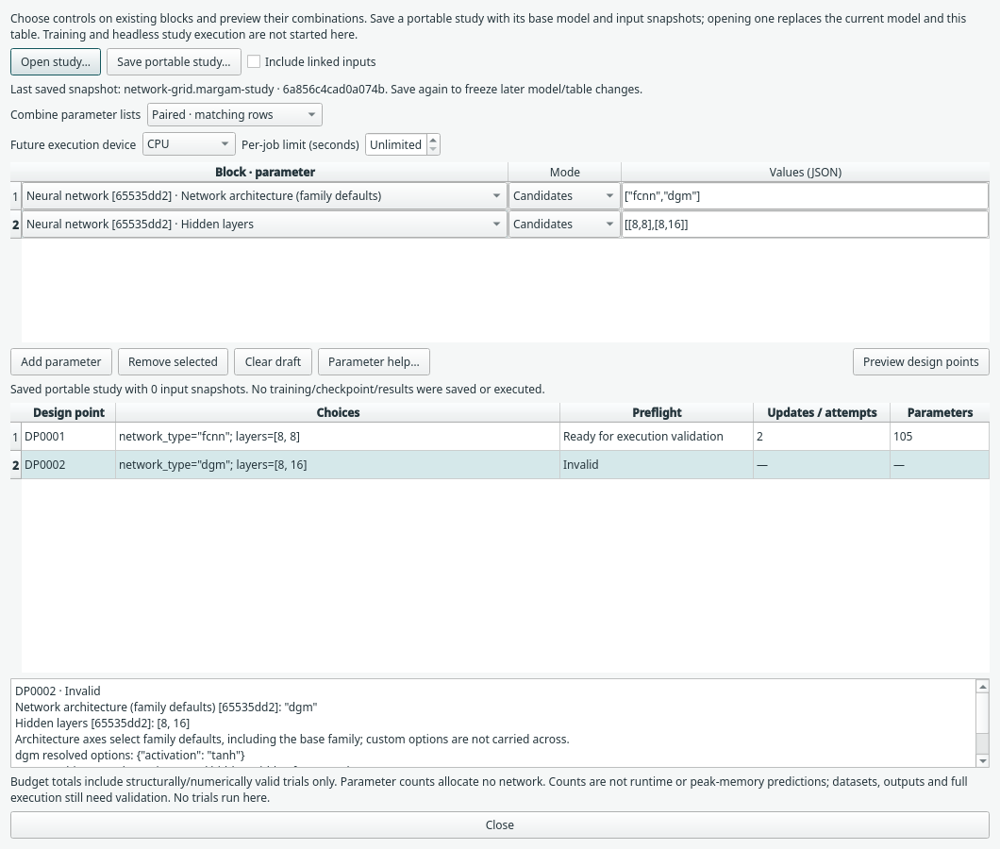

# Prepare and save a parameter study

Open **Run → Parameter study…** to explore combinations, then save the base model,
parameter choices and input snapshots in a portable **`.margam-study`** file.
Opening a study restores that model and table in another session or location.
**The [headless CLI](study-cli.md) now executes saved finite grids serially.**
Nothing trains merely because you preview, save or open a study. Use
[Run saved study](run-study.md) for local serial execution, or
[Export study for Slurm](slurm.md) to prepare a cluster job. Browse returned
folders with [Open study results](study-results.md). Parallel scheduling remains
future work.

Unsaved table edits stay in this window until the application closes. Use
**Save portable study…** to preserve them; ordinary model Save and run archives
do not include the study table.

## Choose block parameters

1. Press **Add parameter** and choose the existing block and control. The short
   block ID distinguishes blocks with similar names.
2. Choose **Fixed**, **Candidates** or **Range** and enter the values below.
3. Add more rows, then press **Preview design points**.
4. Select a design point for its full choices or invalid reason. Use
   **Parameter help…** for the selected parameter row's existing setting help.

| Mode | Example | Meaning |
| --- | --- | --- |
| Fixed | `2000` | Use this value in every design point |
| Candidates | `[1000,2000,3000]` | Use each listed value |
| Range | `[1000,3000,1000]` | Start, stop, step: 1000, 2000, 3000 |
| Descending range | `[5,1,-2]` | 5, 3, 1 |
| Fixed hidden layers | `[16,16]` | One two-layer network |
| Candidate hidden layers | `[[16,16],[32,32]]` | Two network choices |

Values use JSON notation, not Python code. Range endpoints are included only when
reached by a whole step: `[1,6,2]` produces 1, 3, 5. Decimal range arithmetic avoids
accidentally dropping a reachable floating-point endpoint. Counts and seeds need
integers. `null` is allowed only for network seed, retaining its normal fallback
to the sampling seed. Boolean values, duplicate candidates and zero/wrong-direction
steps are rejected. Hidden layers use fixed/candidate lists, not scalar ranges.

## Choose how lists combine

The combination selector defaults to **Cartesian · all combinations**. Choose
**Paired · matching rows** to keep candidate lists aligned by position.
For example, `["fcnn","siren"]` and
`[[16,16],[32,32]]` produce just two paired trials: FCNN with 16/16 and SIREN
with 32/32. Cartesian mode produces four.

Every list with more than one value must have the **same length** in paired mode.
A single value repeats across all rows, including a Fixed parameter. Ranges pair
in their generated order; descending ranges remain descending. There is no silent
truncation, sorting, conditional filtering or removal of incompatible rows.
Repeated values and repeated complete rows are allowed in paired mode and keep
separate trial IDs; Cartesian mode still rejects duplicate axis values.
A mismatched length rejects the draft; an invalid configured trial remains in
the preview/results with its original number and reason.

Paired studies support up to 8 axes and 64 rows and save as study format 3.
The mode is part of study identity and survives opening, GUI/CLI execution,
Slurm export, results collection and resume. Older Margam readers reject these
files; update the cluster checkout before running them. Existing Cartesian
version-1/2 files and their identities stay unchanged. Conditional combinations
and iterator blocks remain future work.

The preview takes the **Cartesian product**: three update budgets × two learning
rates × two networks gives twelve design points. The last parameter row varies
fastest. The DP numbers identify rows. A saved study also has a full content identity;
its persistent trial ID combines that identity with the DP number, so moving or
reopening the file preserves trial identities.
Limits are **8 parameter rows**, **64 values per parameter** and **512 design
points**. Oversized products are rejected before trial copies are created.

Supported controls are sampling/default boundary budgets, sampling/network seeds,
hidden layers, update/attempt budgets, Adam learning rate and global PDE/boundary
coefficients, where those controls belong to an existing block. Compact and
expanded recipes share their real parameters. Imported interior counts are not
offered; their files determine row counts. DSGNAR has no Adam learning-rate choice.
Expert time-marching iteration controls are omitted when its separate window
schedule owns the update budget. Nested method/optimizer settings, architecture
switching and component alternatives are future work.

## Understand the preview

Each combination uses the existing strict model decoder, typed graph assembler,
numerical configuration validation and allocation-free architecture counts.
Invalid combinations remain visible with a reason; for example, a DGM network
requires equal hidden widths. They have no update/parameter budget or fabricated
result metric. Other combinations can still pass.

**Ready for execution validation** means numerical preflight passed. It is not a
completed experiment or proof that its datasets, output/reference alignment or
checkpoint are valid. Those checks still belong to execution validation. The
preview builds no network, samples no points, performs no training/inference and
writes no files. It preserves the open model, Undo history, retained weights,
results and random-number state.

The summary totals requested updates/attempts across passing trials and shows
the largest network's parameter count. These are workload counts, **not elapsed
time or peak RAM/VRAM predictions**. DSGNAR counts attempts, including rejected
steps. Adaptive sampling may grow; default boundary budgets can be overridden by
per-set recipes, and grid samplers can return fewer points than requested. Use
[Run summary and resources](resources.md) to inspect an individual configured run.

Editing the draft or changing the canvas clears the old preview. Preview again
against the current graph. Removed/replaced block IDs are not silently retargeted;
choose the parameter again. Draft controls can be edited while a job runs, but
preview waits for jobs and external editors to finish.

**Clear draft** removes rows and any opened/saved architecture-default snapshots.
It does not delete model blocks or files.
Parallel scheduling, mid-trial checkpoint recovery, paired/conditional combinations
and search integrations remain
[planned work](../todo.md#future-studies-iterator-blocks-and-laptophpc-sweeps).

## Save and reopen the complete study

1. Choose the **Future execution device** and optional **Per-job limit**. These
   are saved intent for the headless runner; they do not change this application's
   device or time-limit preferences and do not test hardware availability. Execution checks it.
2. Press **Save portable study…**. Project-owned inputs are included automatically.
   If the model uses linked input files, explicitly check **Include linked inputs**
   to copy them into the study. Saving otherwise stops with an explanation.
3. Move the single `.margam-study` file wherever needed. No companion data folder
   or original input path is needed for its active mappings.
4. Press **Open study…**. This replaces the current model and study table after
   the usual discard checks. Each open restores private input copies. Existing
   saved files and source datasets are not modified; no geometry editor launches.
5. Press **Preview design points** to recheck combinations against the restored
   model. Ordinary model edits or data-mapping dialogs can change it afterward;
   save a new study snapshot to preserve those changes.

Try the [portable 12-design-point Poisson study](../../assets/studies/poisson-grid.margam-study).
It combines three update budgets, two Adam rates and two hidden-layer choices.
It contains no trained weights or accuracy results.

The file freezes block settings, seeds, enabled output/evaluation/reference
requests, choices and data bytes. Only referenced owned files are included;
unrelated workspace files are omitted. Explicitly copied links become owned
references **inside the saved study only**. Current model mappings and existing
accepted-import history remain unchanged. Bundle checksums verify the frozen
bytes; they do not rewrite an older import baseline. Active input mappings can
be changed using the normal data dialogs after opening, then saved as a new
study. Historical import records can still retain their original source paths;
review those records before sharing a private study publicly.

Study files contain no trained checkpoint, optimizer state, result tables or
monitor curves. Save those separately using the existing run archive workflow.
Study save preserves current trained results, Undo history and model settings;
opening a study deliberately replaces the model and clears its old run state.
The requested execution intent is restored into the **study controls**, while
application device/preferences remain unchanged.

Saving creates an atomic snapshot; replacing an existing study requires explicit
confirmation. Readers validate the schema, identity, input checksums and bounded
ZIP contents before installing a new workspace. Limits are 64 MiB per input,
256 MiB total inputs, 256 files and an 8 MiB manifest. Symlinks, path traversal,
extra/missing entries, encryption and unsupported compression are rejected. These
are file budgets, not an OS memory quota or a training-fit guarantee.

The [versioned file/API contract](../study-format.md) documents deterministic trial
resolution. The [CLI runner](study-cli.md) performs full supported execution/data/output
preflight for each trial. Mid-trial checkpoint recovery, concurrent scheduling, Slurm and grouped
result collection are still open todos.

POSIX [grid resume](study-cli.md#continue-the-grid) verifies completed trials and
restarts unfinished trials fresh, preserving all earlier attempts.

Use [Run → Run saved study](run-study.md) for reviewed local serial execution.
It uses the frozen saved definition and preserves the open canvas/results.

For categorical network-family choices and frozen option snapshots, see
[Network alternatives in studies](study-networks.md).
