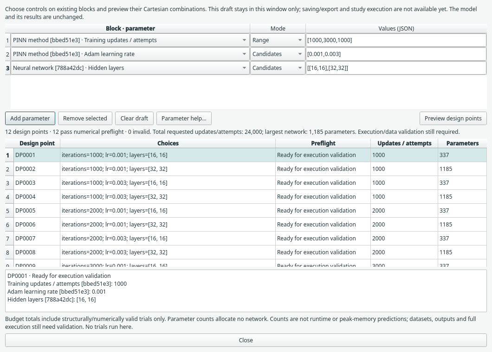

# Preview a parameter study

Open **Run → Parameter study preview…** to explore combinations before designing
a larger experiment. This is the first part of the planned laptop/HPC study
workflow: a draft table and numerical preflight. **It does not run or save a study.**
The draft stays in this window until the application closes. Close/reopen keeps
it during that session; model Save and run archives do not include it.

## Choose block parameters

1. Press **Add parameter** and choose the existing block and control. The short
   block ID distinguishes blocks with similar names.
2. Choose **Fixed**, **Candidates** or **Range** and enter the values below.
3. Add more rows, then press **Preview design points**.
4. Select a design point for its full choices or invalid reason. Use
   **Parameter help…** for the selected parameter row's existing setting help.

| Mode | Example | Meaning |
| --- | --- | --- |
| Fixed | `2000` | Use this value in every design point |
| Candidates | `[1000,2000,3000]` | Use each listed value |
| Range | `[1000,3000,1000]` | Start, stop, step: 1000, 2000, 3000 |
| Descending range | `[5,1,-2]` | 5, 3, 1 |
| Fixed hidden layers | `[16,16]` | One two-layer network |
| Candidate hidden layers | `[[16,16],[32,32]]` | Two network choices |

Values use JSON notation, not Python code. Range endpoints are included only when
reached by a whole step: `[1,6,2]` produces 1, 3, 5. Decimal range arithmetic avoids
accidentally dropping a reachable floating-point endpoint. Counts and seeds need
integers. `null` is allowed only for network seed, retaining its normal fallback
to the sampling seed. Boolean values, duplicate candidates and zero/wrong-direction
steps are rejected. Hidden layers use fixed/candidate lists, not scalar ranges.

The preview takes the **Cartesian product**: three update budgets × two learning
rates × two networks gives twelve design points. The last parameter row varies
fastest. These DP numbers identify rows in this preview, not persistent run IDs.
Limits are **8 parameter rows**, **64 values per parameter** and **512 design
points**. Oversized products are rejected before trial copies are created.

Supported controls are sampling/default boundary budgets, sampling/network seeds,
hidden layers, update/attempt budgets, Adam learning rate and global PDE/boundary
coefficients, where those controls belong to an existing block. Compact and
expanded recipes share their real parameters. Imported interior counts are not
offered; their files determine row counts. DSGNAR has no Adam learning-rate choice.
Expert time-marching iteration controls are omitted when its separate window
schedule owns the update budget. Nested method/optimizer settings, architecture
switching and component alternatives are future work.

## Understand the preview

Each combination uses the existing strict model decoder, typed graph assembler,
numerical configuration validation and allocation-free architecture counts.
Invalid combinations remain visible with a reason; for example, a DGM network
requires equal hidden widths. They have no update/parameter budget or fabricated
result metric. Other combinations can still pass.

**Ready for execution validation** means numerical preflight passed. It is not a
completed experiment or proof that its datasets, output/reference alignment or
checkpoint are valid. Those checks still belong to execution validation. The
preview builds no network, samples no points, performs no training/inference and
writes no files. It preserves the open model, Undo history, retained weights,
results and random-number state.

The summary totals requested updates/attempts across passing trials and shows
the largest network's parameter count. These are workload counts, **not elapsed
time or peak RAM/VRAM predictions**. DSGNAR counts attempts, including rejected
steps. Adaptive sampling may grow; default boundary budgets can be overridden by
per-set recipes, and grid samplers can return fewer points than requested. Use
[Run summary and resources](resources.md) to inspect an individual configured run.

Editing the draft or changing the canvas clears the old preview. Preview again
against the current graph. Removed/replaced block IDs are not silently retargeted;
choose the parameter again. Draft controls can be edited while a job runs, but
preview waits for jobs and external editors to finish.

**Clear draft** removes table rows only. It does not delete model blocks or files.
Saving portable studies, applying/running design points, headless CLI/HPC jobs,
result collection, paired/conditional combinations and search integrations remain
[planned work](../todo.md#future-studies-iterator-blocks-and-laptophpc-sweeps).
