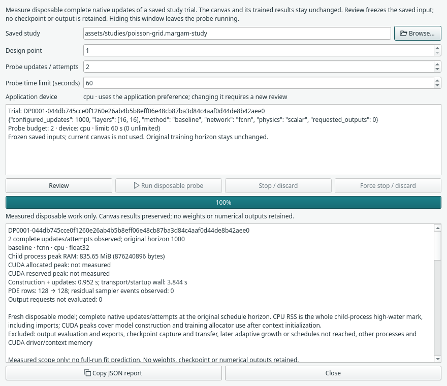
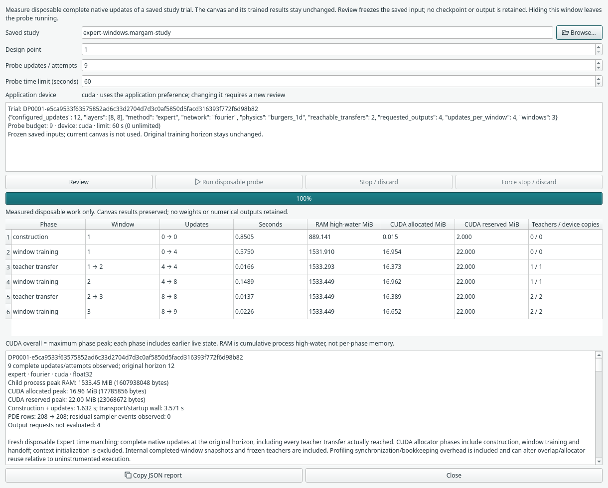

# Measure a disposable training probe

The allocation-free [Run summary](resources.md) describes workload without
training. For a measured check, save a [parameter study](parameter-studies.md),
then run this from the existing Margam environment:

```bash
.venv/bin/margam-cli study probe my-study.margam-study \
  --trial 1 --updates 2 --device cpu --wall-time 60
```

Use a study with one Fixed parameter if you only need one configuration. `--trial`
is the **one-based design-point number**; paired and Cartesian studies use their
saved ordering. The command prints JSON and creates no results folder, run
archive or export files. It never adopts the probe's weights into the application.
For desktop controls, use **Run → Resource probe…** as described below.

Choose `--device cuda` for CUDA, or `auto` for availability-based selection. If
omitted, the saved study's device intent applies. Explicit CUDA never silently
falls back to CPU. The numerical process uses the same environment as the caller.

For scripts, the same operation returns a plain report dictionary:

```python
from margam.execution.probe import probe_study
report = probe_study("my-study.margam-study", trial=1, updates=2, device="cpu")
```

## Run from the desktop

Choose **Run → Resource probe…**, browse to a saved `.margam-study`, choose the
one-based design point and probe update/attempt budget, then press **Review**.
Review validates that selected trial and freezes a private copy of its saved
inputs. It does not build a network. The current canvas is not used.



Press **Run disposable probe** to execute the reviewed copy. Changes to the
original file after Review do not replace that snapshot. Editing a field clears
the review and previous report. The desktop uses the **application device
preference**, overriding the saved study intent; changing that preference after
Review requires another review. It does not change the saved file or preference.

The dialog's explicit probe time limit defaults to 60 seconds, with 0 unlimited.
It does not edit the application job-limit preference. The measured report shows
RAM/CUDA peaks, actual work, timing and exclusions, with the complete JSON below.
Use **Copy JSON report** to copy a completed measurement to the clipboard. It
copies only the report dictionary, without the surrounding explanatory text.
The button is unavailable during review/running and after a failed or discarded
probe. Nothing is copied automatically.
No trained model or output is adopted, and no results folder is created.

**Stop / discard** or **Run → Stop** rejects the measurement. **Force stop /
discard** targets only the newly owned probe process group. Closing the dialog
hides it while the probe runs; reopen the same controls from Run. Closing the
main window stops the probe before the normal unsaved-model check. If the GUI
process is lost, the existing owner-pipe guard interrupts its CLI and numerical
child. Desktop supervision currently requires POSIX; the CLI/API remains separate.
While active, the probe locks conflicting training, editing and device changes.
Your current model, Undo history, results, weights and CPU/CUDA RNG stay intact.

*The screenshot measures two CPU updates from the shipped study. It demonstrates
workflow and measurement scope, not solution accuracy or a full-run memory fit.*

## What runs

A new isolated process builds the selected native model and executes complete
training updates through the ordinary numerical worker. Gradient-based methods count
updates; DSGNAR counts attempts, including rejections. The original configured
training horizon, seeds, loss coefficients, architecture and sampling schedules
stay intact. Only the number of updates performed by this disposable job changes.
The probe is fresh training, not checkpoint continuation. It uses the native CLI
float32 default; DSGNAR's explicit precision setting still applies. The report
records the actual dtype, rather than assuming the dtype of an open checkpoint.

`--updates` defaults to 1. Single-window probes accept up to 1,000 updates;
Expert multi-window probes accept up to 100,000. Both are bounded by the trial's
original configured training budget. The larger bound lets a probe reach a
native handoff after a default 1,000-update window without skipping updates. One update includes derivative evaluation, loss, backward work and the
method's normal update. Adam state, SA masks and Scale's previous network are
constructed by the native method. Scheduled balancing, NTK work and residual
sampling occur **only if the probe reaches their configured schedule**. Increase
the explicit probe budget to include later work; the command never shifts a
schedule forward to make a short probe appear representative.

Native methods use their existing validators. Expert multi-window probes also
measure reached teacher transfers, as described below. Invalid/incompatible trials
fail without printing a measurement. No random replacement of missing imported points occurs.

## Measure Expert time-window handoffs

Configure an Expert transient example's **Time windows** and **Updates per
window**, then save a study. A Fixed network-seed axis provides one design point
when the ordinary training-budget axis is unavailable for marching examples.
Review and run that saved trial through the same desktop controls or CLI.



The phase table appears for multi-window reports. The screenshot runs **9 of 12
configured updates**, with three windows of four updates. It reaches both
handoffs and performs one update in window 3. The measured state remains separate
from the current canvas; Copy JSON report includes the complete phase list.

| Phase | Included work |
| --- | --- |
| Construction | First-window model, samples and optimizer construction, after CUDA context initialization |
| Window training | Complete native updates, including causal weighting and scheduled gradient/NTK balancing when reached |
| Teacher transfer | Native completed-window CPU snapshot, frozen teacher and used device copies, next-window model construction, parameter transfer and optimizer/EMA/decay reset |

**A handoff occurs before the next window's first update.** Stopping at update
1,000 of a 1,000-update first window measures no transfer. Use at least 1,001
updates to reach it, within the original trial budget. The report marks an
unperformed next transfer as pending. It never fast-forwards training, evaluates
a synthetic teacher or changes the original schedule to make a short probe
appear representative. A shorter configured total budget can still stop before
all planned windows; both the original horizon and window schedule are reported.

CUDA overall peaks are the **maximum of the phase peaks**, not their sum. Each
phase includes memory already live at its start, including earlier teachers and
allocator pools. Start/end/peak byte counters remain in JSON. CPU RSS is a
**cumulative process high-water mark** including imports; table differences are
not phase-local RAM costs. Teacher counts and retained device-copy counts make
working-state growth explicit.

The profiler synchronizes phase boundaries. Synchronization/bookkeeping overhead
is included and can change overlap and allocator reuse compared with an
uninstrumented run. These are measurements of the profiled execution; they do
not guarantee the original execution's peak or speed. Internal window snapshots
are included in handoff cost. Final run-archive capture/transfer, outputs, exports
and unobserved later windows remain excluded. The child discards its working
teachers, optimizers and snapshots when it exits.

Single-window reports retain format version 1. Expert multi-window reports use
version 2, with up to 32 windows and 64 ordered phases. The desktop handles both;
the [report contract](../resource-probe-format.md) describes the validation rules.
Failures identify the active window/phase when available and publish no partial
measurement.

## Read measured values

| JSON field | Meaning |
| --- | --- |
| `completed_updates`, `requested_updates`, `configured_updates` | Actual work, requested probe work and original training horizon; convergence can stop DSGNAR early |
| `process_peak_rss_bytes` | Whole child-process resident-memory high-water mark, including Python/Torch imports; `null` when unavailable |
| `cuda_peak_allocated_bytes` | PyTorch allocator peak covering construction and training after CUDA context initialization; `null` for CPU |
| `cuda_peak_reserved_bytes` | Peak reserved allocator pool over that same CUDA scope |
| `build_and_train_seconds` | Construction and observed training, synchronized on CUDA; excludes imports, CUDA context initialization, output evaluation and checkpoint transfer |
| `numerical_job_seconds` | Parent-observed transport duration, including packet preparation, child startup and result transfer; preflight is separate |
| `initial_pde_rows`, `final_pde_rows` | Actual collocation row counts before/after the observed updates, preserving connected boundary rows |
| `observed_sampling_events` | RAR/importance controller events actually reached; this does not count Expert's own fresh-batch mechanism |
| `requested_output_count`, `excluded` | Output requests were validated but are not evaluated or exported; exclusions are recorded explicitly |
| `study_id`, `trial_id`, `study_archive_sha256`, `source_sha256`, `runtime` | Definition, input archive, code and child runtime provenance |

The report also records the actual device/dtype, network family/widths, method,
adaptive settings and job limit. Byte values are measurements, **not a capacity
prediction or reservation**. CPU RSS cannot be reset between phases; its scope
is deliberately broader than the CUDA allocator measurement. Other processes,
CUDA driver/context memory and OS/scheduler quotas are not measured by the CUDA
allocator counters.

Outputs, exports, checkpoint capture/transfer, unobserved adaptive growth and
later scheduled work remain excluded. A short probe can succeed while a longer
run or output evaluation runs out of memory. No full-run peak is extrapolated.

## Limits and isolation

The child defaults to a **60-second launch-to-exit limit**. Use `--wall-time 0`
explicitly for unlimited time, or another limit up to seven days. Parent-side
input/output packet work is outside that deadline. The probe can itself exhaust
memory; this is neither an OS memory quota nor an automatic batch-sizing system.

Ctrl+C, a worker failure or timeout discards the probe. A runtime-source change
also refuses the measurement. The saved study, inputs and parent model/RNG remain
unchanged; private workspaces are cleaned up. No checkpoint or numerical output
is retained, and nothing is resumed automatically after failure.

## Reproduce the small workflow check

```bash
.venv/bin/python -m examples.profile_resource_probe \
  --devices cpu cuda --output build/resource-probe.json
```

The [recorded CPU/CUDA measurements](../../assets/benchmarks/resource-probes.json)
use two complete updates of the shipped Poisson study. They demonstrate measured
scope and isolation, not solution accuracy, a hardware speed comparison or a
universal fit threshold. Omit `cuda` on a CPU-only environment. Existing evidence
files are refused unless `--overwrite` is explicitly supplied.


For the repeatable scalar/coupled window audit:

```bash
.venv/bin/python -m examples.profile_window_resources \
  --devices cpu cuda --output build/window-resource-probes.json
```

The [recorded audit](../../assets/benchmarks/expert-window-resources.json) contains
Burgers and the self-contained cylinder-startup variation, each on CPU and CUDA:
three 16-update windows, 48 updates and two reached transfers per case. Full
settings, source-file hashes, runtime and each phase are retained. Failures receive
explicit status and no measurement. These small settings qualify workflow and
accounting, rather than paper accuracy, a capacity threshold or hardware speed.
